# School Inspection Management System: project document

Modification of the Application V5, Step 1. This document covers the database schema and the functional flow, for developers and for users. Phase 1. Date: 18-11-2026.

| For | Read |
|---|---|
| Officers and administrators (users) | Sections 1, 3, 4 |
| Developers | All sections, then 5–8 |

Related documents:
- `Documents/School_Inspection_PRD.docx`: the requirements
- `CLAUDE.md`: developer rules
- `DB_INDEXING.md`: database indexes
- `LOAD_TEST.md`: capacity
- `BROWSER_SUPPORT.md`: browsers
- `ACTION.md`: change log

The diagrams use Mermaid. GitHub and VS Code (with a Mermaid extension) show them as pictures.

---

## 1. What the application does
Inspecting officers of the Samagra Shiksha (Assam) at **State, District, Block and Cluster** level use the application.
1. They **register** themselves and are **approved** by a higher officer.
2. They **find a school** by UDISE code, within their own area.
3. At the school they fill a **fixed 7-step inspection form** and take **geo-stamped photographs** in the app.
4. They **submit** the report, which is then **locked**.
5. Higher officers **see the reports of their area**, print them as **PDF** and export them to **Excel**.
6. The **State Administrator** manages masters (locations, schools), users and unlocks, and reads the audit log.

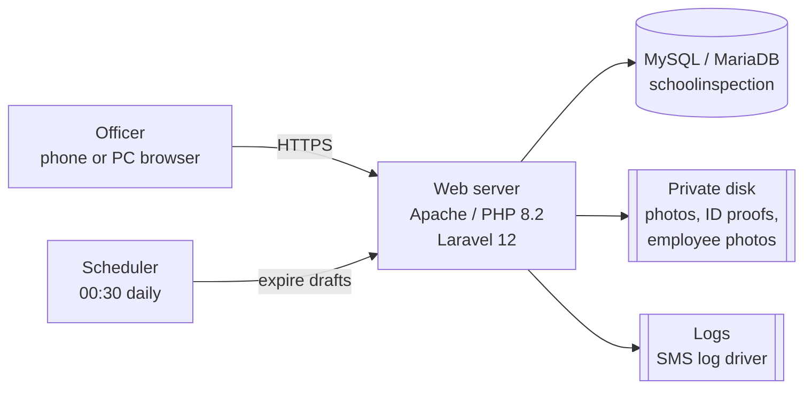

---

## 2. Main terms
| Term | Meaning |
|---|---|
| **Level** | State Admin, State, District, Block or Cluster. Set at registration; users cannot change it themselves |
| **Jurisdiction** | The area of a user: the whole state, one district, one block or one cluster. Stored as a *posting* (`user_jurisdictions`) with start and end dates |
| **UDISE code** | The 11-digit national school code, used to find a school |
| **Draft** | An inspection that has been started but not submitted. Only its officer can see it. Cancelled automatically after 7 days |
| **Submitted** | Final and locked. It gets an Inspection ID such as `SI/2026/1801/000123` |
| **Unlocked** | Opened again by the State Admin, with a reason, so the officer can correct it and submit again |
| **Question code** | A fixed ID for every question (e.g. `GOVR_02`), stored with each answer. Never renamed or reused |

---

## 3. User types and what they can do
### 3.1 Levels and area
| Level | Area (jurisdiction) | Typical designation |
|---|---|---|
| State Administrator | Whole state; also manages masters and users. Created at installation | System administrator |
| State | Whole state | Director, Joint Director, Deputy Director |
| District | One district and its blocks, clusters and schools | DEO, Inspector of Schools, DPC |
| Block | One block and its clusters and schools | BEEO, BMC, BRP |
| Cluster | One cluster and its schools | CRCC |

### 3.2 Rights (PRD 3.2)
Rights are **permissions**. Each level has a default role, and a higher administrator can grant extra rights to one person.

| Action | State Admin | State | District | Block | Cluster |
|---|---|---|---|---|---|
| Conduct and submit inspections | Yes | Yes | Yes | Yes | Yes |
| View inspection reports | All | All | Own district | Own block | Own cluster + own |
| Export to Excel | Yes | Yes | Yes | Yes | Own only |
| Approve registrations of the level below | Yes | If granted | If granted | If granted | No |
| Activate, deactivate, edit, transfer users | Yes | No | If granted | No | No |
| Masters (locations, schools, import) | Yes | No | No | No | No |
| Unlock a submitted inspection | Yes | No | No | No | No |
| Mobile number changes, audit log | Yes | No | No | No | No |

### 3.3 Who approves a registration (PRD 3.3)
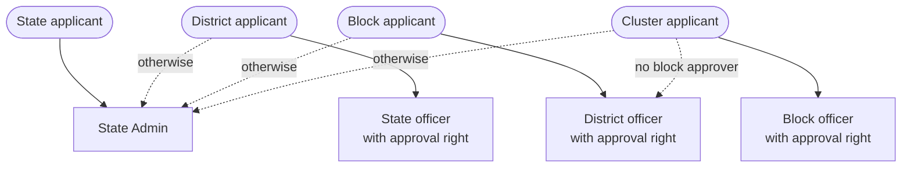
An approver must be **active**, hold the **approval right**, and have the applicant's area **inside their own**. Nobody approves themselves.

### 3.4 User type check (V5 Step 1)
The automated test `tests/Feature/UserTypeAccessTest.php` checks all five levels on every run of `php artisan test`. It verifies:

| Check | Result |
|---|---|
| State Admin opens all officer and admin screens: dashboard, profile, find school, my inspections, area inspections, approvals, users, mobile changes, audit, locations, schools, imports | Pass |
| State, District, Block and Cluster officers open the officer screens and get **403** on every admin screen | Pass |
| A District officer given "approve" and "manage users" opens only those two admin screens; audit and masters stay closed | Pass |
| A submitted inspection is seen by: State Admin, State, the District / Block / Cluster officers **of the same area**. It is **not** seen by another district, block or cluster (report page and area list) | Pass |
| A draft is seen only by its own officer | Pass |

Demo accounts for a manual check are in `CLAUDE.md`:
- active officers at every level, plus pending, rejected and inactive accounts
- password `Demo@1234`
- Admin: `9999999999`

---

## 4. Functional flows (for users and developers)

### 4.1 Registration and approval
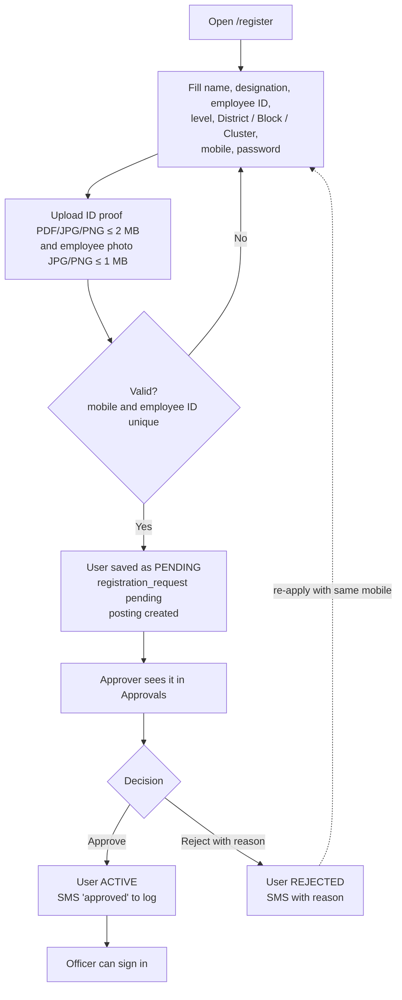

### 4.2 Sign in and session security
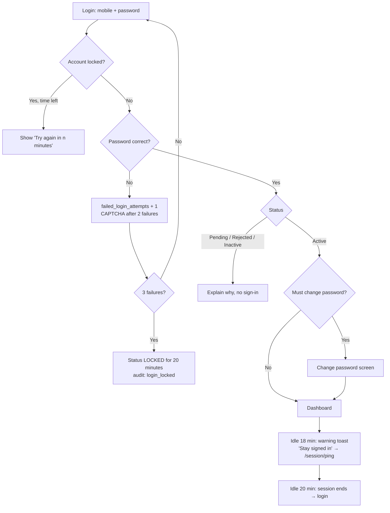
The login form allows 10 attempts per minute from one IP address. Forgot password sends a reset link by email.

**Encrypted record IDs in URLs (V6 Module 4).** Records never appear in a URL by their database number. `/schools/203` is now `/schools/FJyzzv-_Vd03dtnCGFS8opNNXg-x3KyMhWuQQ4ueHOI`.
- **What it covers:** every model bound in a route (inspections and their rows, schools, users, registrations, schedules and items, evidence, mobile requests, import batches) uses the trait `HasEncryptedRouteKey`. The admin location editor uses the same token.
- **The token:** `App\Support\UrlId` builds it with AES-256 under keys derived from `APP_KEY`, plus an HMAC check.
  - The same record always gets the same token, so links stay stable.
  - A typed number, an edited token, or a token of another record type returns **404**.
- **What it does not replace:** the permission checks still run as before. Filters in the query string (`?cluster=`, `?officer=`) stay numeric, because they are checked through `JurisdictionService`.
- **Rotating `APP_KEY`** changes every URL; old bookmarks then return 404.

### 4.3 Find a school and start an inspection (start rules, Modification V3)
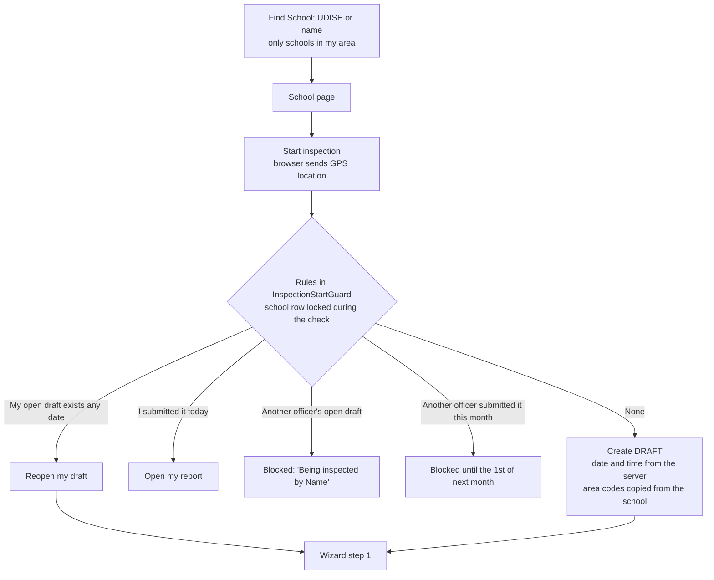
Cancelled inspections never block. Every blocked attempt is audited (`inspection_start_blocked`). The database allows **one inspection per officer, per school, per day** (unique key).

### 4.4 The inspection form (7 steps)
```mermaid
flowchart LR
    S1[1 Condition of the School<br/>CND_* + person met] --> S2[2 Teachers and Students<br/>TSI_* numbers]
    S2 --> S3[3 Teachers Absentee rows]
    S3 --> S4[4 Classroom Performance rows]
    S4 --> S5[5 Fund received and expenditure<br/>by financial year, in lakh]
    S5 --> S6[6 School Governance<br/>GOVR_* + 3 suggestions]
    S6 --> S7[7 Photographs<br/>4 mandatory categories]
    S7 --> R[Review: all answers,<br/>missing items, Expand all]
    R --> SUB[Submit]
```
- **Auto-save:** every answer is saved as soon as it changes (`POST /answers`), so nothing is lost if the network or the session drops. The progress bar comes from `/progress`.
- **Dependent questions:** a question that depends on another one (e.g. CND_18 only when CND_17 = Yes) is greyed out. Its answer is cleared if the parent answer changes.
- **Photos:**
  - taken with the in-app camera or picked from the gallery
  - resized to at most 1600 px and saved as JPEG
  - a strip is stamped with the date, time and GPS; SHA-256 is calculated
  - then uploaded
  - Gallery photos are marked "From gallery". Uploading the same photo again does nothing (`evidence_uid`).
  - Mandatory: school building, toilet block, ICT / smart class, classroom transaction.

### 4.5 Submit, lock, unlock and expiry (inspection life cycle)
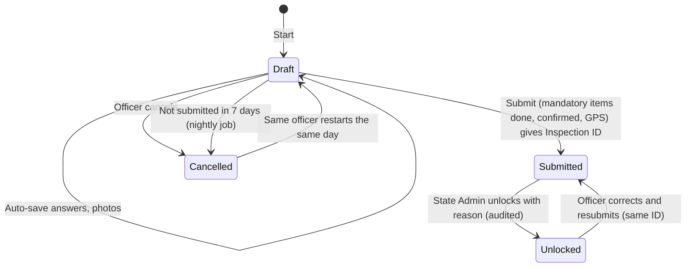
- **Inspection ID:** `SI/<year>/<district code>/<6-digit running number>`, given at the first submission.
- **Submitted inspections are read-only.** Only the State Admin can unlock one.

### 4.6 Reports, PDF and Excel
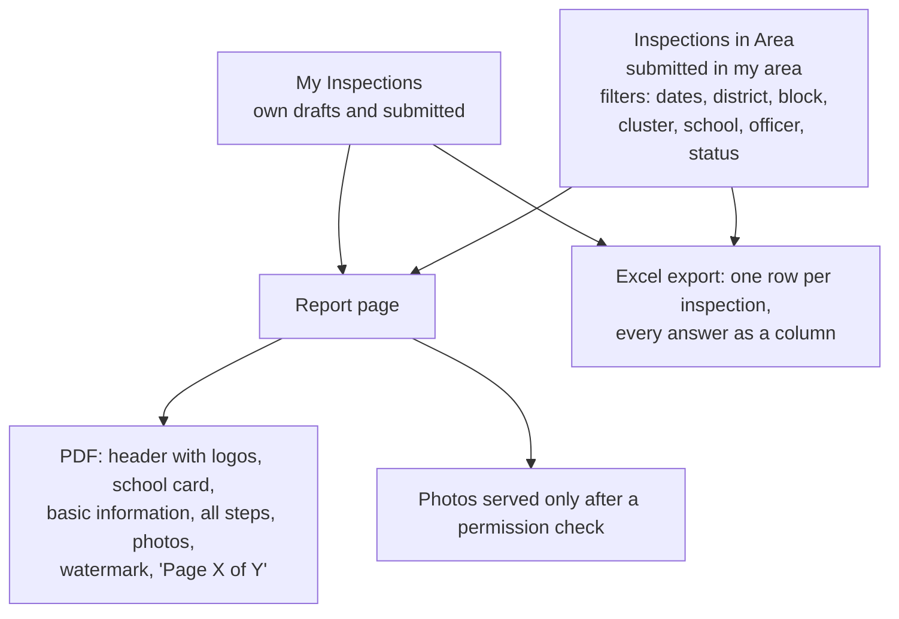
Counts at the top of the area list: schools in the area, schools inspected in the period, and inspections submitted.

### 4.7 Administration
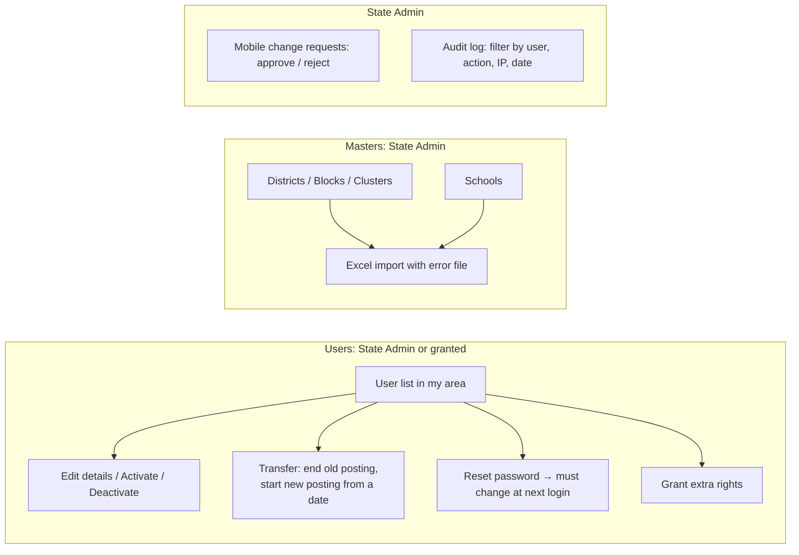
Officers request a **mobile number change** from their profile; the State Admin decides it. **Transfers** keep past inspections in the old area.

### 4.8 Map View (New Module 1)
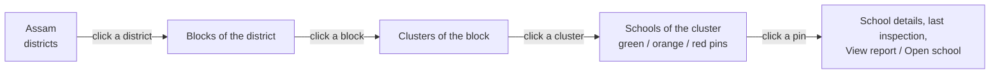
- Menu **Map View** (`/map`, right `view_reports`). The map opens at the user's own level: the State sees districts, a District officer sees the blocks of their district, a Block officer the clusters, a Cluster officer the schools.
- **Area circles** are sized by the number of schools and coloured by coverage (green ≥ 75 %, orange 40–74 %, red below 40 %). An area with no coordinates is placed at the average of its schools' GPS.
- **School pins:** green = submitted in the period, orange = draft or unlocked, red = not inspected. Schools without GPS are counted and listed but not drawn.
- **Stat cards:** registered officers, total schools, inspected, pending, coverage. **Table:** district-, block- or cluster-wise coverage with officers by level.
- **Filters:** District, Block, Cluster, school search (UDISE or name), inspection officer, period (default: this month).
- **Access:** all data comes from `JurisdictionService`. An area or officer outside the user's jurisdiction returns 403.
- **Slow networks:** one level per request (small JSON), Leaflet bundled with the app, pins grouped with marker clustering, server results cached for 60 s (`MAP_CACHE_SECONDS`).
- **Tiles:** OpenStreetMap by default. `MAP_TILE_URL` and `MAP_TILE_ATTRIBUTION` point to another tile server (self-hosted or commercial) for heavy production use. **Boundaries:** the Assam state outline and the district shapes come from the KML files in `public/KML/Assam` (`Assam.kml`, `Assam Dist/<District>.kml`). `php artisan map:boundaries` converts them into small simplified GeoJSON files in `public/geo` (about 240 KB). The state outline is always drawn; at district level each district shape is coloured by the coverage of the District Master row with the same name (or `code`), and districts not in the master are grey. Run the command again when the KML files change.

### 4.9 Inspection Scheduling (New Module 2)
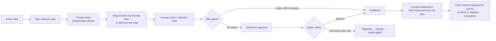
- Menu **Inspection Schedules** (`/schedules`): Day, Week and Month calendar of the user's own plans and the plans of officers below them; filter by officer and status. **Approvals** lists plans waiting for the user.
- **Planner** (`/schedules/plan?date=&officer=`): Leaflet map of the schools the officer may inspect (grey can be planned, green inspected this month, red not available, blue on this plan, numbered in visit order) with the route line from the start point. **Available schools** (nearest first) are dragged into the **Day plan** (SortableJS, works with touch) and reordered there; a map popup also has “Add to plan”. The plan shows km and arrival time per stop, totals, “Optimise route” and “Start from my location”.
- **Rules** (checked on save and again on approval): date today or later (up to 92 days ahead); at most 8 schools a day; each school active and inside the officer's jurisdiction; not on another officer's plan that day (also a database unique key on school + date); not being inspected by another officer, and not already inspected by another officer in the plan's month (the start rules of Modification V3).
- **Who:** an officer plans their own days. A higher officer whose jurisdiction covers the officer (State Admin, State, District, Block) can plan for them (published at once), change, **reassign** to another officer below them (the schools are checked against the new officer), approve or send back. Cluster officers cannot plan for others. With `SCHEDULE_APPROVAL_REQUIRED=false` an officer's own plan is published directly.
- **Distances and times:** straight-line distance × 1.3 road factor, 25 km/h average speed, 60 minutes per visit, day starts 09:30 (all in `config/inspection.php` → `schedule`). Route optimisation is nearest neighbour + 2-opt (`App\Support\RouteOptimizer`, same algorithm in the browser). No external routing service is used; **Directions** opens the route in the phone's maps app.
- **Conducting:** on the plan day the officer starts each inspection from the plan. Submitting the inspection marks that visit *inspected*; a visit can be *skipped* with a reason; when nothing is left the plan is *Completed*. The dashboard shows **Today's plan**.
- **History:** every step (created, changed, submitted, approved, sent back, published, reassigned, visit inspected or skipped, cancelled, completed) is written to the audit log and shown on the plan page.
### 4.10 Automatic Inspection Rating (New Module 3)
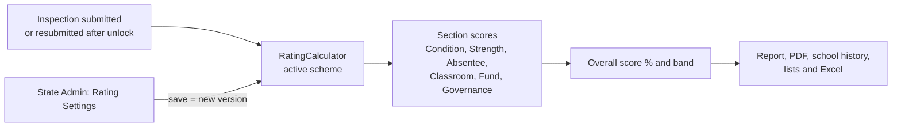
- **Formula:** Score % = Σ(weight × points) ÷ Σ(weight of the applicable items) × 100. The same formula gives each section's score. Points run from 0 to 1.
- **Not Applicable** items are left out of the denominator: a question hidden or disabled by its parent (`show_if` / `enable_if`), an answer not in the points list (e.g. “Not Applicable”), or a metric with nothing to divide by (no absentees, no classrooms observed, no fund received, no students). A section with nothing applicable shows “N/A”; an inspection with nothing applicable is “Not rated”.
- **Default scheme (version 1):**

| Section | Scored items |
|---|---|
| Condition | CND_02–CND_24 yes = 1, no = 0 (CND_12 “additional classroom required” is inverted); CND_01 Pucca 1, Semi-pucca 0.5, Others 0; CND_26 yes/no (“na” = N/A). Weight 1 each |
| Strength | Student attendance (present ÷ enrolled), teacher attendance (present ÷ total), trained teachers. Weight 3 each |
| Absentee | Share of absences on authorised leave (not UL). Weight 3 |
| Classroom | Share of classrooms using TLM; share with satisfactory participation. Weight 3 each |
| Fund | Utilisation = expenditure ÷ received, capped at 100 %. Weight 3 |
| Governance | GOVR yes/no items and satisfactory/unsatisfactory items; GOVR_01 non-conventional 1, conventional 0.5. Reason boxes are not scored. Weight 1 each |

- **Bands:** Excellent ≥ 90 (green), Very Good 75–89.99 (blue), Good 60–74.99 (yellow), Needs Improvement 40–59.99 (orange), Unsatisfactory below 40 (red).
- **Shown:** report page (score dial, band, section bars, summary, strengths, weaknesses, areas requiring improvement = sections below 60 %), PDF (“School Performance Summary”), school page history (score and change since the previous rated inspection), My Inspections / Inspections in Area (rating column) and the Excel export (score and band).
- **Updates:** rated on submit; an authorised correction (State Admin unlock, officer resubmits) re-rates it. The old and new scores are written to the audit log (`inspection_rated`, `inspection_rerated`).
- **Rating Settings** (`/admin/rating`, right `manage_masters`): change weights, points per answer and bands. Saving creates a **new version**; earlier ratings keep the version they were calculated with until “Recalculate all” (or `php artisan ratings:recalculate --all`). Legacy v1 inspections are not rated.
- **Deploy:** run `php artisan ratings:recalculate` once to rate inspections submitted before this module.
---

## 5. Database schema
MySQL / MariaDB database `schoolinspection`, InnoDB, utf8mb4. There are 32 tables, all created by `database/migrations`. The location masters run first (`0001_01_00_*`).

### 5.1 Entity relationship diagram (main tables)
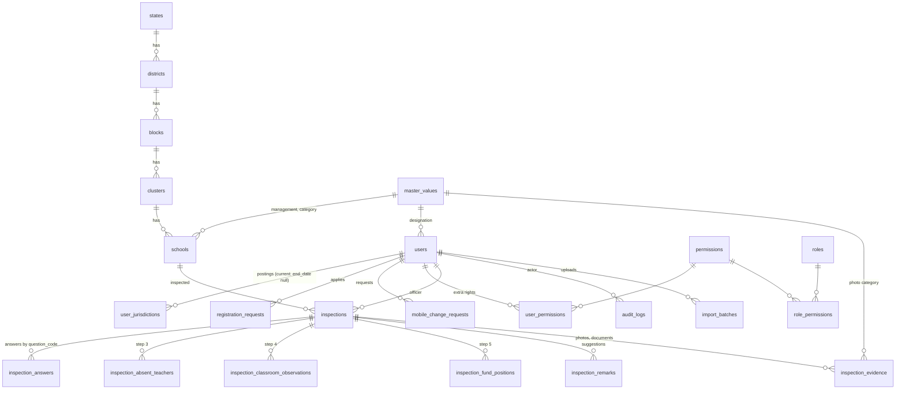

### 5.2 Tables
**Location and school masters**
| Table | Purpose | Key columns |
|---|---|---|
| `states` | State (single-state deployment, code 18) | `code` UQ, `name`, `is_active` |
| `districts` | Districts | `state_id` FK, `code` UQ (e.g. 1801), `name`, lat/lng, `is_active` |
| `blocks` | Blocks | `district_id` FK, `code` UQ (180101), `name`, lat/lng, `is_active` |
| `clusters` | Clusters | `block_id` FK, `code` UQ (18010101), `name`, lat/lng (New Module 1), `is_active` |
| `schools` | School master | `udise_code` CHAR(11) UQ, `name`, `state_id`/`district_id`/`block_id`/`cluster_id` FK, `management_id`/`category_id` → master_values, address, lat/lng, `status` (active/closed), soft delete |
| `master_values` | Drop-down lists | `type` (designation, management, category, photo_category, fund_category, subject), `code`, `label`, `sort`, `is_active` |
| `import_batches` | Excel imports of masters | `type` (location/school), file, `uploaded_by`, total/added/updated/rejected, `error_file_path` |

**Users and access**
| Table | Purpose | Key columns |
|---|---|---|
| `users` | Officers and administrators | `name`, `designation_id`, `employee_id` UQ, `mobile` CHAR(10) UQ (login), `email`, `password` (bcrypt), `level`, `status` (pending, active, rejected, inactive, locked), `id_proof_path`, `photo_path` (private disk), `failed_login_attempts`, `locked_until`, `must_change_password`, `last_login_at`, soft delete |
| `user_jurisdictions` | Postings. The **current** one has `end_date` null; a transfer ends it and adds a new one | `user_id`, `state_id`, `district_id`, `block_id`, `cluster_id` (filled down to the user's level), `start_date`, `end_date`, `assigned_by` |
| `roles` / `role_permissions` | One role per level, with its default rights | `slug` = level |
| `permissions` | Rights | `slug`: conduct_inspections, view_reports, export_excel, approve_registrations, manage_users, manage_masters, unlock_inspections |
| `user_permissions` | Extra rights given to one user | `user_id`, `permission_id`, `granted_by`, `granted_at` |
| `registration_requests` | Approval queue | `user_id`, `approver_id`, `status` (pending/approved/rejected), `reason`, `decided_at` |
| `mobile_change_requests` | Mobile number changes | `user_id`, `old_mobile`, `new_mobile`, `status`, `reason`, `decided_by`, `decided_at` |
| `otp_verifications` | Ready for Phase 2 OTP (not used in Phase 1) | `mobile`, `purpose`, `otp_hash`, `attempts`, `expires_at` |
| `password_reset_tokens`, `sessions` | Laravel password reset and sessions (database driver) | |

**Inspections**
| Table | Purpose | Key columns |
|---|---|---|
| `inspections` | One inspection | `inspection_no` UQ (given at submit), `officer_id`, `school_id`, `inspection_date` (server date), `started_at`, `submitted_at`, `district_id`/`block_id`/`cluster_id` and their codes (copied from the school at start, so a later master change or transfer does not move old reports), start/submit GPS and accuracy, `person_met_name`/`_designation`, `status` (draft, submitted, unlocked, cancelled), `completion_pct`, `questionnaire_version` (2), `unlocked_by`/`_at`/`unlock_reason`, `cancelled_reason`, soft delete. **UQ (officer_id, school_id, inspection_date)** |
| `inspection_answers` | Answers of steps 1, 2 and 6 | `inspection_id`, `step`, `question_code`, `value` (JSON), `remarks`. **UQ (inspection_id, question_code)** |
| `inspection_absent_teachers` | Step 3 rows | `teacher_name`, `teacher_type`, `reason` (e.g. UL = unauthorised leave), `status`, `remarks` |
| `inspection_classroom_observations` | Step 4 rows | `teacher_name`, `class`, `subject`, `tlm_used`, `participation`, `remarks` |
| `inspection_fund_positions` | Step 5, one row per financial year | `financial_year` (UQ per inspection), received/expenditure for ASG, MDM, Govt, Other (lakh) |
| `inspection_remarks` | Suggestions and notes | `type` (suggestion, general, classroom_note, inspection_remark), `sort`, `body` |
| `inspection_evidence` | Photos and documents | `evidence_uid` UQ (idempotent upload), `kind`, `source` (camera/gallery), `category_id`, `question_code`, `caption`, `taken_at`, `received_at`, GPS, `no_location_reason`, `mime`, `size_bytes`, `storage_path` (private disk, random name), `sha256`, `status` (pending, uploaded, failed), `uploaded_by` |

**Inspection schedules (New Module 2)**
| Table | Purpose | Key columns |
|---|---|---|
| `inspection_schedules` | One plan per officer per day | `officer_id` FK, `schedule_date`, UQ (officer, date), `status` (draft, submitted, rejected, published, completed, cancelled), `created_by`, `submitted_at`, `reviewed_by`/`reviewed_at`/`review_note`, `published_at`, start lat/lng, `total_distance_km`, `total_minutes`, `notes` |
| `inspection_schedule_items` | Schools of a plan in visit order | `schedule_id` FK (cascade), `school_id` FK, `schedule_date` (copy), `sequence`, `distance_km`, `travel_minutes`, `planned_arrival`, `status` (planned, inspected, skipped), `inspection_id`; UQ (schedule, school) and **UQ (school, date)**: a school is on one plan per day |

**Automatic rating (New Module 3)**
| Table | Purpose | Key columns |
|---|---|---|
| `rating_schemes` | Versioned scoring set-ups; one active | `version` UQ, `name`, `is_active`, `bands` JSON (min, label, color), `created_by`, `activated_at` |
| `rating_criteria` | Scored items of a scheme | `scheme_id` FK, `section`, `code` (question code or metric key), `label`, `kind` (answer/metric), `weight`, `points` JSON (answer → 0..1), `sort`; UQ (scheme, code) |
| `inspection_ratings` | One rating per inspection | `inspection_id` UQ FK, `scheme_id` FK, `obtained`, `applicable`, `score_percent` (null = not rated), `band`, `color`, `sections`, `details`, `strengths`, `weaknesses` JSON, `calculated_at` |

**Audit and system**
| Table | Purpose |
|---|---|
| `audit_logs` | **Append-only** log: `user_id`, `action` (e.g. login, login_failed, registration_approved, inspection_started, inspection_submitted, inspection_unlocked, inspection_pdf, evidence_downloaded), `auditable_type`/`_id`, `meta` JSON, `ip_address`, `user_agent`, `created_at`. Kept for 5 years |
| `cache`, `cache_locks`, `jobs`, `job_batches`, `failed_jobs`, `migrations` | Laravel cache, queue and migration tables |

Indexes and the reason for each one are in `DB_INDEXING.md`.

### 5.3 Rules the database enforces
- **Unique keys:**
  - one inspection per officer, school and day
  - one answer per question per inspection
  - one fund row per year
  - unique mobile, employee ID, UDISE code, Inspection ID and `evidence_uid`
- **Foreign keys with RESTRICT:** a location or school that has inspections cannot be deleted.
- **Soft deletes** on users, schools, inspections and evidence. Nothing is removed for good from the screens.
- **The answer `value` column holds JSON.** The model casts it.

---

## 6. Modules and the tables they use
| Module (controller / service) | Reads | Writes |
|---|---|---|
| Registration (`Auth\RegisterController`) | locations, master_values | users, user_jurisdictions, registration_requests, audit_logs |
| Login, password (`Auth\LoginController`, `PasswordController`) | users | users (failures, lock, last_login), sessions, password_reset_tokens, audit_logs |
| Approvals (`Admin\ApprovalController`, `ApproverResolver`) | registration_requests, users, user_jurisdictions, user_permissions | registration_requests, users.status, audit_logs |
| Users (`Admin\UserController`) | users, user_jurisdictions, permissions | users, user_jurisdictions (transfer), user_permissions, audit_logs |
| Profile, mobile change (`ProfileController`, `Admin\MobileRequestController`) | users, user_jurisdictions, inspections (counts) | users.photo_path, mobile_change_requests, users.mobile, audit_logs |
| Masters (`Admin\LocationController`, `SchoolMasterController`, `ImportController`, `MasterImportService`) | locations, schools | states, districts, blocks, clusters, schools, import_batches, audit_logs |
| Find School (`SchoolController`, `JurisdictionService`) | schools, inspections (badges) | — |
| Start (`InspectionController::start`, `InspectionStartGuard`) | schools (locked row), inspections | inspections, audit_logs |
| Wizard (`InspectionController`, `InspectionValidator`, `QuestionnaireDefinition`) | inspections and all child tables | inspection_answers, absent_teachers, classroom_observations, fund_positions, remarks, inspections (person met, completion) |
| Photos (`EvidenceController`, `EvidenceStorage`) | inspection_evidence | inspection_evidence, private disk, audit_logs (download) |
| Submit / unlock / cancel | inspections | inspections (number, status, GPS), audit_logs |
| Reports, PDF, Excel (`ReportController`) | inspections + children, schools, users, locations | audit_logs (pdf, export) |
| Dashboard (`DashboardController`) | inspections, registration_requests | — |
| Rating (`RatingService`, `App\Rating\RatingCalculator`, `Admin\RatingController`) | inspections + answers, absentees, classrooms, funds, rating_schemes, rating_criteria | inspection_ratings, rating_schemes, rating_criteria, audit_logs |
| Schedules (`ScheduleController`, `ScheduleService`, `RouteOptimizer`) | users, user_jurisdictions, schools, inspections, schedules | inspection_schedules, inspection_schedule_items, audit_logs |
| Map View (`MapController`, `MapDataService`) | districts, blocks, clusters, schools, inspections, users, user_jurisdictions | — (read only, cached 60 s) |
| Audit (`Admin\AuditLogController`, `AuditLogger`) | audit_logs | audit_logs (append only) |
| Nightly job `inspections:expire-drafts` | inspections | inspections (cancelled), audit_logs |

**Example: one auto-save**
1. `POST /inspections/{id}/answers`
2. `InspectionPolicy::update`: only the officer, and only while the inspection is Draft or Unlocked
3. `QuestionnaireDefinition::find(code)` and clean the value
4. upsert `inspection_answers` (inspection_id, question_code)
5. clear the answers of children it now disables
6. update `inspections.person_met_*` if the question was the person met
7. return the progress as JSON

---

## 7. Developer guide
### 7.1 Code layout
| Path | Content |
|---|---|
| `app/Enums` | UserLevel (rank, area rules), UserStatus, InspectionStatus, EvidenceStatus |
| `app/Services` | JurisdictionService (**every** area filter), ApproverResolver, PermissionService, InspectionStartGuard, InspectionNumberGenerator, EvidenceStorage, AuditLogger, MasterImportService, Otp/* |
| `app/Questionnaire` | `QuestionnaireDefinition` (version 2, the fixed questions; it drives both the screens and the validation), `InspectionValidator` |
| `app/Policies/InspectionPolicy.php` | view / update / cancel / unlock rules |
| `app/Http/Middleware` | `active` (signed-out if not active), `password.fresh` (force password change) |
| `config/inspection.php` | Configurable values: draft expiry, login lock, photo limits, mandatory photos, page size, retention |
| `resources/views`, `resources/js`, `resources/scss` | Blade screens, wizard / camera / review JS, Samagra Shiksha theme |
| `database/seeders` | Roles, masters, demo locations and schools, State Admin, demo users, load-test data |
| `tests/Feature` | Registration and login, approvals and users, the inspection flow, masters and audit, user types, load-test switch |
| `tools/loadtest` | Load driver (LOAD_TEST.md) |

### 7.2 Request path
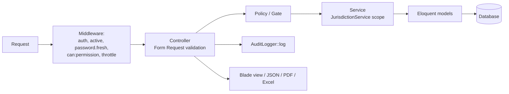

### 7.3 Rules that must not be broken
They are listed in `CLAUDE.md` under domain rules. In short:
1. Every school, user and inspection query goes through `JurisdictionService`. Location IDs from the browser are never trusted.
2. Users cannot change their own level or area.
3. Question codes are never renamed or reused.
4. Submitted means locked; only the State Admin unlocks, with a reason.
5. One inspection per officer, school and day; the start rules apply.
6. Evidence stays on the private disk and is served only after a permission check.
7. The audit log is append-only.
8. Server time is the source of truth.
9. Record IDs in URLs are encrypted tokens (`HasEncryptedRouteKey`). Pass the model, or `Model::routeKeyFor($id)`, to `route()`, never a raw `*_id`.

### 7.4 Commands
```bash
php artisan migrate --seed            # schema + roles, masters, State Admin, demo data
php artisan serve --port=8010         # development (Apache for load tests)
npm run dev | npm run build           # assets
php artisan config:clear && php artisan test   # tests (SQLite in memory only)
php artisan inspections:expire-drafts # nightly at 00:30 through the scheduler
php artisan optimize                  # production (required on Windows/Apache, LOAD_TEST.md)
```

### 7.5 Testing
- 56 feature tests, run on SQLite in memory. `tests/TestCase.php` refuses to run against any other database.
- **Never run the tests while the config is cached.**
- Demo data for manual tests: `DemoUserSeeder`.
- Volume data: `LoadTestSeeder`. Use it only on a database you have backed up.

---

## 8. Statuses at a glance
| Object | Statuses |
|---|---|
| User | pending → active / rejected; active ↔ inactive; active → locked (20 min) → active |
| Registration request | pending → approved / rejected |
| Mobile change request | pending → approved / rejected |
| Inspection | draft → submitted → unlocked → submitted; draft → cancelled (by the officer or after 7 days) |
| Evidence | pending → uploaded / failed |
| School | active / closed (closed schools cannot be inspected) |
