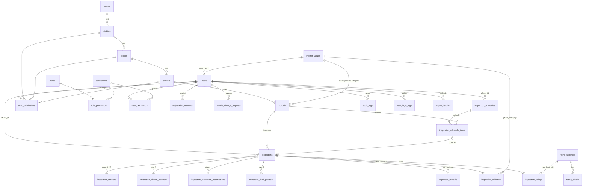

# Database Architecture and Schema

School Inspection Management System (Phase 1 with New Modules, Modification V1–V7). Prepared 19-11-2026 from the migrations in `database/migrations/`, the Eloquent models in `app/Models/`, and a read-only scan of the live schema (`information_schema`). No row data was read.

Status labels used in this document: **Implemented**, **Partial**, **Not implemented**.

---

## 1. Database overview

| Item | Value |
|---|---|
| Database name | `schoolinspection` |
| Engine | MariaDB 10.4 (XAMPP), InnoDB tables, `utf8mb4_unicode_ci` |
| Production target | MySQL 8 or MariaDB 10.4+ (CHECK constraints need MariaDB 10.2+ / MySQL 8.0.16+) |
| Connection | `config/database.php`, values from `.env` (`DB_*`). Credentials are not reproduced here |
| Tests | In-memory SQLite (`phpunit.xml`). `tests/TestCase.php` refuses any other connection |
| Total tables | **38**: 31 application tables + 7 Laravel framework tables |
| Foreign keys | 53 |
| CHECK constraints | 10 (JSON validity and mobile number format) |
| Migrations | 24 files. Master tables first (`0001_01_00_*`), then users, framework, access, schools, inspections, audit, then the modification migrations dated 2026-11-18/19 |

**Purpose.** The database stores:
- the location hierarchy (State → District → Block → Cluster) and the School Master;
- officers, their postings (jurisdictions), roles and permissions, and the registration approval chain;
- inspections: the answers of the 7-step questionnaire, repeating rows, geo-stamped evidence, remarks, and the automatic rating;
- inspection schedules (day plans);
- the audit trail and login monitoring.

**Architecture.** It is one relational schema behind a Laravel 12 monolith. All writes go through Eloquent models and services, so there are no stored procedures and no triggers. Business rules are enforced in two layers:
- in the database: unique keys, foreign keys, CHECK constraints, enums;
- in PHP: `InspectionStartGuard`, `InspectionValidator`, `ScheduleService`, `JurisdictionService` and the policies.

### 1.1 Functional modules and their tables

| Module | Tables |
|---|---|
| Location and school masters | `states`, `districts`, `blocks`, `clusters`, `schools`, `master_values`, `import_batches` |
| Users and access | `users`, `user_jurisdictions`, `roles`, `permissions`, `role_permissions`, `user_permissions`, `registration_requests`, `mobile_change_requests`, `otp_verifications` |
| Inspection | `inspections`, `inspection_answers`, `inspection_absent_teachers`, `inspection_classroom_observations`, `inspection_fund_positions`, `inspection_remarks`, `inspection_evidence` |
| Rating (New Module 3) | `rating_schemes`, `rating_criteria`, `inspection_ratings` |
| Scheduling (New Module 2) | `inspection_schedules`, `inspection_schedule_items` |
| Audit and monitoring | `audit_logs`, `user_login_logs` |
| Laravel framework | `migrations`, `sessions`, `cache`, `cache_locks`, `jobs`, `job_batches`, `failed_jobs`, `password_reset_tokens` |

---

## 2. Complete table inventory

| Sl | Table | Purpose | PK | Related tables |
|---|---|---|---|---|
| 1 | `states` | State master (single state: Assam) | `id` | districts, schools, user_jurisdictions |
| 2 | `districts` | District master with code, centre coordinates and `boundary_name` (link to KML outline) | `id` | states, blocks, schools, inspections, user_jurisdictions |
| 3 | `blocks` | Block master with coordinates | `id` | districts, clusters, schools, inspections, user_jurisdictions |
| 4 | `clusters` | Cluster master with coordinates | `id` | blocks, schools, inspections, user_jurisdictions |
| 5 | `schools` | School Master: 11-digit UDISE code, location, management, category, lat/lng, status | `id` | states, districts, blocks, clusters, master_values, inspections, inspection_schedule_items |
| 6 | `master_values` | Generic lookup lists by `type`: designation, management, category, photo_category, fund_category, subject | `id` | users, schools, inspection_evidence, inspection_fund_positions |
| 7 | `import_batches` | Each Excel upload of locations or schools, with counts and an error file | `id` | users |
| 7a | `parliamentary_constituencies` | PC master (Lok Sabha), code `PC1801` and name | `id` | assembly_constituencies, schools |
| 7b | `assembly_constituencies` | AC master, code `AC18002`, name and its PC | `id` | parliamentary_constituencies, schools |
| 8 | `users` | Officers and the State Admin: mobile login, level, status, lockout, photo and ID proof paths | `id` | almost every table |
| 9 | `user_jurisdictions` | Postings: the area of a user with `start_date`/`end_date` (a transfer ends one row and opens another) | `id` | users, states, districts, blocks, clusters |
| 10 | `roles` | One role per level (`state_admin`, `state`, `district`, `block`, `cluster`) | `id` | role_permissions |
| 11 | `permissions` | The 7 permission slugs | `id` | role_permissions, user_permissions |
| 12 | `role_permissions` | Role ↔ permission (M:N pivot) | composite | roles, permissions |
| 13 | `user_permissions` | Individual "if permitted" grants (M:N pivot) with `granted_by` | composite | users, permissions |
| 14 | `registration_requests` | One row per registration attempt; decision, approver and reason | `id` | users |
| 15 | `mobile_change_requests` | Officer request to change the login mobile number; State Admin decides | `id` | users |
| 16 | `otp_verifications` | Hashed OTPs with attempts and expiry. **Not used in Phase 1** (log driver only) | `id` | — |
| 17 | `inspections` | Inspection header: officer, school, date, location snapshot (ids and codes), start/submit GPS, status, version, unlock/cancel data | `id` | users, schools, districts, blocks, clusters, all `inspection_*` tables |
| 18 | `inspection_answers` | One row per question code per inspection; JSON `value` and `remarks` | `id` | inspections |
| 19 | `inspection_absent_teachers` | Step 3 rows: absent teacher, type, leave reason | `id` | inspections |
| 20 | `inspection_classroom_observations` | Step 4 rows: teacher, class, subject, TLM used, participation | `id` | inspections, `inspection_classroom_tlm` |
| 20a | `tlm_items` | TLM master, FLN and ECCE lists (V10): list, items per class (null = all classes), group, code, variety, remarks, active | `id` | `inspection_classroom_tlm` |
| 20b | `inspection_classroom_tlm` | TLM items ticked on a classroom observation | (`classroom_observation_id`, `tlm_item_id`) | inspection_classroom_observations, tlm_items |
| 21 | `inspection_fund_positions` | Step 5 rows: one per financial year, received and spent per head, in lakh | `id` | inspections, master_values (v1 only) |
| 22 | `inspection_remarks` | Suggestions (step 6) and other free-text remarks | `id` | inspections |
| 23 | `inspection_evidence` | Photos and documents: private-disk path, SHA-256, GPS, source (camera/gallery), category | `id` | inspections, master_values, users |
| 24 | `inspection_ratings` | Derived rating of a submitted inspection: score, band, sections, details, strengths, weaknesses (JSON) | `id` | inspections, rating_schemes |
| 25 | `rating_schemes` | Versioned rating schemes; one active; bands JSON | `id` | rating_criteria, inspection_ratings, users |
| 26 | `rating_criteria` | Criteria of a scheme: section, code, kind (answer/metric), weight, points JSON | `id` | rating_schemes |
| 27 | `inspection_schedules` | Day plan of one officer: status, reviewer, start point, distance and time | `id` | users, inspection_schedule_items |
| 28 | `inspection_schedule_items` | Schools of a plan in visit order, with travel estimate and status; links to the inspection done | `id` | inspection_schedules, schools, inspections |
| 29 | `audit_logs` | Append-only audit trail: action, subject, user, IP, meta JSON. Since V13, entries older than `AUDIT_RETENTION_DAYS` (30) are archived to Excel and then deleted, monthly (`audit:purge`) | `id` | users |
| 30 | `user_login_logs` | Login monitoring: successes and refusals, device, browser, IP, last seen, logout | `id` | users |
| 31 | `password_reset_tokens` | Laravel email reset tokens | `email` | — |
| 32 | `sessions` | Database session store (`SESSION_DRIVER=database`) | `id` | users (no FK) |
| 33 | `cache` | Database cache store | `key` | — |
| 34 | `cache_locks` | Cache locks | `key` | — |
| 35 | `jobs` | Queue (`QUEUE_CONNECTION=database`) | `id` | — |
| 36 | `job_batches` | Queue batches | `id` | — |
| 37 | `failed_jobs` | Failed queue jobs | `id` | — |
| 38 | `migrations` | Laravel migration history | `id` | — |

---

## 3. Relationships

### 3.1 One-to-one
- `inspections` 1 — 0..1 `inspection_ratings` (unique `inspection_id`).
- `inspection_schedule_items` 0..1 — 0..1 `inspections` (`inspection_id`, set when the planned school is inspected; set null on delete).
- `users` 1 — 0..1 *current* `user_jurisdictions` (`User::currentJurisdiction()`: the row with `end_date` null). In the table it is 1:N (history).

### 3.2 One-to-many (parent → children)
| Parent | Child | FK | On delete |
|---|---|---|---|
| `states` | `districts` | `state_id` | restrict |
| `districts` | `blocks` | `district_id` | restrict |
| `blocks` | `clusters` | `block_id` | restrict |
| `states`/`districts`/`blocks`/`clusters` | `schools` | `*_id` (denormalised, all four) | restrict |
| `master_values` | `schools` (`management_id`, `category_id`), `users` (`designation_id`), `inspection_evidence` (`category_id`), `inspection_fund_positions` (`fund_category_id`) | | restrict |
| `users` | `inspections` (`officer_id`), `user_jurisdictions`, `registration_requests`, `mobile_change_requests`, `inspection_schedules` (`officer_id`), `import_batches` (`uploaded_by`), `inspection_evidence` (`uploaded_by`) | | restrict |
| `users` | `audit_logs`, `user_login_logs`, and the "actor" columns (`unlocked_by`, `approver_id`, `decided_by`, `reviewed_by`, `created_by`, `assigned_by`, `granted_by`) | | set null |
| `schools` | `inspections`, `inspection_schedule_items` | `school_id` | restrict |
| `inspections` | `inspection_answers`, `inspection_absent_teachers`, `inspection_classroom_observations`, `inspection_fund_positions`, `inspection_remarks`, `inspection_ratings` | `inspection_id` | cascade |
| `inspections` | `inspection_evidence` | `inspection_id` | **restrict** (files must be removed through `EvidenceStorage` first) |
| `rating_schemes` | `rating_criteria` (cascade), `inspection_ratings` (restrict: a scheme in use cannot be deleted) | `scheme_id` | |
| `inspection_schedules` | `inspection_schedule_items` | `schedule_id` | cascade |

### 3.3 Many-to-many
- `roles` ↔ `permissions` through `role_permissions`.
- `users` ↔ `permissions` through `user_permissions` (individual grants, `granted_by`).
- Users have no `role_id` column. A user's role is found by matching `users.level` with `roles.slug` (`PermissionService::slugsFor()`), so this is an implicit relation by value, not a foreign key.

### 3.4 Master–detail
- **Inspection** (master `inspections`) with details: answers, the three repeating row tables, remarks, evidence and rating.
- **Schedule** (master `inspection_schedules`) with its items.
- **Rating scheme** (master `rating_schemes`) with its criteria.
- **Import batch** with an error file on the private disk (`error_file_path`).

### 3.5 ER diagram



---

## 4. Rules enforced by the database

| Rule | Mechanism |
|---|---|
| One inspection per officer, per school, per day | unique key on `inspections` (`officer_id`, `school_id`, `inspection_date`) |
| Unique inspection number | unique `inspections.inspection_no` |
| One answer per question per inspection | unique `inspection_answers` (`inspection_id`, `question_code`) |
| Offline replay never duplicates rows | unique (`inspection_id`, `row_uid`) on `inspection_absent_teachers` and `inspection_classroom_observations` (migration `2026_11_19_000009`). Fund rows are unique per year instead: `fund_inspection_year_unique` (`inspection_id`, `financial_year`) |
| Evidence upload is idempotent | unique `inspection_evidence.evidence_uid` |
| One plan per officer per day; a school on at most one plan per day | unique keys on `inspection_schedules` (`officer_id`, `schedule_date`) and `inspection_schedule_items` (`school_id`, `schedule_date`) |
| One rating per inspection | unique `inspection_ratings.inspection_id` |
| Mobile number format | CHECK `chk_users_mobile` and `chk_mcr_new_mobile`: `^[6-9][0-9]{9}$` |
| JSON columns are valid JSON | CHECK `json_valid(...)` on `audit_logs.meta`, `inspection_answers.value`, the rating JSON columns, `rating_schemes.bands`, `rating_criteria.points` |
| UDISE code is 11 characters | `schools.udise_code` `char(11)`, unique |
| Soft delete | `deleted_at` on `users`, `schools`, `inspections`, `inspection_evidence` |
| Performance indexes | migration `2026_11_18_000006_add_performance_indexes.php`; see `DB_INDEXING.md` |

---

## 5. Database business logic (as implemented)

| Topic | How it works | Where | Status |
|---|---|---|---|
| **User records** | An officer self-registers (`/register`, `RegisterRequest`). This creates a `users` row with `status = pending`, a `user_jurisdictions` row (the requested area), and a `registration_requests` row. The photo (required) and ID proof (optional) go to the private disk. Approval sets `status = active` and the request to `approved`, with the approver. The State Admin is seeded (`StateAdminSeeder`) and must change the password on first login (`must_change_password`). | `Auth\RegisterController`, `Admin\ApprovalController`, `ApproverResolver` | Implemented |
| **School records** | The State Admin maintains them through the School Master form or an Excel import (`MasterImportService`, `import_batches`). The UDISE code is the natural key. A school is never hard-deleted: its status is `active` or `closed`. | `Admin\SchoolMasterController`, `Admin\ImportController` | Implemented |
| **Inspection records** | Started from a school page. `InspectionStartGuard` checks the start rules, then an `inspections` row is created as a draft. The server date is the inspection date; GPS and a snapshot of the location IDs and codes are stored. `InspectionNumberGenerator` assigns `inspection_no` on submit. | `InspectionController::start/submit` | Implemented |
| **Questions and answers** | The questions are not in the DB. They are defined in code (`QuestionnaireDefinition`, Version 2). Each answer is one `inspection_answers` row keyed by its permanent `question_code`, with a JSON `value`. Steps 3–5 use their own row tables. `questionnaire_version` keeps v1 records readable. | `InspectionController::saveAnswer` | Implemented |
| **Evidence and files** | The browser resizes the photo, stamps it and hashes it (SHA-256). The server re-checks the real MIME type (finfo), the size and the hash, runs an optional ClamAV scan, and stores the file as `evidence/{inspection}/{random40}.jpg` on the `private` disk. Files are served only by `EvidenceController::show` after a policy check. | `EvidenceStorage`, `EvidenceController` | Implemented |
| **Inspection status** | `draft` → `submitted` (locked) → `unlocked` (State Admin, with a reason) → `submitted`. A draft can become `cancelled` by the officer or by the daily expiry job (`inspections:expire-drafts`, 7 days). | `InspectionStatus`, `routes/console.php` | Implemented |
| **Approval and rejection** | Registrations: `registration_requests` with `status`, `approver_id`, `reason`, `decided_at`. Mobile changes: `mobile_change_requests` with `decided_by`. Schedules: `inspection_schedules.status`, `reviewed_by`, `review_note`. There is **no approval of inspection reports** (Phase 2). | | Implemented (registrations, mobile, schedules) / Not implemented (report review) |
| **Ratings** | On submit, `RatingService::rate()` scores the inspection with the active scheme and stores `inspection_ratings` (derived; never edited by hand). Saving the settings creates a new scheme version. `ratings:recalculate` rebuilds the ratings. | `app/Rating/RatingCalculator.php`, `RatingService` | Implemented |
| **Dashboard statistics** | Computed live with COUNT queries. The dashboard is personal (today, month, total, drafts). The area figures are on the Map View (`MapDataService`, cached for 60 s) and the Rating Report (`RatingReportService`). There are no summary tables. | `DashboardController`, `MapDataService`, `RatingReportService` | Implemented (no materialised statistics) |
| **Audit** | `AuditLogger::log()` only inserts, and the `AuditLog` model refuses updates and deletes. The only deletion is the V13 retention purge (`HousekeepingService::purgeAudit()`, `audit:purge`), which writes an Excel archive to `private:audit-archive/` first. | `app/Services/AuditLogger.php`, `app/Services/HousekeepingService.php` | Implemented |
| **Data retention** | `config('inspection.retention_years') = 5` is declared, but no job uses it. | `config/inspection.php` | **Not implemented** |
| **OTP** | The `otp_verifications` table and the `OtpSender` interface with `LogOtpSender` exist; no screen uses them. | `app/Services/Otp/` | Not implemented (Phase 2) |

---

## 6. Data flow (inspection)

```mermaid
flowchart LR
    B[Browser wizard.js] -- answer JSON --> A[POST /inspections/{id}/answers]
    A --> T1[(inspection_answers)]
    B -- row + row_uid --> R[POST teachers / classrooms / funds]
    R --> T2[(row tables)]
    B -- resized JPEG + sha256 + GPS --> E[POST /evidence]
    E --> D[[private disk]]
    E --> T3[(inspection_evidence)]
    B -- submit --> S[POST /submit]
    S --> V{InspectionValidator}
    V -- missing items --> B
    V -- ok --> L[(inspections: submitted, inspection_no)]
    L --> RT[(inspection_ratings)]
    L --> SI[(inspection_schedule_items: inspected)]
    L --> AU[(audit_logs)]
```

---

## 7. Observations on the schema

1. `inspection_schedules.status` and `inspection_schedule_items.status` are `varchar(20)`, while other status columns are MySQL `enum`s. The values are controlled by the `ScheduleStatus` PHP enum only.
2. `inspections.questionnaire_version` defaults to `1` in the DB, but new inspections are version 2. The application sets the value, so a raw insert would be mislabelled.
3. `users.level` has no FK to `roles`: the link is by slug value.
4. `inspection_fund_positions.fund_category_id`, `amount_received` and `amount_utilised` are v1 columns kept for legacy rows.
5. `otp_verifications` and `password_reset_tokens` exist but are unused or rarely used. Phase 1 has no OTP, and email reset works only for users with an email address (most officers log in by mobile).
6. Foreign keys use `restrict` almost everywhere, so a master row in use cannot be deleted. This is the intended behaviour; masters are deactivated instead.
7. `sessions.user_id` has no foreign key (Laravel default).

---

## 8. Detailed table structures

Generated from `information_schema.COLUMNS`, `KEY_COLUMN_USAGE`, `REFERENTIAL_CONSTRAINTS`, `STATISTICS` and `CHECK_CONSTRAINTS` on 19-11-2026. Length is the character length or `precision,scale`. FK shows the referenced column and the ON DELETE rule.

#### `audit_logs`

| Field | Data type | Length | PK | FK | Nullable | Default |
|---|---|---|---|---|---|---|
| `id` | bigint(20) unsigned |  | Yes |  | No | auto increment |
| `user_id` | bigint(20) unsigned |  |  | users.id (set null) | Yes |  |
| `action` | varchar(50) | 50 |  |  | No |  |
| `auditable_type` | varchar(60) | 60 |  |  | Yes |  |
| `auditable_id` | bigint(20) unsigned |  |  |  | Yes |  |
| `meta` | longtext |  |  |  | Yes |  |
| `ip_address` | varchar(45) | 45 |  |  | Yes |  |
| `user_agent` | varchar(255) | 255 |  |  | Yes |  |
| `created_at` | timestamp |  |  |  | No | current_timestamp() |

Indexes: `audit_created_idx` (created_at); `audit_ip_idx` (ip_address); `audit_logs_action_created_at_index` (action, created_at); `audit_logs_auditable_type_auditable_id_index` (auditable_type, auditable_id); `audit_user_created_idx` (user_id, created_at).

CHECK `meta`: `json_valid(`meta`)`

#### `blocks`

| Field | Data type | Length | PK | FK | Nullable | Default |
|---|---|---|---|---|---|---|
| `id` | bigint(20) unsigned |  | Yes |  | No | auto increment |
| `district_id` | bigint(20) unsigned |  |  | districts.id (restrict) | No |  |
| `code` | varchar(12) | 12 |  |  | No |  |
| `name` | varchar(120) | 120 |  |  | No |  |
| `latitude` | decimal(10,7) | 10,7 |  |  | Yes |  |
| `longitude` | decimal(10,7) | 10,7 |  |  | Yes |  |
| `is_active` | tinyint(1) |  |  |  | No | 1 |
| `created_at` | timestamp |  |  |  | Yes |  |
| `updated_at` | timestamp |  |  |  | Yes |  |

Indexes: **unique** `blocks_code_unique` (code); `blocks_district_id_foreign` (district_id).

#### `cache`

| Field | Data type | Length | PK | FK | Nullable | Default |
|---|---|---|---|---|---|---|
| `key` | varchar(255) | 255 | Yes |  | No |  |
| `value` | mediumtext |  |  |  | No |  |
| `expiration` | int(11) |  |  |  | No |  |

#### `cache_locks`

| Field | Data type | Length | PK | FK | Nullable | Default |
|---|---|---|---|---|---|---|
| `key` | varchar(255) | 255 | Yes |  | No |  |
| `owner` | varchar(255) | 255 |  |  | No |  |
| `expiration` | int(11) |  |  |  | No |  |

#### `clusters`

| Field | Data type | Length | PK | FK | Nullable | Default |
|---|---|---|---|---|---|---|
| `id` | bigint(20) unsigned |  | Yes |  | No | auto increment |
| `block_id` | bigint(20) unsigned |  |  | blocks.id (restrict) | No |  |
| `code` | varchar(15) | 15 |  |  | No |  |
| `name` | varchar(120) | 120 |  |  | No |  |
| `latitude` | decimal(10,7) | 10,7 |  |  | Yes |  |
| `longitude` | decimal(10,7) | 10,7 |  |  | Yes |  |
| `is_active` | tinyint(1) |  |  |  | No | 1 |
| `created_at` | timestamp |  |  |  | Yes |  |
| `updated_at` | timestamp |  |  |  | Yes |  |

Indexes: `clusters_block_id_foreign` (block_id); **unique** `clusters_code_unique` (code).

#### `districts`

IDs of `districts`, `blocks` and `clusters` follow the Location Master code order (1801 → 1). `php artisan locations:renumber --force` restores that order and moves every referencing column (schools, user_jurisdictions, inspections, import_batches, coverage_settings, blocks, clusters) and the id keys in `import_batches.summary`.

| Field | Data type | Length | PK | FK | Nullable | Default |
|---|---|---|---|---|---|---|
| `id` | bigint(20) unsigned |  | Yes |  | No | auto increment |
| `state_id` | bigint(20) unsigned |  |  | states.id (restrict) | No |  |
| `code` | varchar(10) | 10 |  |  | No |  |
| `name` | varchar(120) | 120 |  |  | No |  |
| `latitude` | decimal(10,7) | 10,7 |  |  | Yes |  |
| `longitude` | decimal(10,7) | 10,7 |  |  | Yes |  |
| `boundary_name` | varchar(80) | 80 |  |  | Yes |  |
| `is_active` | tinyint(1) |  |  |  | No | 1 |
| `created_at` | timestamp |  |  |  | Yes |  |
| `updated_at` | timestamp |  |  |  | Yes |  |

Indexes: **unique** `districts_code_unique` (code); `districts_state_id_foreign` (state_id).

#### `failed_jobs`

| Field | Data type | Length | PK | FK | Nullable | Default |
|---|---|---|---|---|---|---|
| `id` | bigint(20) unsigned |  | Yes |  | No | auto increment |
| `uuid` | varchar(255) | 255 |  |  | No |  |
| `connection` | text |  |  |  | No |  |
| `queue` | text |  |  |  | No |  |
| `payload` | longtext |  |  |  | No |  |
| `exception` | longtext |  |  |  | No |  |
| `failed_at` | timestamp |  |  |  | No | current_timestamp() |

Indexes: **unique** `failed_jobs_uuid_unique` (uuid).

#### `import_batches`

| Field | Data type | Length | PK | FK | Nullable | Default |
|---|---|---|---|---|---|---|
| `id` | bigint(20) unsigned |  | Yes |  | No | auto increment |
| `type` | enum('location','school') | 8 |  |  | No |  |
| `file_name` | varchar(255) | 255 |  |  | No |  |
| `uploaded_by` | bigint(20) unsigned |  |  | users.id (restrict) | No |  |
| `total_rows` | int(10) unsigned |  |  |  | No | 0 |
| `added` | int(10) unsigned |  |  |  | No | 0 |
| `updated` | int(10) unsigned |  |  |  | No | 0 |
| `rejected` | int(10) unsigned |  |  |  | No | 0 |
| `error_file_path` | varchar(255) | 255 |  |  | Yes |  |
| `created_at` | timestamp |  |  |  | Yes |  |
| `updated_at` | timestamp |  |  |  | Yes |  |

Indexes: `import_batches_uploaded_by_foreign` (uploaded_by).

#### `inspections`

| Field | Data type | Length | PK | FK | Nullable | Default |
|---|---|---|---|---|---|---|
| `id` | bigint(20) unsigned |  | Yes |  | No | auto increment |
| `inspection_no` | varchar(40) | 40 |  |  | Yes |  |
| `officer_id` | bigint(20) unsigned |  |  | users.id (restrict) | No |  |
| `school_id` | bigint(20) unsigned |  |  | schools.id (restrict) | No |  |
| `inspection_date` | date |  |  |  | No |  |
| `started_at` | timestamp |  |  |  | No | current_timestamp() |
| `submitted_at` | timestamp |  |  |  | Yes |  |
| `district_id` | bigint(20) unsigned |  |  | districts.id (restrict) | No |  |
| `block_id` | bigint(20) unsigned |  |  | blocks.id (restrict) | No |  |
| `cluster_id` | bigint(20) unsigned |  |  | clusters.id (restrict) | No |  |
| `state_code` | varchar(10) | 10 |  |  | No |  |
| `district_code` | varchar(10) | 10 |  |  | No |  |
| `block_code` | varchar(12) | 12 |  |  | No |  |
| `cluster_code` | varchar(15) | 15 |  |  | No |  |
| `start_lat` | decimal(10,7) | 10,7 |  |  | Yes |  |
| `start_lng` | decimal(10,7) | 10,7 |  |  | Yes |  |
| `start_accuracy` | decimal(8,2) | 8,2 |  |  | Yes |  |
| `submit_lat` | decimal(10,7) | 10,7 |  |  | Yes |  |
| `submit_lng` | decimal(10,7) | 10,7 |  |  | Yes |  |
| `submit_accuracy` | decimal(8,2) | 8,2 |  |  | Yes |  |
| `person_met_name` | varchar(120) | 120 |  |  | Yes |  |
| `person_met_designation` | varchar(120) | 120 |  |  | Yes |  |
| `status` | enum('draft','submitted','unlocked','cancelled') | 9 |  |  | No | draft |
| `completion_pct` | tinyint(3) unsigned |  |  |  | No | 0 |
| `questionnaire_version` | tinyint(3) unsigned |  |  |  | No | 1 |
| `unlocked_by` | bigint(20) unsigned |  |  | users.id (set null) | Yes |  |
| `unlocked_at` | timestamp |  |  |  | Yes |  |
| `unlock_reason` | text |  |  |  | Yes |  |
| `cancelled_reason` | text |  |  |  | Yes |  |
| `created_at` | timestamp |  |  |  | Yes |  |
| `updated_at` | timestamp |  |  |  | Yes |  |
| `deleted_at` | timestamp |  |  |  | Yes |  |

Indexes: `inspections_district_id_block_id_cluster_id_index` (district_id, block_id, cluster_id); **unique** `inspections_inspection_no_unique` (inspection_no); **unique** `inspections_officer_school_day_unique` (officer_id, school_id, inspection_date); `inspections_status_inspection_date_index` (status, inspection_date); `inspections_unlocked_by_foreign` (unlocked_by); `insp_block_status_date_idx` (block_id, status, inspection_date); `insp_cluster_status_date_idx` (cluster_id, status, inspection_date); `insp_district_status_date_idx` (district_id, status, inspection_date); `insp_officer_status_date_idx` (officer_id, status, inspection_date); `insp_school_status_date_idx` (school_id, status, inspection_date); `insp_status_started_idx` (status, started_at).

#### `inspection_absent_teachers`

| Field | Data type | Length | PK | FK | Nullable | Default |
|---|---|---|---|---|---|---|
| `id` | bigint(20) unsigned |  | Yes |  | No | auto increment |
| `inspection_id` | bigint(20) unsigned |  |  | inspections.id (cascade) | No |  |
| `row_uid` | char(36) | 36 |  |  | Yes |  |
| `teacher_name` | varchar(120) | 120 |  |  | No |  |
| `teacher_type` | varchar(20) | 20 |  |  | Yes |  |
| `reason` | varchar(20) | 20 |  |  | Yes |  |
| `status` | varchar(30) | 30 |  |  | Yes |  |
| `remarks` | text |  |  |  | Yes |  |
| `created_at` | timestamp |  |  |  | Yes |  |
| `updated_at` | timestamp |  |  |  | Yes |  |

Indexes: `inspection_absent_teachers_inspection_id_foreign` (inspection_id); **unique** `inspection_absent_teachers_inspection_id_row_uid_unique` (inspection_id, row_uid).

#### `inspection_answers`

| Field | Data type | Length | PK | FK | Nullable | Default |
|---|---|---|---|---|---|---|
| `id` | bigint(20) unsigned |  | Yes |  | No | auto increment |
| `inspection_id` | bigint(20) unsigned |  |  | inspections.id (cascade) | No |  |
| `step` | tinyint(3) unsigned |  |  |  | No |  |
| `question_code` | varchar(20) | 20 |  |  | No |  |
| `value` | longtext |  |  |  | Yes |  |
| `remarks` | text |  |  |  | Yes |  |
| `created_at` | timestamp |  |  |  | Yes |  |
| `updated_at` | timestamp |  |  |  | Yes |  |

Indexes: **unique** `inspection_answers_inspection_id_question_code_unique` (inspection_id, question_code).

CHECK `value`: `json_valid(`value`)`

#### `inspection_classroom_observations`

| Field | Data type | Length | PK | FK | Nullable | Default |
|---|---|---|---|---|---|---|
| `id` | bigint(20) unsigned |  | Yes |  | No | auto increment |
| `inspection_id` | bigint(20) unsigned |  |  | inspections.id (cascade) | No |  |
| `row_uid` | char(36) | 36 |  |  | Yes |  |
| `teacher_name` | varchar(120) | 120 |  |  | No |  |
| `class` | varchar(4) | 4 |  |  | No |  |
| `subject` | varchar(100) | 100 |  |  | No |  |
| `tlm_used` | tinyint(1) |  |  |  | No |  |
| `participation` | varchar(20) | 20 |  |  | No |  |
| `remarks` | text |  |  |  | Yes |  |
| `created_at` | timestamp |  |  |  | Yes |  |
| `updated_at` | timestamp |  |  |  | Yes |  |

Indexes: `inspection_classroom_observations_inspection_id_foreign` (inspection_id); **unique** `inspection_classroom_observations_inspection_id_row_uid_unique` (inspection_id, row_uid).

#### `tlm_items`
Migration `2026_11_20_000002_create_tlm_items`. It inserts the FLN TLM list for 2026-27: 6 items for Class I and 5 for Class II. Migration `2026_11_21_000001_tlm_lists_ecce` (Modification V10) adds `list` and `section` and inserts the ECCE TLM list 2025-26: 2 items "TLM for students" and 11 "TLM for schools" (all classes).

| Field | Data type | Length | PK | FK | Nullable | Default |
|---|---|---|---|---|---|---|
| `id` | bigint(20) unsigned |  | Yes |  | No | auto increment |
| `list` | varchar(10) | 10 |  |  | No | `fln` (`fln` / `ecce`, V10) |
| `class` | varchar(4) | 4 |  |  | Yes | (null = all classes) |
| `section` | varchar(60) | 60 |  |  | Yes | group inside a list, e.g. "TLM for schools" (V10) |
| `name` | varchar(150) | 150 |  |  | No |  |
| `code` | varchar(60) | 60 |  |  | Yes |  |
| `variety` | smallint unsigned |  |  |  | No | 1 |
| `remarks` | varchar(200) | 200 |  |  | Yes |  |
| `sort` | smallint unsigned |  |  |  | No | 0 |
| `is_active` | tinyint(1) |  |  |  | No | 1 |
| `created_at` / `updated_at` | timestamp |  |  |  | Yes |  |

Indexes: `tlm_items_class_index` (class); `tlm_items_list_index` (list); **unique** `tlm_items_list_class_name_unique` (list, class, name), which replaced (class, name) in V10.

#### `inspection_classroom_tlm`

| Field | Data type | Length | PK | FK | Nullable | Default |
|---|---|---|---|---|---|---|
| `classroom_observation_id` | bigint(20) unsigned |  | Yes | inspection_classroom_observations.id (cascade) | No |  |
| `tlm_item_id` | bigint(20) unsigned |  | Yes | tlm_items.id (restrict) | No |  |

#### `inspection_evidence`

| Field | Data type | Length | PK | FK | Nullable | Default |
|---|---|---|---|---|---|---|
| `id` | bigint(20) unsigned |  | Yes |  | No | auto increment |
| `evidence_uid` | char(36) | 36 |  |  | No |  |
| `inspection_id` | bigint(20) unsigned |  |  | inspections.id (restrict) | No |  |
| `kind` | enum('photo','document') | 8 |  |  | No | photo |
| `source` | enum('camera','gallery') | 7 |  |  | No | camera |
| `category_id` | bigint(20) unsigned |  |  | master_values.id (restrict) | Yes |  |
| `question_code` | varchar(20) | 20 |  |  | Yes |  |
| `caption` | varchar(150) | 150 |  |  | Yes |  |
| `taken_at` | timestamp |  |  |  | Yes |  |
| `received_at` | timestamp |  |  |  | Yes |  |
| `latitude` | decimal(10,7) | 10,7 |  |  | Yes |  |
| `longitude` | decimal(10,7) | 10,7 |  |  | Yes |  |
| `accuracy` | decimal(8,2) | 8,2 |  |  | Yes |  |
| `no_location_reason` | varchar(255) | 255 |  |  | Yes |  |
| `original_name` | varchar(255) | 255 |  |  | Yes |  |
| `mime` | varchar(60) | 60 |  |  | Yes |  |
| `size_bytes` | int(10) unsigned |  |  |  | No | 0 |
| `storage_path` | varchar(255) | 255 |  |  | Yes |  |
| `sha256` | char(64) | 64 |  |  | Yes |  |
| `status` | enum('pending','uploaded','failed') | 8 |  |  | No | pending |
| `uploaded_by` | bigint(20) unsigned |  |  | users.id (restrict) | No |  |
| `created_at` | timestamp |  |  |  | Yes |  |
| `updated_at` | timestamp |  |  |  | Yes |  |
| `deleted_at` | timestamp |  |  |  | Yes |  |

Indexes: `inspection_evidence_category_id_foreign` (category_id); **unique** `inspection_evidence_evidence_uid_unique` (evidence_uid); `inspection_evidence_inspection_id_kind_status_index` (inspection_id, kind, status); `inspection_evidence_sha256_index` (sha256); `inspection_evidence_uploaded_by_foreign` (uploaded_by).

#### `inspection_fund_positions`

| Field | Data type | Length | PK | FK | Nullable | Default |
|---|---|---|---|---|---|---|
| `id` | bigint(20) unsigned |  | Yes |  | No | auto increment |
| `inspection_id` | bigint(20) unsigned |  |  | inspections.id (cascade) | No |  |
| `financial_year` | varchar(12) | 12 |  |  | No |  |
| `fund_category_id` | bigint(20) unsigned |  |  | master_values.id (restrict) | Yes |  |
| `amount_received` | decimal(12,2) | 12,2 |  |  | Yes |  |
| `amount_utilised` | decimal(12,2) | 12,2 |  |  | Yes |  |
| `created_at` | timestamp |  |  |  | Yes |  |
| `updated_at` | timestamp |  |  |  | Yes |  |
| `asg_received` | decimal(10,2) | 10,2 |  |  | No | 0.00 |
| `asg_expenditure` | decimal(10,2) | 10,2 |  |  | No | 0.00 |
| `mdm_received` | decimal(10,2) | 10,2 |  |  | No | 0.00 |
| `mdm_expenditure` | decimal(10,2) | 10,2 |  |  | No | 0.00 |
| `govt_received` | decimal(10,2) | 10,2 |  |  | No | 0.00 |
| `govt_expenditure` | decimal(10,2) | 10,2 |  |  | No | 0.00 |
| `other_received` | decimal(10,2) | 10,2 |  |  | No | 0.00 |
| `other_expenditure` | decimal(10,2) | 10,2 |  |  | No | 0.00 |

Indexes: **unique** `fund_inspection_year_unique` (inspection_id, financial_year); `inspection_fund_positions_fund_category_id_foreign` (fund_category_id).

#### `inspection_ratings`

| Field | Data type | Length | PK | FK | Nullable | Default |
|---|---|---|---|---|---|---|
| `id` | bigint(20) unsigned |  | Yes |  | No | auto increment |
| `inspection_id` | bigint(20) unsigned |  |  | inspections.id (cascade) | No |  |
| `scheme_id` | bigint(20) unsigned |  |  | rating_schemes.id (restrict) | No |  |
| `obtained` | decimal(8,2) | 8,2 |  |  | No | 0.00 |
| `applicable` | decimal(8,2) | 8,2 |  |  | No | 0.00 |
| `score_percent` | decimal(5,2) | 5,2 |  |  | Yes |  |
| `band` | varchar(40) | 40 |  |  | Yes |  |
| `color` | varchar(20) | 20 |  |  | Yes |  |
| `sections` | longtext |  |  |  | No |  |
| `details` | longtext |  |  |  | No |  |
| `strengths` | longtext |  |  |  | No |  |
| `weaknesses` | longtext |  |  |  | No |  |
| `calculated_at` | timestamp |  |  |  | No | current_timestamp() |
| `created_at` | timestamp |  |  |  | Yes |  |
| `updated_at` | timestamp |  |  |  | Yes |  |

Indexes: **unique** `inspection_ratings_inspection_id_unique` (inspection_id); `inspection_ratings_scheme_id_foreign` (scheme_id); `inspection_ratings_score_percent_index` (score_percent).

CHECK `sections`: `json_valid(`sections`)`

CHECK `details`: `json_valid(`details`)`

CHECK `strengths`: `json_valid(`strengths`)`

CHECK `weaknesses`: `json_valid(`weaknesses`)`

#### `inspection_remarks`

| Field | Data type | Length | PK | FK | Nullable | Default |
|---|---|---|---|---|---|---|
| `id` | bigint(20) unsigned |  | Yes |  | No | auto increment |
| `inspection_id` | bigint(20) unsigned |  |  | inspections.id (cascade) | No |  |
| `type` | enum('suggestion','general','classroom_note','inspection_… | 17 |  |  | No |  |
| `sort` | tinyint(3) unsigned |  |  |  | No | 0 |
| `body` | text |  |  |  | No |  |
| `created_at` | timestamp |  |  |  | Yes |  |
| `updated_at` | timestamp |  |  |  | Yes |  |

Indexes: `inspection_remarks_inspection_id_type_index` (inspection_id, type).

#### `inspection_schedules`

| Field | Data type | Length | PK | FK | Nullable | Default |
|---|---|---|---|---|---|---|
| `id` | bigint(20) unsigned |  | Yes |  | No | auto increment |
| `officer_id` | bigint(20) unsigned |  |  | users.id (restrict) | No |  |
| `schedule_date` | date |  |  |  | No |  |
| `status` | varchar(20) | 20 |  |  | No | draft |
| `created_by` | bigint(20) unsigned |  |  | users.id (set null) | Yes |  |
| `submitted_at` | timestamp |  |  |  | Yes |  |
| `reviewed_by` | bigint(20) unsigned |  |  | users.id (set null) | Yes |  |
| `reviewed_at` | timestamp |  |  |  | Yes |  |
| `review_note` | varchar(500) | 500 |  |  | Yes |  |
| `published_at` | timestamp |  |  |  | Yes |  |
| `start_lat` | decimal(10,7) | 10,7 |  |  | Yes |  |
| `start_lng` | decimal(10,7) | 10,7 |  |  | Yes |  |
| `total_distance_km` | decimal(8,2) | 8,2 |  |  | No | 0.00 |
| `total_minutes` | smallint(5) unsigned |  |  |  | No | 0 |
| `notes` | varchar(500) | 500 |  |  | Yes |  |
| `created_at` | timestamp |  |  |  | Yes |  |
| `updated_at` | timestamp |  |  |  | Yes |  |

Indexes: `inspection_schedules_created_by_foreign` (created_by); `inspection_schedules_reviewed_by_foreign` (reviewed_by); **unique** `sched_officer_date_unique` (officer_id, schedule_date); `sched_status_date_idx` (status, schedule_date).

#### `inspection_schedule_items`

| Field | Data type | Length | PK | FK | Nullable | Default |
|---|---|---|---|---|---|---|
| `id` | bigint(20) unsigned |  | Yes |  | No | auto increment |
| `schedule_id` | bigint(20) unsigned |  |  | inspection_schedules.id (cascade) | No |  |
| `school_id` | bigint(20) unsigned |  |  | schools.id (restrict) | No |  |
| `schedule_date` | date |  |  |  | No |  |
| `sequence` | smallint(5) unsigned |  |  |  | No |  |
| `distance_km` | decimal(7,2) | 7,2 |  |  | Yes |  |
| `travel_minutes` | smallint(5) unsigned |  |  |  | Yes |  |
| `planned_arrival` | varchar(5) | 5 |  |  | Yes |  |
| `status` | varchar(20) | 20 |  |  | No | planned |
| `inspection_id` | bigint(20) unsigned |  |  | inspections.id (set null) | Yes |  |
| `created_at` | timestamp |  |  |  | Yes |  |
| `updated_at` | timestamp |  |  |  | Yes |  |

Indexes: `inspection_schedule_items_inspection_id_foreign` (inspection_id); **unique** `sched_item_school_date_unique` (school_id, schedule_date); **unique** `sched_item_school_unique` (schedule_id, school_id).

#### `jobs`

| Field | Data type | Length | PK | FK | Nullable | Default |
|---|---|---|---|---|---|---|
| `id` | bigint(20) unsigned |  | Yes |  | No | auto increment |
| `queue` | varchar(255) | 255 |  |  | No |  |
| `payload` | longtext |  |  |  | No |  |
| `attempts` | tinyint(3) unsigned |  |  |  | No |  |
| `reserved_at` | int(10) unsigned |  |  |  | Yes |  |
| `available_at` | int(10) unsigned |  |  |  | No |  |
| `created_at` | int(10) unsigned |  |  |  | No |  |

Indexes: `jobs_queue_index` (queue).

#### `job_batches`

| Field | Data type | Length | PK | FK | Nullable | Default |
|---|---|---|---|---|---|---|
| `id` | varchar(255) | 255 | Yes |  | No |  |
| `name` | varchar(255) | 255 |  |  | No |  |
| `total_jobs` | int(11) |  |  |  | No |  |
| `pending_jobs` | int(11) |  |  |  | No |  |
| `failed_jobs` | int(11) |  |  |  | No |  |
| `failed_job_ids` | longtext |  |  |  | No |  |
| `options` | mediumtext |  |  |  | Yes |  |
| `cancelled_at` | int(11) |  |  |  | Yes |  |
| `created_at` | int(11) |  |  |  | No |  |
| `finished_at` | int(11) |  |  |  | Yes |  |

#### `master_values`

| Field | Data type | Length | PK | FK | Nullable | Default |
|---|---|---|---|---|---|---|
| `id` | bigint(20) unsigned |  | Yes |  | No | auto increment |
| `type` | enum('designation','management','category','photo_categor… | 14 |  |  | No |  |
| `code` | varchar(40) | 40 |  |  | No |  |
| `label` | varchar(150) | 150 |  |  | No |  |
| `sort` | smallint(5) unsigned |  |  |  | No | 0 |
| `is_active` | tinyint(1) |  |  |  | No | 1 |
| `created_at` | timestamp |  |  |  | Yes |  |
| `updated_at` | timestamp |  |  |  | Yes |  |

Indexes: **unique** `master_values_type_code_unique` (type, code).

#### `migrations`

| Field | Data type | Length | PK | FK | Nullable | Default |
|---|---|---|---|---|---|---|
| `id` | int(10) unsigned |  | Yes |  | No | auto increment |
| `migration` | varchar(255) | 255 |  |  | No |  |
| `batch` | int(11) |  |  |  | No |  |

#### `mobile_change_requests`

| Field | Data type | Length | PK | FK | Nullable | Default |
|---|---|---|---|---|---|---|
| `id` | bigint(20) unsigned |  | Yes |  | No | auto increment |
| `user_id` | bigint(20) unsigned |  |  | users.id (restrict) | No |  |
| `old_mobile` | char(10) | 10 |  |  | No |  |
| `new_mobile` | char(10) | 10 |  |  | No |  |
| `status` | enum('pending','approved','rejected') | 8 |  |  | No | pending |
| `reason` | text |  |  |  | Yes |  |
| `decided_by` | bigint(20) unsigned |  |  | users.id (set null) | Yes |  |
| `decided_at` | timestamp |  |  |  | Yes |  |
| `created_at` | timestamp |  |  |  | Yes |  |
| `updated_at` | timestamp |  |  |  | Yes |  |

Indexes: `mcr_status_created_idx` (status, created_at); `mcr_user_status_idx` (user_id, status); `mobile_change_requests_decided_by_foreign` (decided_by).

CHECK `chk_mcr_new_mobile`: ``new_mobile` regexp '^[6-9][0-9]{9}$'`

#### `otp_verifications`

| Field | Data type | Length | PK | FK | Nullable | Default |
|---|---|---|---|---|---|---|
| `id` | bigint(20) unsigned |  | Yes |  | No | auto increment |
| `mobile` | char(10) | 10 |  |  | No |  |
| `purpose` | varchar(30) | 30 |  |  | No |  |
| `otp_hash` | varchar(255) | 255 |  |  | No |  |
| `attempts` | tinyint(3) unsigned |  |  |  | No | 0 |
| `expires_at` | timestamp |  |  |  | No | current_timestamp() |
| `created_at` | timestamp |  |  |  | Yes |  |
| `updated_at` | timestamp |  |  |  | Yes |  |

Indexes: `otp_verifications_mobile_index` (mobile).

#### `password_reset_tokens`

| Field | Data type | Length | PK | FK | Nullable | Default |
|---|---|---|---|---|---|---|
| `email` | varchar(255) | 255 | Yes |  | No |  |
| `token` | varchar(255) | 255 |  |  | No |  |
| `created_at` | timestamp |  |  |  | Yes |  |

#### `permissions`

| Field | Data type | Length | PK | FK | Nullable | Default |
|---|---|---|---|---|---|---|
| `id` | bigint(20) unsigned |  | Yes |  | No | auto increment |
| `slug` | varchar(50) | 50 |  |  | No |  |
| `name` | varchar(100) | 100 |  |  | No |  |
| `created_at` | timestamp |  |  |  | Yes |  |
| `updated_at` | timestamp |  |  |  | Yes |  |

Indexes: **unique** `permissions_slug_unique` (slug).

#### `rating_criteria`

| Field | Data type | Length | PK | FK | Nullable | Default |
|---|---|---|---|---|---|---|
| `id` | bigint(20) unsigned |  | Yes |  | No | auto increment |
| `scheme_id` | bigint(20) unsigned |  |  | rating_schemes.id (cascade) | No |  |
| `section` | varchar(20) | 20 |  |  | No |  |
| `code` | varchar(40) | 40 |  |  | No |  |
| `label` | varchar(200) | 200 |  |  | No |  |
| `kind` | varchar(10) | 10 |  |  | No |  |
| `weight` | decimal(6,2) | 6,2 |  |  | No | 1.00 |
| `points` | longtext |  |  |  | Yes |  |
| `sort` | smallint(5) unsigned |  |  |  | No | 0 |

Indexes: **unique** `rating_criteria_scheme_id_code_unique` (scheme_id, code).

CHECK `points`: `json_valid(`points`)`

#### `rating_schemes`

| Field | Data type | Length | PK | FK | Nullable | Default |
|---|---|---|---|---|---|---|
| `id` | bigint(20) unsigned |  | Yes |  | No | auto increment |
| `version` | int(10) unsigned |  |  |  | No |  |
| `name` | varchar(120) | 120 |  |  | No |  |
| `is_active` | tinyint(1) |  |  |  | No | 0 |
| `bands` | longtext |  |  |  | No |  |
| `created_by` | bigint(20) unsigned |  |  | users.id (set null) | Yes |  |
| `activated_at` | timestamp |  |  |  | Yes |  |
| `created_at` | timestamp |  |  |  | Yes |  |
| `updated_at` | timestamp |  |  |  | Yes |  |

Indexes: `rating_schemes_created_by_foreign` (created_by); **unique** `rating_schemes_version_unique` (version).

CHECK `bands`: `json_valid(`bands`)`

#### `registration_requests`

| Field | Data type | Length | PK | FK | Nullable | Default |
|---|---|---|---|---|---|---|
| `id` | bigint(20) unsigned |  | Yes |  | No | auto increment |
| `user_id` | bigint(20) unsigned |  |  | users.id (restrict) | No |  |
| `approver_id` | bigint(20) unsigned |  |  | users.id (set null) | Yes |  |
| `status` | enum('pending','approved','rejected') | 8 |  |  | No | pending |
| `reason` | text |  |  |  | Yes |  |
| `decided_at` | timestamp |  |  |  | Yes |  |
| `created_at` | timestamp |  |  |  | Yes |  |
| `updated_at` | timestamp |  |  |  | Yes |  |

Indexes: `registration_requests_status_created_at_index` (status, created_at); `registration_requests_user_id_foreign` (user_id); `reg_approver_status_idx` (approver_id, status).

#### `roles`

| Field | Data type | Length | PK | FK | Nullable | Default |
|---|---|---|---|---|---|---|
| `id` | bigint(20) unsigned |  | Yes |  | No | auto increment |
| `slug` | varchar(30) | 30 |  |  | No |  |
| `name` | varchar(60) | 60 |  |  | No |  |
| `created_at` | timestamp |  |  |  | Yes |  |
| `updated_at` | timestamp |  |  |  | Yes |  |

Indexes: **unique** `roles_slug_unique` (slug).

#### `role_permissions`

| Field | Data type | Length | PK | FK | Nullable | Default |
|---|---|---|---|---|---|---|
| `role_id` | bigint(20) unsigned |  | Yes | roles.id (cascade) | No |  |
| `permission_id` | bigint(20) unsigned |  | Yes | permissions.id (cascade) | No |  |

Indexes: `role_permissions_permission_id_foreign` (permission_id).

#### `schools`

| Field | Data type | Length | PK | FK | Nullable | Default |
|---|---|---|---|---|---|---|
| `id` | bigint(20) unsigned |  | Yes |  | No | auto increment |
| `udise_code` | char(11) | 11 |  |  | No |  |
| `name` | varchar(200) | 200 |  |  | No |  |
| `state_id` | bigint(20) unsigned |  |  | states.id (restrict) | No |  |
| `district_id` | bigint(20) unsigned |  |  | districts.id (restrict) | No |  |
| `block_id` | bigint(20) unsigned |  |  | blocks.id (restrict) | No |  |
| `cluster_id` | bigint(20) unsigned |  |  | clusters.id (restrict) | No |  |
| `management_id` | bigint(20) unsigned |  |  | master_values.id (restrict) | Yes |  |
| `category_id` | bigint(20) unsigned |  |  | master_values.id (restrict) | Yes |  |
| `school_type` | varchar(10) | 10 |  |  | Yes |  |
| `area_type` | varchar(10) | 10 |  |  | Yes |  |
| `medium` | varchar(120) | 120 |  |  | Yes | List, e.g. "Assamese, Bodo" (a school may teach in more than one medium) |
| `ac_id` | bigint(20) unsigned |  |  | assembly_constituencies.id (restrict) | Yes |  |
| `pc_id` | bigint(20) unsigned |  |  | parliamentary_constituencies.id (restrict) | Yes |  |
| `streams` | json |  |  |  | Yes |  |
| `address` | text |  |  |  | Yes |  |
| `pincode` | char(6) | 6 |  |  | Yes |  |
| `latitude` | decimal(10,7) | 10,7 |  |  | Yes |  |
| `longitude` | decimal(10,7) | 10,7 |  |  | Yes |  |
| `status` | enum('active','closed') | 6 |  |  | No | active |
| `created_at` | timestamp |  |  |  | Yes |  |
| `updated_at` | timestamp |  |  |  | Yes |  |
| `deleted_at` | timestamp |  |  |  | Yes |  |

UDISE+ 2025-26 fields (migration `2026_11_23_000001`, all optional), filled from the School Master upload:
- `school_type`: `boys` / `girls` / `co_ed` (UDISE `School_Type`)
- `area_type`: `rural` / `urban` (`School_Location`)
- `medium`: as in `Med_Final_25`, e.g. `AssameseBodo`, shown as "Assamese, Bodo"
- `ac_id` / `pc_id`: links to the AC / PC Master, read from the template's `ac` / `pc` columns, or from the UDISE `Assembly_Name` / `LS` (migration `2026_11_23_000002` replaced the earlier free-text columns). `pc_id` follows the AC.
- `streams`: JSON such as `{"arts":true,"commerce":false,…}` from the five `*_Stream` columns; null when all are "NA" (no Higher Secondary)
- `pincode`: 6 digits, else null

Category and Management are matched by their UDISE number (`"1 - Primary"`) to `master_values` codes (`MasterImportService::UDISE_CATEGORY` / `UDISE_MANAGEMENT`).

Indexes: `schools_area_type_index` (area_type); `schools_block_status_name_idx` (block_id, status, name); `schools_category_id_foreign` (category_id); `schools_cluster_status_name_idx` (cluster_id, status, name); `schools_district_status_name_idx` (district_id, status, name); `schools_management_id_foreign` (management_id); `schools_name_index` (name); `schools_state_id_foreign` (state_id); **unique** `schools_udise_code_unique` (udise_code).

#### `parliamentary_constituencies` (PC master)

| Field | Data type | Length | PK | FK | Nullable | Default |
|---|---|---|---|---|---|---|
| `id` | bigint(20) unsigned |  | Yes |  | No | auto increment |
| `code` | varchar(10) | 10 |  |  | No |  |
| `name` | varchar(60) | 60 |  |  | No |  |
| `is_active` | tinyint(1) |  |  |  | No | 1 |
| `created_at` / `updated_at` | timestamp |  |  |  | Yes |  |

Indexes: **unique** `code`, **unique** `name`. 14 rows seeded (PC1801 KOKRAJHAR (ST) … PC1814 JORHAT, ECI order).

#### `assembly_constituencies` (AC master)

| Field | Data type | Length | PK | FK | Nullable | Default |
|---|---|---|---|---|---|---|
| `id` | bigint(20) unsigned |  | Yes |  | No | auto increment |
| `code` | varchar(10) | 10 |  |  | No |  |
| `name` | varchar(60) | 60 |  |  | No |  |
| `pc_id` | bigint(20) unsigned |  |  | parliamentary_constituencies.id (restrict) | No |  |
| `is_active` | tinyint(1) |  |  |  | No | 1 |
| `created_at` / `updated_at` | timestamp |  |  |  | Yes |  |

Indexes: **unique** `code`, `name`, `pc_id`. 126 rows seeded from the UDISE+ 2025-26 School Master (`AC18001` … `AC18126`).

#### `sessions`

| Field | Data type | Length | PK | FK | Nullable | Default |
|---|---|---|---|---|---|---|
| `id` | varchar(255) | 255 | Yes |  | No |  |
| `user_id` | bigint(20) unsigned |  |  |  | Yes |  |
| `ip_address` | varchar(45) | 45 |  |  | Yes |  |
| `user_agent` | text |  |  |  | Yes |  |
| `payload` | longtext |  |  |  | No |  |
| `last_activity` | int(11) |  |  |  | No |  |

Indexes: `sessions_last_activity_index` (last_activity); `sessions_user_id_index` (user_id).

#### `states`

| Field | Data type | Length | PK | FK | Nullable | Default |
|---|---|---|---|---|---|---|
| `id` | bigint(20) unsigned |  | Yes |  | No | auto increment |
| `code` | varchar(10) | 10 |  |  | No |  |
| `name` | varchar(120) | 120 |  |  | No |  |
| `is_active` | tinyint(1) |  |  |  | No | 1 |
| `created_at` | timestamp |  |  |  | Yes |  |
| `updated_at` | timestamp |  |  |  | Yes |  |

Indexes: **unique** `states_code_unique` (code).

#### `users`

| Field | Data type | Length | PK | FK | Nullable | Default |
|---|---|---|---|---|---|---|
| `id` | bigint(20) unsigned |  | Yes |  | No | auto increment |
| `name` | varchar(120) | 120 |  |  | No |  |
| `gender` | enum('male','female','other') |  |  |  | Yes |  |
| `designation_id` | bigint(20) unsigned |  |  | master_values.id (restrict) | Yes |  |
| `designation_other` | varchar(120) | 120 |  |  | Yes |  |
| `employee_id` | varchar(40) | 40 |  |  | Yes |  |
| `mobile` | char(10) | 10 |  |  | No |  |
| `email` | varchar(150) | 150 |  |  | Yes |  |
| `password` | varchar(255) | 255 |  |  | No |  |
| `level` | enum('state_admin','state','district','block','cluster') | 11 |  |  | No |  |
| `status` | enum('pending','active','rejected','inactive','locked') | 8 |  |  | No | pending |
| `id_proof_path` | varchar(255) | 255 |  |  | Yes |  |
| `id_proof_original_name` | varchar(255) | 255 |  |  | Yes |  |
| `photo_path` | varchar(255) | 255 |  |  | Yes |  |
| `failed_login_attempts` | tinyint(3) unsigned |  |  |  | No | 0 |
| `locked_until` | timestamp |  |  |  | Yes |  |
| `must_change_password` | tinyint(1) |  |  |  | No | 0 |
| `last_login_at` | timestamp |  |  |  | Yes |  |
| `remember_token` | varchar(100) | 100 |  |  | Yes |  |
| `created_at` | timestamp |  |  |  | Yes |  |
| `updated_at` | timestamp |  |  |  | Yes |  |
| `deleted_at` | timestamp |  |  |  | Yes |  |

Indexes: `users_designation_id_foreign` (designation_id); **unique** `users_employee_id_unique` (employee_id); `users_level_status_index` (level, status); **unique** `users_mobile_unique` (mobile).

CHECK `chk_users_mobile`: ``mobile` regexp '^[6-9][0-9]{9}$'`

#### `user_jurisdictions`

| Field | Data type | Length | PK | FK | Nullable | Default |
|---|---|---|---|---|---|---|
| `id` | bigint(20) unsigned |  | Yes |  | No | auto increment |
| `user_id` | bigint(20) unsigned |  |  | users.id (restrict) | No |  |
| `state_id` | bigint(20) unsigned |  |  | states.id (restrict) | No |  |
| `district_id` | bigint(20) unsigned |  |  | districts.id (restrict) | Yes |  |
| `block_id` | bigint(20) unsigned |  |  | blocks.id (restrict) | Yes |  |
| `cluster_id` | bigint(20) unsigned |  |  | clusters.id (restrict) | Yes |  |
| `start_date` | date |  |  |  | No |  |
| `end_date` | date |  |  |  | Yes |  |
| `assigned_by` | bigint(20) unsigned |  |  | users.id (set null) | Yes |  |
| `created_at` | timestamp |  |  |  | Yes |  |
| `updated_at` | timestamp |  |  |  | Yes |  |

Indexes: `uj_block_end_idx` (block_id, end_date); `uj_cluster_end_idx` (cluster_id, end_date); `uj_district_end_idx` (district_id, end_date); `user_jurisdictions_assigned_by_foreign` (assigned_by); `user_jurisdictions_state_id_foreign` (state_id); `user_jurisdictions_user_id_end_date_index` (user_id, end_date).

#### `user_login_logs`

| Field | Data type | Length | PK | FK | Nullable | Default |
|---|---|---|---|---|---|---|
| `id` | bigint(20) unsigned |  | Yes |  | No | auto increment |
| `user_id` | bigint(20) unsigned |  |  | users.id (set null) | Yes |  |
| `mobile` | varchar(15) | 15 |  |  | Yes |  |
| `status` | varchar(12) | 12 |  |  | No |  |
| `reason` | varchar(60) | 60 |  |  | Yes |  |
| `session_id` | varchar(100) | 100 |  |  | Yes |  |
| `ip_address` | varchar(45) | 45 |  |  | Yes |  |
| `user_agent` | varchar(255) | 255 |  |  | Yes |  |
| `browser` | varchar(40) | 40 |  |  | Yes |  |
| `platform` | varchar(40) | 40 |  |  | Yes |  |
| `device` | varchar(10) | 10 |  |  | Yes |  |
| `login_at` | timestamp |  |  |  | No | current_timestamp() |
| `last_seen_at` | timestamp |  |  |  | Yes |  |
| `logout_at` | timestamp |  |  |  | Yes |  |
| `logout_reason` | varchar(20) | 20 |  |  | Yes |  |

Indexes: `user_login_logs_login_at_index` (login_at); `user_login_logs_status_login_at_index` (status, login_at); `user_login_logs_user_id_login_at_index` (user_id, login_at).

#### `user_permissions`

| Field | Data type | Length | PK | FK | Nullable | Default |
|---|---|---|---|---|---|---|
| `user_id` | bigint(20) unsigned |  | Yes | users.id (cascade) | No |  |
| `permission_id` | bigint(20) unsigned |  | Yes | permissions.id (cascade) | No |  |
| `granted_by` | bigint(20) unsigned |  |  | users.id (set null) | Yes |  |
| `granted_at` | timestamp |  |  |  | No | current_timestamp() |

Indexes: `user_permissions_granted_by_foreign` (granted_by); `user_permissions_permission_id_foreign` (permission_id).
