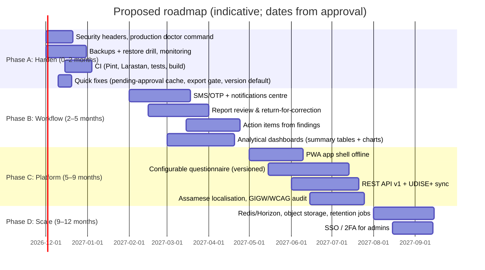

# Future Technology Recommendations, Application Gaps and Modernization Roadmap

19-11-2026. This document is based on the reviewed code, the PRD (v3.0) and its Phase 2 scope, and the Modification V1–V7 requests. These are recommendations only; no development was started.

---

## 1. Application gaps

### 1.1 Functional gaps (what users cannot do today)

| # | Gap | Who is affected | Today | Proposed | Priority |
|---|---|---|---|---|---|
| G1 | **Report review / approval** | Block, District, State officers | Submitted reports are final; only the State Admin can unlock | A review step: higher officer *Accepts* or *Returns for correction* with comments; review status and SLA on the report; audit | High |
| G2 | **Action tracking on findings** | Officers, schools, district | Weaknesses are listed on the rating card but nobody follows them up | "Action items" from weaknesses/suggestions with owner, due date, status; next inspection shows open items | High |
| G3 | **Notifications** | All | None (no SMS/email/in-app) | In-app notification centre + SMS (DLT-registered templates) + email for: registration decision, plan approval/rejection, unlock, report returned | High |
| G4 | **Self-service password reset without email** | Most officers (no email) | Ask the State Admin | OTP over SMS (the `OtpSender` interface and the `otp_verifications` table already exist) | High |
| G5 | **Analytical dashboards** | District/State officers, management | Personal dashboard; rating report; map | Coverage % by area/month, trend of ratings, top 10 weak criteria, officer productivity, overdue schools (not inspected in N months) | High |
| G6 | **Configurable questionnaire** | State Admin | Fixed in code (v2); a change needs a developer | Questions/options/rules in DB with versions (codes stay permanent); preview; the rating scheme linked to the questionnaire version | Medium |
| G7 | **School-to-officer assignment / targets** | District/Block | Any school in the area; plans per day | Monthly targets per officer (e.g. N schools), auto-suggested plans for uncovered schools | Medium |
| G8 | **Integration** | State/national systems | None | REST API (read) for UDISE+ school master sync, state dashboards; import of enrolment so attendance % uses real enrolment | Medium |
| G9 | **Native/installed app experience** | Field officers | Responsive web + offline queue for answers/photos | Installable PWA (manifest + service worker caching the app shell) so the wizard opens without network | Medium |
| G10 | **Languages** | Field officers, school staff | English only | Assamese (and Bengali/Bodo) UI via Laravel localisation | Medium |
| G11 | **In-app help** | New officers | Documents in the repository | Help pages, tooltips, short videos; a printable user manual | Low |
| G12 | **CSV / open data** | Analysts | Excel and PDF | CSV export; anonymised open-data extract | Low |
| G13 | **Data retention** | Department (compliance) | `retention_years` not applied | Archive after 5 years, purge evidence files per policy, logs rotation | Medium |
| G14 | **Accessibility review** | All | Good contrast and touch targets; not formally audited | WCAG 2.1 AA / GIGW 3.0 audit (mandatory for Government of India sites) | Medium |

### 1.2 Technical gaps

| # | Gap | Proposed |
|---|---|---|
| T1 | No CI/CD | GitHub Actions: lint (Pint), static analysis (Larastan), tests, build; deploy script with `config:cache`, `route:cache`, `view:cache`, migrations |
| T2 | No backup/restore procedure in code | Scheduled DB dump + private-disk sync to off-site storage; documented restore drill |
| T3 | No monitoring/alerting | Error tracking (Sentry or self-hosted GlitchTip), uptime check on `/up`, scheduler heartbeat, disk-space alert for evidence |
| T4 | Security headers missing | CSP, HSTS, frame-ancestors, Referrer-Policy, Permissions-Policy (see audit S11) |
| T5 | Database driver for cache/session/queue | Redis for cache and sessions; a queue worker (Supervisor/NSSM) for PDFs, exports, notifications |
| T6 | Limited automated tests on the front end | Vitest (unit) + Playwright (one full inspection on a mobile viewport, incl. offline replay) |
| T7 | Public OSM tiles / OSRM demo server | Self-hosted tile cache and OSRM (Assam extract), or a contracted provider |
| T8 | ClamAV optional | Enable in production; quarantine on detection |
| T9 | MariaDB 10.4 (EOL) locally | Production on MySQL 8.4 LTS or MariaDB 10.11 LTS |
| T10 | Single server assumption | Plan for a load balancer + shared storage for `storage/app/private` (NFS/S3-compatible MinIO) if more than one web node is needed |

---

## 2. Future technology recommendations

| Area | Recommendation | Reason |
|---|---|---|
| Framework | Stay on **Laravel 12 → 13** LTS track; PHP 8.3/8.4 | Current stack is modern; upgrade yearly to stay in support |
| Front end | Keep Blade + ES modules; add **Alpine.js** only if interactivity grows; avoid a full SPA rewrite | Small bundle suits low-end phones; the team already follows this pattern |
| Offline | **PWA**: service worker (Workbox) to cache the app shell and steps; keep IndexedDB queue | Officers often work without network at schools |
| Mobile app (optional) | Wrap the PWA with **Capacitor** only if store distribution or background sync is required | Reuses the web code; no separate native codebase |
| API | Laravel **Sanctum** token API (`routes/api.php`) with versioning (`/api/v1`) | Needed for integrations and a possible native app |
| Notifications | Laravel Notifications with channels: database (in-app), mail, SMS via a DLT-compliant gateway | Built-in, queue-friendly |
| Queue | Redis + Laravel Horizon | Visibility of jobs (PDF, exports, notifications) |
| Search | MySQL FULLTEXT on school name is enough; Meilisearch only if search across 50k+ schools is slow | Avoid infrastructure until needed |
| Analytics | Summary tables refreshed nightly + charts (Chart.js, already Bootstrap-friendly); optional Metabase for management | Fast dashboards without heavy BI cost |
| Storage | S3-compatible object storage (MinIO on-prem / NIC cloud) for evidence via Laravel's `s3` disk | Scales beyond one server; lifecycle rules for retention |
| Maps | Self-hosted vector tiles (OpenMapTiles) or Bhuvan/NIC map services | Government data residency, no usage limits |
| Identity | Optional **SSO** with the state's identity provider / Jan Parichay (OIDC) for officers | Fewer passwords; central off-boarding |
| Security | Add 2FA (TOTP or SMS OTP) for State Admin and user managers; WAF at the edge | Highest-privilege accounts |
| Hosting | NIC / State Data Centre / MeghRaj cloud; HTTPS with an auto-renewing certificate | Government hosting norms |
| Observability | Sentry/GlitchTip, Laravel Pulse for performance | Find slow pages and errors early |

---

## 3. Modernization roadmap

### Phase A: Harden (0–2 months, before or at go-live)
1. Security headers middleware; `APP_DEBUG=false`, `DEMO_LOGINS=false`, secure cookies, explicit `SESSION_LIFETIME`.
2. A `php artisan app:doctor` check that fails on unsafe production settings, missing RSA keys, scheduler not running, ClamAV/SMTP not configured.
3. Daily backups of DB + `storage/app/private`; restore tested.
4. Error tracking and uptime monitoring.
5. CI pipeline.
6. Quick fixes from the audit: cache pending approval count (P1), `export_excel` on all exports (C8), `questionnaire_version` default (D2), remove unused npm package (C6), move raw KML out of `public/` (S18).

### Phase B: Close the workflow loop (2–5 months)
1. SMS gateway + OTP (registration verification, password reset) using the existing `OtpSender` contract.
2. Notification centre (in-app bell) + SMS/email for key events.
3. Report review: new statuses beside `submitted` (e.g. `reviewed`, `returned`) without breaking the lock rule (Domain rule 4); reviewer comments stored in a new table; audited.
4. Action items generated from weaknesses and suggestions, visible on the next inspection of the school.
5. Management dashboards from nightly summary tables.

### Phase C: Platform (5–9 months)
1. PWA (manifest, service worker) on top of the existing offline queue.
2. Configurable questionnaire with versions; current codes migrated as version 2 seed; rating criteria linked to the version.
3. Sanctum API v1 (schools, inspections summary, ratings) and UDISE+ master sync.
4. Localisation (Assamese first) and an accessibility audit (GIGW 3.0 / WCAG 2.1 AA).

### Phase D: Scale and identity (9–12 months)
1. Redis + Horizon; queue PDFs/exports/notifications.
2. Evidence on S3-compatible storage with lifecycle (retention) rules; implement `retention_years`.
3. SSO (OIDC) and 2FA for administrators.

---

## 4. Risks and dependencies

| Risk | Mitigation |
|---|---|
| Changing the questionnaire breaks historical comparisons | Never reuse codes (Domain rule 3); version questionnaires and rating schemes together |
| SMS cost and DLT template approval delays | Start the DLT registration early; keep email/in-app as fallback |
| Offline PWA conflicts with server-side locking | Keep server time and server validation as the source of truth (Domain rule 8); replay queue already idempotent |
| Data protection (DPDP Act 2023) | Retention policy, consent text at registration, access logs (already present), minimal data in exports |
| Third-party map services limits | Self-host or contract before state-wide rollout |

## 5. Quick wins (low effort, visible value)

- Cache the pending-approvals badge (faster every page for approvers).
- "Schools not inspected in the last N months" list per area (one query on existing data).
- CSV export alongside Excel.
- Add screenshots of Map, Schedules and Rating to `docs/screenshots` and to the user manual.
- Show the rating trend (last 3 inspections) on the school page; the data already exists.
