# Inspection Form: screens, flow, code and database

How the School Inspection form works, from the moment an officer finds a school to the locked report. It is written for two readers:
- **Users and trainers:** the screens with screenshots (sections 1–4 and 8).
- **Developers:** the flow charts, the code behind each step and the tables each step writes (sections 5–11).

This document goes deeper into the form than `PROJECT_DOCUMENT.md` (section 4.4) does. Date: 18-11-2026. Questionnaire version 2.

**Screenshots:**
- Taken from the running app with the demo officer **Arjun Saikia**, a Cluster officer (mobile 9000000031).
- They show demo draft #4 and demo report `SI/2026/1801/000001`.
- Evidence photos are blurred on purpose.
- The files are in `docs/screenshots/`. Section 12 says how to take them again.

## Contents
1. [The form at a glance](#1-the-form-at-a-glance)
2. [Before the form: find the school and start](#2-before-the-form-find-the-school-and-start)
3. [The seven steps](#3-the-seven-steps)
4. [Moving between steps, missing items, review and submit](#4-moving-between-steps-missing-items-review-and-submit)
5. [Flow charts](#5-flow-charts)
6. [Database schema of the form](#6-database-schema-of-the-form)
7. [What is saved where: step by step](#7-what-is-saved-where-step-by-step)
8. [The submitted report and PDF](#8-the-submitted-report-and-pdf)
9. [Code walkthrough](#9-code-walkthrough)
10. [Security and data rules](#10-security-and-data-rules)
11. [Tests that cover the form](#11-tests-that-cover-the-form)
12. [Taking the screenshots again](#12-taking-the-screenshots-again)

---

## 1. The form at a glance

| Step | Title in the app | What the officer records | Stored in | Required to submit |
|---|---|---|---|---|
| 1 | Condition of the School | Person met at the school, and 26 building and facility questions (Yes/No and choices) | `inspection_answers` (`BAS_PERSON_*`, `CND_01`–`CND_26`) | Yes. Every visible, enabled question |
| 2 | Teacher's & Student's Information | 13 numbers: students present and absent, benches, teachers by type, teachers present, trained and untrained | `inspection_answers` (`TSI_01`–`TSI_13`) | Yes. All 13 |
| 3 | Teachers Absentee Form | One row per absent teacher: name, type, reason for leave | `inspection_absent_teachers` | No. Leave it empty if all were present; a warning shows if the numbers don't match |
| 4 | Class Room Performance | One row per class observed: teacher, class, subject, TLM used, participation, remarks | `inspection_classroom_observations` | Yes. At least 1 row |
| 5 | Fund Received & Expenditure | Per financial year, in lakh: received and spent for ASG, MDM, Government and Other | `inspection_fund_positions` | No (optional) |
| 6 | School Governance | 24 questions (`GOVR_01`–`GOVR_24`) plus up to 3 suggestions | `inspection_answers`, `inspection_remarks` | Yes. Every visible question |
| 7 | Photographs of School | 4 mandatory photos (School, Toilet Block, ICT/Smart Class, Classroom Transaction), extra photos, documents | `inspection_evidence`, plus files on the `private` disk | Yes. 1 photo in each of the 4 categories, all uploaded |
| — | Review & Submit | All answers on one page, with the missing items listed | `inspections` (status, number, GPS) | Confirm tick |

**Key behaviour:**
- **Auto-save:** every answer is saved to the server as soon as it is given. There is no "Save" button.
- **Free movement:** the officer can open the steps in any order, leave, and continue later from the dashboard ("Continue where you left off").
- **Submit:** blocked until everything required is done. After submit the inspection gets its number (`SI/<year>/<district code>/<6 digits>`) and is locked.

---

## 2. Before the form: find the school and start

### 2.1 Sign in and dashboard
| Login | Dashboard |
|---|---|
| 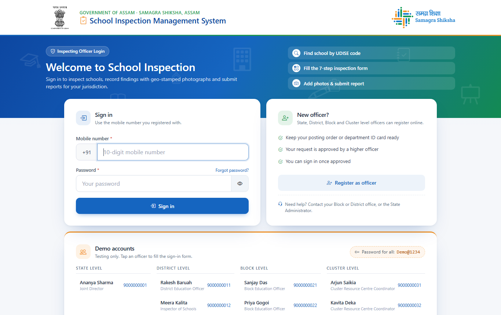 | 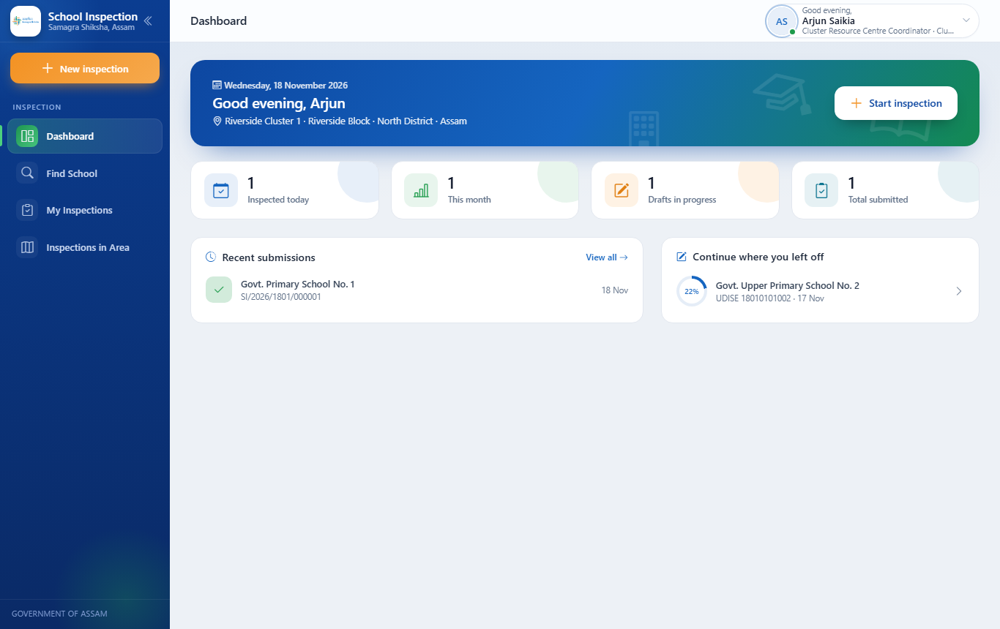 |

The dashboard shows:
- **Start inspection** and **New inspection** buttons
- counts for today, this month, drafts and total submitted
- **Continue where you left off**: open drafts with their completion %

### 2.2 Find the school
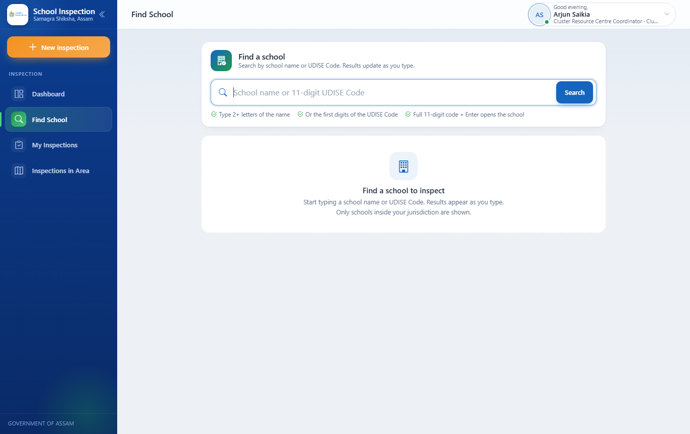

- **Find School** lists only the schools in the officer's own area (`JurisdictionService`).
- Search by UDISE code or name, or filter by block and cluster.
- Badges warn when a school is being inspected by another officer, or was already inspected this month.

### 2.3 School page and the Start button
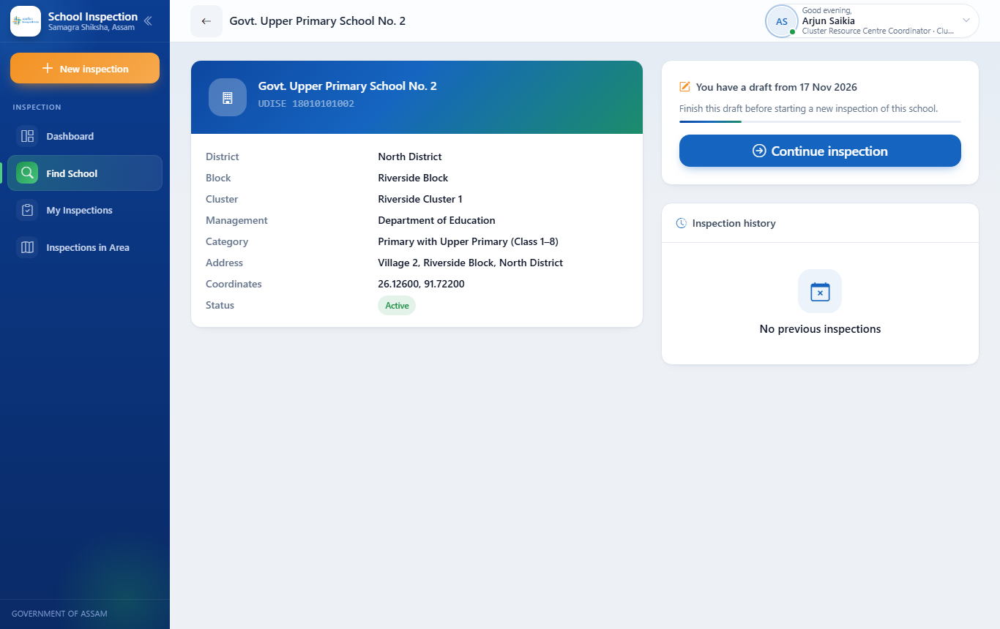

The right-hand card changes with the start rules:
- **Start inspection:** no blocking inspection exists.
- **Continue inspection:** the officer already has an open draft for this school (shown above).
- **Blocked:** another officer's draft is open, or the school was completed by another officer this month. The message names the officer and the date the school opens again.

Pressing **Start** sends the phone's GPS position (`lat`, `lng`, `accuracy`) with `POST /schools/{school}/inspections`. The start rules are in section 5.2.

---

## 3. The seven steps

Every step page has the same frame:
- **Top:** the school name, UDISE, the date and the overall progress %, plus a "Saved hh:mm:ss" indicator.
- **Stepper:** 7 steps plus Review. Each shows Not started, In progress (n left), Done or "You are here", and can be tapped to jump to that step.
- **Officer card:** officer, school, server date and time, and the start location with its distance from the school.
- **Bottom bar:** Back, "n left in this step", and Next (Review on step 7). Below it is **Cancel this draft**.

### Step 1: Condition of the School
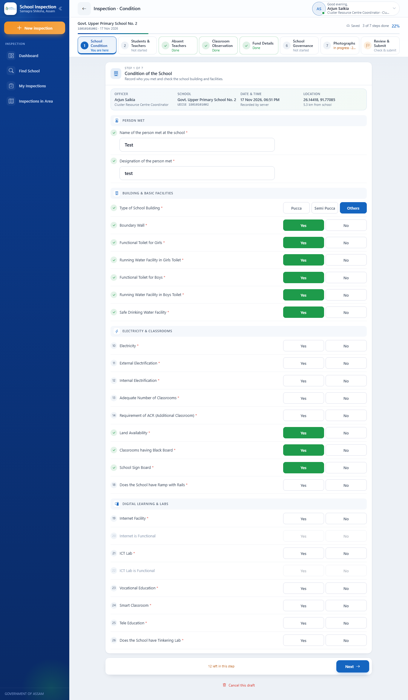

- **Person met (Modification V9: no longer asked):** `BAS_PERSON_NAME` and `BAS_PERSON_DESIG` are marked `hidden` in the definition, so they are not rendered and not required. The codes are kept. Older inspections still show the person met on the report and the PDF, and in the Excel column.
- **Building and basic facilities:** `CND_01` building type (Pucca / Semi Pucca / Others) and `CND_02`–`CND_08` Yes/No.
- **Electricity and classrooms:** `CND_09`–`CND_16`.
- **Digital learning and labs:** `CND_17`–`CND_26`.
- **Dependent questions:**
  - **Greyed out** (`enable_if`): `CND_18` "Internet is Functional" is enabled only when `CND_17` = Yes, and `CND_20` only when `CND_19` = Yes. They stay on screen but greyed. When the parent changes to No, the saved child answer is **cleared on the server**.
  - **Hidden** (`show_if`): `CND_25` (agency) and `CND_26` (Tinkering lab functional) appear only when `CND_24` = Yes.
- A tick next to a question means it is saved. A red star means it is required.

### Step 2: Teacher's & Student's Information
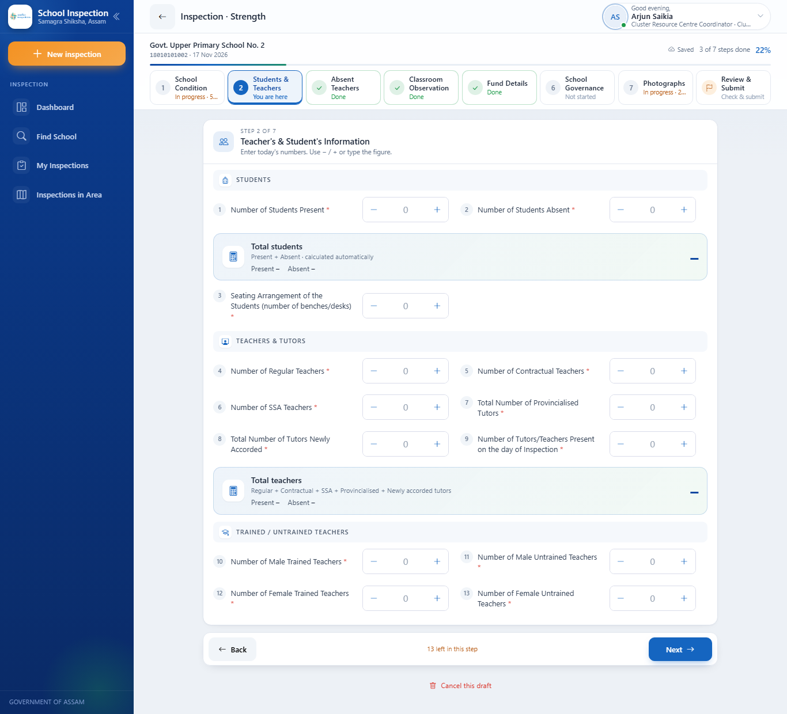

- 13 whole numbers (`TSI_01`–`TSI_13`), with − and + buttons. The server accepts only 0–100,000.
- **V10 Step 2 change rolled back (21-11-2026):** V10 briefly replaced the male / female counts with two totals (`TSI_14` Total trained, `TSI_15` Total untrained). That was rolled back the same day: the four counts `TSI_10`–`TSI_13` are asked again.
  - `TSI_14` / `TSI_15` are kept as hidden codes (no default, never reused). An inspection saved with only those totals still shows them on the report and the PDF (`QuestionnaireDefinition::totalsOnlyBreakdown()`), and its rating uses them.
- **Optional counts (Modification V9):** `TSI_05` Contractual, `TSI_06` SSA, `TSI_07` Provincialised, `TSI_08` Newly accorded and `TSI_09` Present are not required. Since 20-11-2026 this also applies to `TSI_10`–`TSI_13` (male / female, trained / untrained).
  - They have `'default' => 0`: the box shows 0 with the hint "Enter 0 if none".
  - A blank value counts as 0 in the totals (`QuestionnaireDefinition::withDefaults()`).
  - At submit, a blank value is stored as 0.
- **Automatic totals (display only, not stored):**
  - total students = present + absent
  - **Total teachers** = regular + contractual + SSA + provincialised + newly accorded tutors. Since V9 the box sits **above** the teacher numbers and shows only the total (no Present / Absent).
- **Blocking:** teachers present more than the total; trained/untrained (and male/female) more than the total.

### Step 3: Teachers Absentee Form
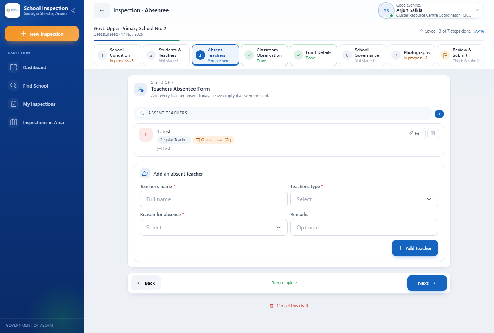

> **Completion (20-11-2026):** the step shows **Not started** until the officer acts, and becomes **Done** when at least one absent teacher is added **or** the switch **ABS_00 "All teachers present"** is ticked. Both together is an error ("remove the absent teachers, or untick"). While rows exist, the switch is locked; when it is ticked, the add form is hidden. Required before Submit.

- Add one row per absent teacher:
  - **name** (2–120 characters)
  - **type:** Regular Teacher / Contractual Teacher / Tutor
  - **reason:** CL, EL, Maternity Leave, CCL, Study Leave, Medical Leave, Un-authorised Leave
  - **remarks** (optional)
- Rows can be edited and deleted. Every change returns the new list and the progress.
- **Limit (Modification V9, blocking):** at most **Total teachers − Present** absent teachers (`InspectionValidator::absentLimit()`).
  - The counter shows "added / allowed", and the Add button rests once the limit is reached.
  - The server refuses one more row with a 422. A replay of a saved `row_uid` is still accepted.
  - If step 2 is lowered later, the extra rows block Submit.
- **Warning (does not block):** step 2 shows 3 teachers absent but only 1 row was entered.
- **One line per teacher (Modification V10):** the list, the review / report table and the PDF keep each absent teacher on a single line: name, **Type** and **Reason for absence** (chips that do not wrap), remarks (shortened, full text on hover), actions. On phones, Type and Reason now both show, side by side under the name.

### Step 4: Class Room Performance
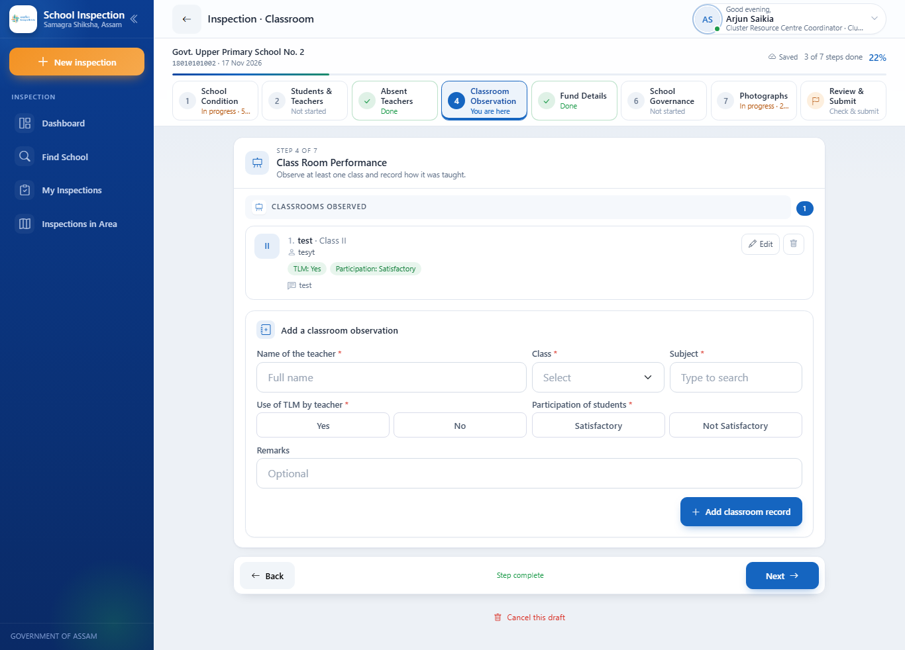

- One row per class observed:
  - **teacher name**
  - **class** (I–XII)
  - **subject:** autocomplete from the subject master (`GET /subjects/suggest`); free text is also allowed
  - **TLM used** (Yes/No)
  - **TLM items used** (FLN and ECCE TLM lists, shown when TLM = Yes)
  - **participation** (Satisfactory / Not Satisfactory)
  - **remarks**
- **At least one row is required** to submit.

> **FLN TLM list (20-11-2026, `Documents/FLN TLM list_2026-27.docx`):**
> - When **Use of TLM by teacher = Yes**, a list of TLM items appears. The officer ticks every item used (several are allowed).
> - The list shows **every active item, grouped by class**, whatever class is observed: Class I, Class II, …, and "All classes" last. Each group shows how many items are ticked. The document gives:
>   - Class I: 6 items (Karjyapatra Vidya Pravesh / Literacy / Numeracy, Reading Books, English Activity Book, HPC)
>   - Class II: 5 items
> - **At least one item must be ticked** when the class has items. This is checked in the browser and by the server: 422 on `tlm_items`, "Tick at least one TLM item used."
>   - An inactive or unknown item is refused. A row keeps an item it already has.
>   - With TLM = No, the ticks are cleared.
> - The items come from the **TLM Master** (`tlm_items`, Admin → TLM Master, `manage_masters`). The admin can:
>   - add an item: class or All classes, name, serial no / code, variety, order, remarks
>   - the list is a table with Sl., Class, Name of item and Serial no / Code only ("NA" when there is no code)
>   - edit an item
>   - make an item inactive
> - Items are never deleted. An inactive item is no longer offered, but older rows keep it.
> - The ticks are stored in `inspection_classroom_tlm`.
>   - The report, the review and the PDF show "Yes: item · code, …".
>   - An offline replay (same `row_uid`) stores the same ticks again without duplicating them.

> **ECCE TLM list (Modification V10, 21-11-2026, `Documents/TLM -2025-26-ECCE (1).docx`):**
> - The TLM picker shows **two lists**, each under its own heading: **FLN TLM (2026-27)** first (grouped by class, as above), then **ECCE TLM (2025-26)** (grouped by its group). Both lists are offered for every class.
>   - TLM for students (2): Alphabet and Number Tracing Card, Number Dot Domino
>   - TLM for schools (11): Alphabet Card, Number Card, Picture Story, Picture Reading Poster, Poem Poster, Sound Domino, Pre Number Concept Card, Sequential Thinking Card, Self Corrective Puzzle, Jig Saw Puzzle, User Manual
> - The "at least one tick" rule counts ticks in both lists.
> - `tlm_items.list` (`fln` / `ecce`) and `tlm_items.section` (the group) were added; the unique key is now (list, class, name), so the same name may be in both lists.
> - The two lists are told apart by colour everywhere (21-11-2026): **FLN in blue** (book icon) and **ECCE in orange** (balloon icon). On step 4 each list is a card with a coloured header and a live "n ticked" count. Saved rows, the Review / report page and the PDF show the ticks as two coloured groups ("FLN TLM (2026-27)", "ECCE TLM (2025-26)") with counts, and the Use of TLM cell carries "FLN n" / "ECCE n" badges. The Review page also has a summary strip: observed, using TLM, FLN items, ECCE items, satisfactory. (`InspectionClassroomObservation::tlmGroups()` / `tlmSummary()`; `tlmText()` and the `tlm_items` strings still read "ECCE · Number Card".)
> - TLM Master: a list filter (All lists / FLN / ECCE), a List column, and List + Group in the add and edit forms.

> **20-11-2026: totals and layout**
> - **Trained / untrained and male / female:** a blank count is 0. The four totals are calculated automatically in a 2×2 box:
>   - Trained = Male trained + Female trained
>   - Untrained = Male untrained + Female untrained
>   - Male = Male trained + Male untrained
>   - Female = Female trained + Female untrained
> - The four totals must not add up to more than Total teachers (blocking).
> - **Lists:** Absent teachers, Classrooms observed and Saved years show as a clean table on wide screens: a header strip, Sl., chips and amounts aligned right. On phones each row becomes a card with labelled fields.
> - On the review and report pages, the absent teachers and the classroom performance (with the TLM items used) are tables. They stack into cards on phones.

> **21-11-2026: total trained / untrained only, equal to Total teachers**
> - The four counts (`TSI_10`–`TSI_13`) are still entered, but the box under them shows only **Total trained** (Male trained + Female trained) and **Total untrained** (Male untrained + Female untrained). Male and Female totals are no longer shown on the form, the report or the PDF.
> - Trained + Untrained must be **equal to** Total teachers (blocking). The box shows "Equal to Total teachers", "Less than Total teachers: N more to count" or "More than Total teachers". Blank counts are 0, so the counts must be filled whenever Total teachers is more than 0.

> **Field size (20-11-2026):** every input, dropdown, number box and button uses the portal standard: **14 px text, 40 px tall** on desktop and tablet, and 16 px / 44 px on phones (no iOS zoom, easy to tap).

### Step 5: Fund Received & Expenditure
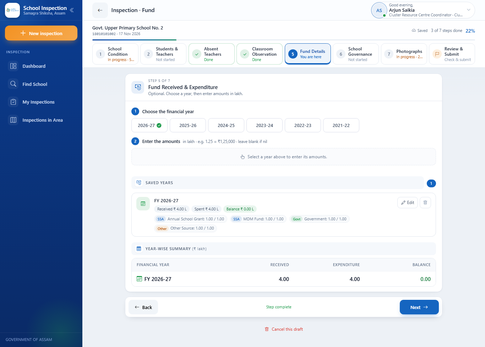
> **Modification V9 (20-11-2026):** fund details are **optional** again. The step counts as done with no year saved, and Submit is not blocked.
> - Amounts are formatted when the officer leaves the box: `.2` → `0.20`, `5` → `5.00`.
> - An amount with more than 2 decimals, or one over 99,999, shows an error at once. The server rule is still `decimal:0,2`.

1. **Choose the financial year:** the current one and the 5 before it, e.g. `FY-2026-27`.
2. **Enter the amounts in lakh** (up to 2 decimals, 0–99,999), received and expenditure for each head:
   - Annual School Grant
   - MDM Fund
   - Government
   - Other Source

At least one amount is needed per year. Saving the same year again **updates** that year; there is one row per year (unique key). The **year-wise summary** shows received, expenditure and balance. The step is optional.

### Step 6: School Governance
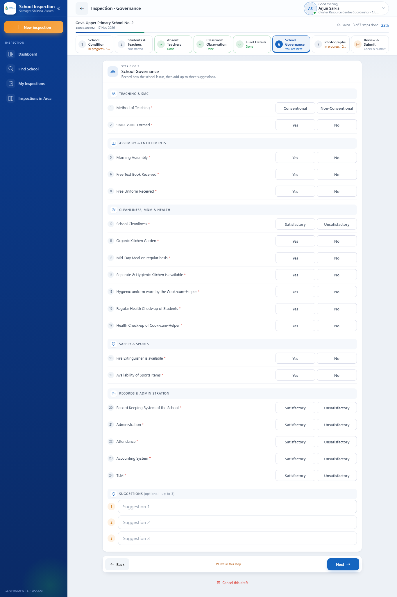

- `GOVR_01` Method of Teaching, `GOVR_02`–`GOVR_19` Yes/No, and `GOVR_20`–`GOVR_24` Satisfactory / Unsatisfactory.
- **Reason boxes appear only when the answer is No,** and are then required:
  - `GOVR_03`: SMC not formed
  - `GOVR_07`: no free text books
  - `GOVR_09`: no free uniform
  - `GOVR_13`: Mid-Day Meal irregular
- `GOVR_04` (monthly SMC sitting) appears only when `GOVR_02` = Yes.
- **Suggestions:** up to 3 free-text lines, each up to 500 characters. They are saved 0.9 s after typing stops.

### Step 7: Photographs of School
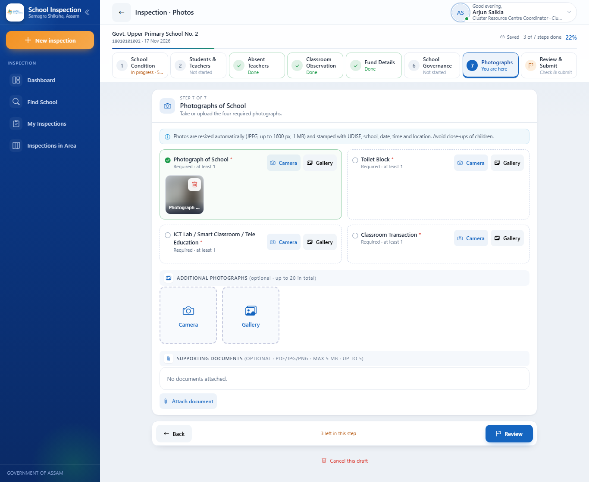

- **Four mandatory slots** (from `config('inspection.mandatory_photos')`): Photograph of School, Toilet Block, ICT Lab / Smart Classroom / Tele Education, Classroom Transaction. Each slot has **Camera** (the in-app camera) and **Gallery** (the phone gallery).
- **Additional photographs:** optional, up to 20 photos in total.
- **Supporting documents:** optional, PDF/JPG/PNG, up to 5 MB each, at most 5.

**What happens to each photo on the phone, before upload:**
1. It is resized so the longest side is at most 1600 px.
2. A strip is stamped at the bottom. It shows the UDISE code and school, the date and time, the GPS position (or "No location"), and the officer. Gallery photos also get "From gallery".
3. It is saved as JPEG, and the quality is lowered until the file is under about 950 KB.
4. A SHA-256 fingerprint and a random `evidence_uid` are made.
5. It is uploaded in the background. On a weak network the upload is retried after 3 s, 8 s and 20 s; a failed photo shows a **Retry** button.

| Phone: step 1 | Phone: step 7 |
|---|---|
| 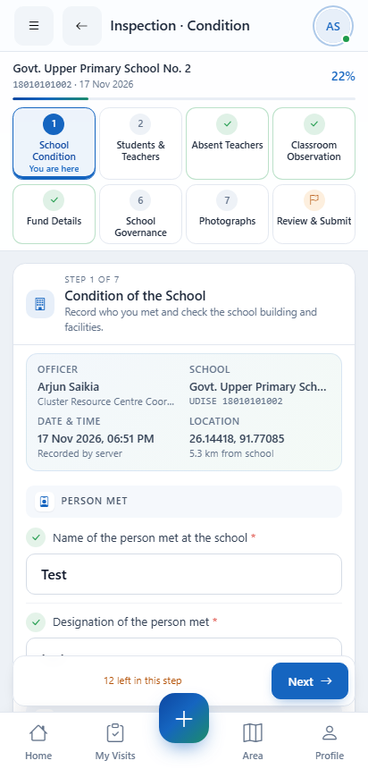 | 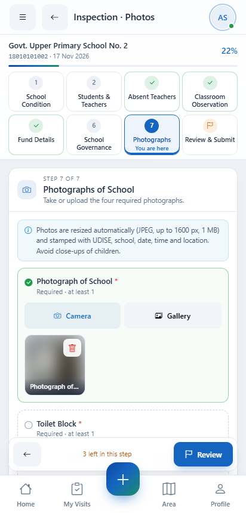 |

On a phone, the stepper wraps into a grid and the bottom navigation bar (Home, My Visits, +, Area, Profile) replaces the sidebar.

---

## 4. Moving between steps, missing items, review and submit

### 4.1 "Items still to fill" when leaving a step
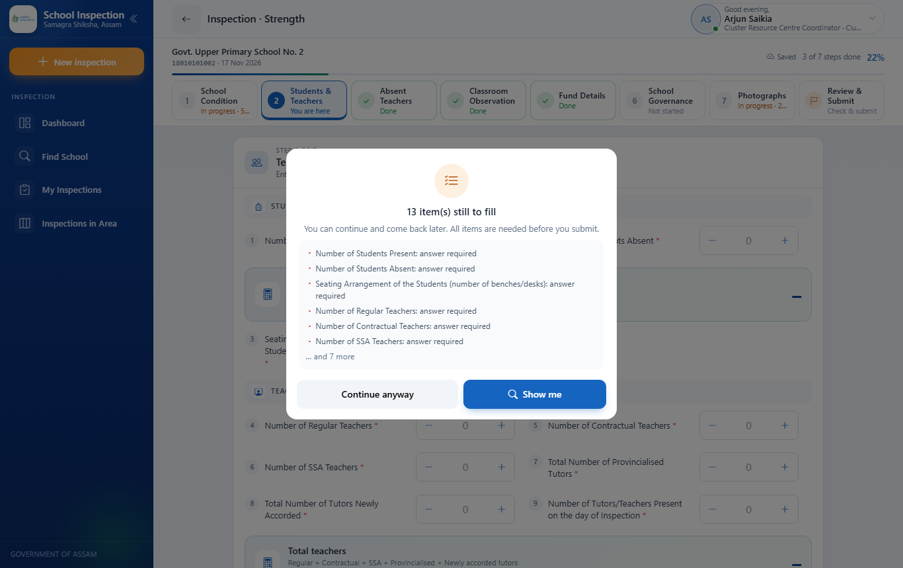

- **Next** first waits until every pending save has finished.
- If the step still has missing items, the officer sees this dialog with a list of them:
  - **Show me** marks each missing question in red and scrolls to the first one.
  - **Continue anyway** moves on. Nothing is lost; the items are only needed before submit.
- If saves or uploads are still running, the browser asks before the page is closed.

### 4.2 Review & Submit
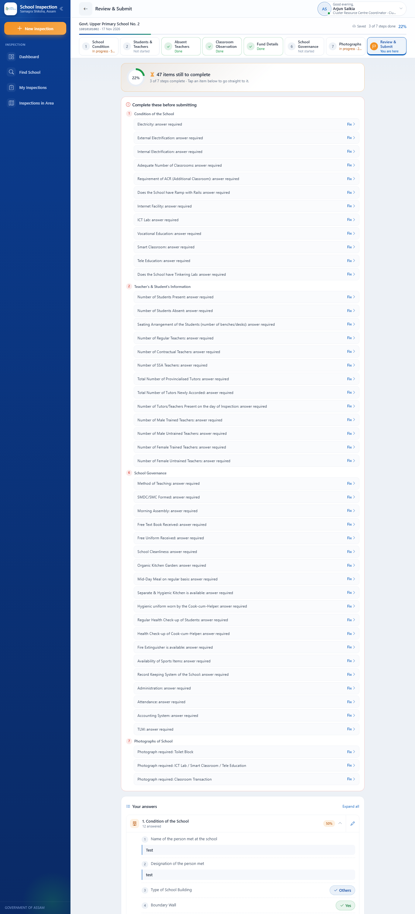

- **Review** shows every answer, grouped by step, and lists all missing items with a link straight to the question (`step/N#q-CODE`).
- **Submit** works only when nothing is missing and the officer ticks "I confirm that the information is correct". The phone's GPS position at submit is stored as well.
- If the session expired, the officer sees "Your answers are saved. Please sign in again" and is sent to the login page. No answers are lost, because each one was already saved.

---

## 5. Flow charts

### 5.1 The whole form, end to end
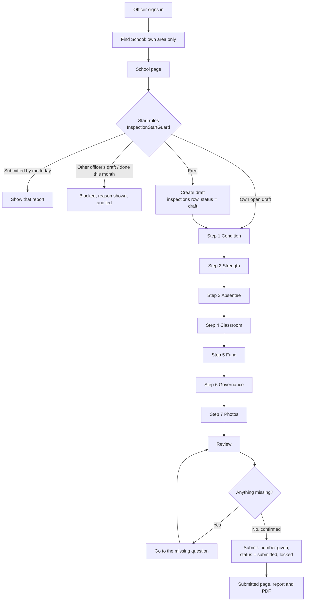

### 5.2 Start rules (`InspectionStartGuard::check`, inside a DB transaction with the school row locked)
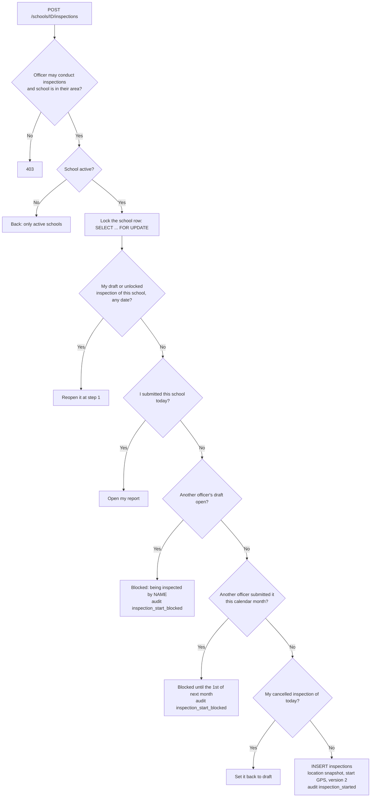
- Cancelled inspections never block anyone.
- The unique key `(officer_id, school_id, inspection_date)` is the final guard. If two taps arrive together, the second insert fails and the existing row is opened instead.

### 5.3 Auto-save of one answer
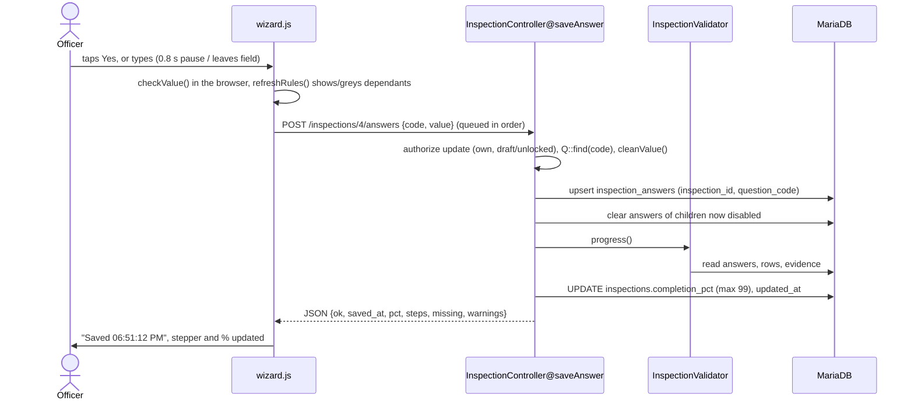
- **Order:** all saves go through one promise chain (`queue()`), so they reach the server in the order they were made.
- **Errors:**
  - A 422 error appears under the question.
  - 401 or 419 (session ended) sends the officer to the login page.
  - No network shows "No connection. Your change will be saved when you edit it again".

### 5.4 Photo capture and upload
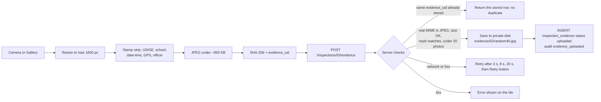

### 5.5 Submit
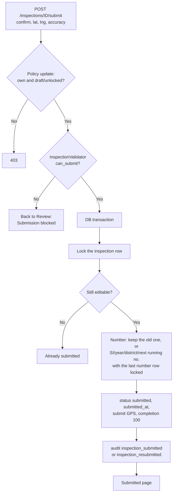

### 5.6 Life cycle
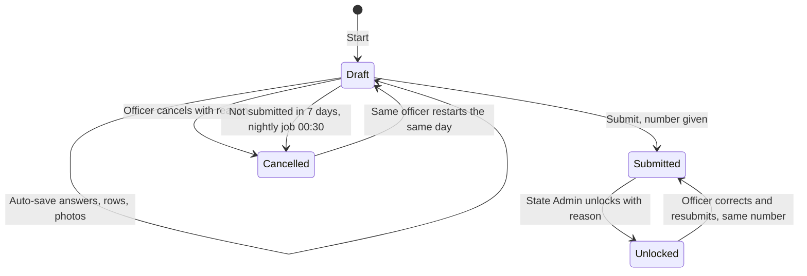

---

## 6. Database schema of the form

### 6.1 Relationship diagram
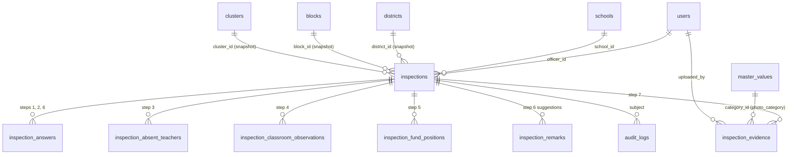

### 6.2 `inspections`: one row per inspection (the header)
| Column | Type | Meaning |
|---|---|---|
| `id` | bigint PK | |
| `inspection_no` | varchar(40), unique, null | `SI/2026/1801/000001`, given at the first submit |
| `officer_id` | FK users | The inspecting officer (owner of the draft) |
| `school_id` | FK schools | |
| `inspection_date` | date | **Server** date of the start |
| `started_at`, `submitted_at` | timestamp | Server times |
| `district_id`, `block_id`, `cluster_id` | FK | **Snapshot** of the school's location on the inspection date. Area reports use these, so a later school transfer does not move old reports |
| `state_code`, `district_code`, `block_code`, `cluster_code` | varchar | Code snapshot. `district_code` is used in the number |
| `start_lat/lng/accuracy`, `submit_lat/lng/accuracy` | decimal | Phone GPS at start and at submit |
| `person_met_name`, `person_met_designation` | varchar(120) | Copy of `BAS_PERSON_*` for lists |
| `status` | enum draft, submitted, unlocked, cancelled | |
| `completion_pct` | tinyint | 0–99 while editing, 100 when submitted |
| `questionnaire_version` | tinyint | 2 = current form. Version 1 rows are legacy |
| `unlocked_by`, `unlocked_at`, `unlock_reason` | | Set by the State Admin unlock |
| `cancelled_reason` | text | |
| `created_at`, `updated_at`, `deleted_at` | | `updated_at` = last activity (used by the draft expiry) |

**Keys:**
- `UNIQUE(officer_id, school_id, inspection_date)`: one per officer, school and day.
- `UNIQUE(inspection_no)`.
- Indexes:
  - `(status, inspection_date)`
  - `(school_id, status, inspection_date)`: start rules, school history
  - `(officer_id, status, inspection_date)`: My Inspections, dashboard
  - `(district_id|block_id|cluster_id, status, inspection_date)`: area lists

### 6.3 `inspection_answers`: steps 1, 2 and 6 (one row per question)
| Column | Type | Meaning |
|---|---|---|
| `inspection_id` | FK, cascade delete | |
| `step` | tinyint | 1, 2 or 6 |
| `question_code` | varchar(20) | Permanent code, e.g. `CND_17`, `TSI_04`, `GOVR_02`. **Never renamed or reused** |
| `value` | JSON, null | `"yes"`, `"pucca"`, `12`, `"Head Teacher"`; `null` when cleared |
| `remarks` | text | Per-question remarks |

`UNIQUE(inspection_id, question_code)`: the auto-save is an upsert on this key. A complete version 2 form has **65 rows** (2 person, 26 condition, 13 numbers, 24 governance), minus any hidden questions.

Example rows after step 1 of draft #4:
| inspection_id | step | question_code | value |
|---|---|---|---|
| 4 | 1 | BAS_PERSON_NAME | "Test" |
| 4 | 1 | CND_01 | "others" |
| 4 | 1 | CND_02 | "yes" |

### 6.4 `inspection_absent_teachers`: step 3
| Column | Type | Meaning |
|---|---|---|
| `inspection_id` | FK, cascade | |
| `teacher_name` | varchar(120) | |
| `teacher_type` | varchar(20) | `regular`, `contractual`, `tutor` |
| `reason` | varchar(20) | `CL`, `EL`, `MATL`, `CCL`, `SL`, `MEDL`, `UL` |
| `status` | varchar(30), null | Version 1 only (legacy) |
| `remarks` | text | |

### 6.5 `inspection_classroom_observations`: step 4
| Column | Type | Meaning |
|---|---|---|
| `inspection_id` | FK, cascade | |
| `teacher_name` | varchar(120) | |
| `class` | varchar(4) | `I` … `XII` |
| `subject` | varchar(100) | From the subject master or free text |
| `tlm_used` | boolean | |
| `participation` | varchar(20) | `satisfactory`, `not_satisfactory` |
| `remarks` | text | |

TLM items ticked: `inspection_classroom_tlm` (`classroom_observation_id` FK cascade, `tlm_item_id` FK restrict; composite PK). The master `tlm_items` has these columns: `class` (null = all classes), `name`, `code`, `variety`, `remarks`, `sort`, `is_active`, with a unique key on (`class`, `name`).

### 6.6 `inspection_fund_positions`: step 5 (one row per financial year)
| Column | Type | Meaning |
|---|---|---|
| `inspection_id` | FK, cascade | |
| `financial_year` | varchar(12) | `FY-2026-27` |
| `asg_received`, `asg_expenditure` | decimal(10,2) | Annual School Grant, in lakh |
| `mdm_received`, `mdm_expenditure` | decimal(10,2) | MDM fund |
| `govt_received`, `govt_expenditure` | decimal(10,2) | Government |
| `other_received`, `other_expenditure` | decimal(10,2) | Other source |
| `fund_category_id`, `amount_received`, `amount_utilised` | | Version 1 only (legacy) |

`UNIQUE(inspection_id, financial_year)`, so saving a year again updates its row (`updateOrCreate`).

### 6.7 `inspection_remarks`: step 6 suggestions
| Column | Type | Meaning |
|---|---|---|
| `inspection_id` | FK, cascade | |
| `type` | enum suggestion, general, classroom_note, inspection_remark | The form writes `suggestion` |
| `sort` | tinyint | 1–3 |
| `body` | text | Up to 500 characters |

Saving replaces all suggestions of the inspection in one transaction (delete, then insert).

### 6.8 `inspection_evidence`: step 7 photos and documents
| Column | Type | Meaning |
|---|---|---|
| `evidence_uid` | uuid, **unique** | Made on the phone. A retry with the same uid never makes a duplicate |
| `inspection_id` | FK, restrict | Evidence is never deleted with the inspection by accident |
| `kind` | enum photo, document | |
| `source` | enum camera, gallery | Gallery photos are labelled "From gallery" |
| `category_id` | FK master_values | `photo_category`: `school`, `toilet_block`, `ict_smart`, `classroom_transaction`, … |
| `question_code` | varchar(20), null | For a photo tied to a question |
| `caption` | varchar(150) | |
| `taken_at` | timestamp | Device time |
| `received_at` | timestamp | **Server** time |
| `latitude`, `longitude`, `accuracy` | decimal | GPS at capture |
| `no_location_reason` | varchar(255) | Required when a photo has no GPS |
| `original_name`, `mime`, `size_bytes` | | `mime` is detected from the file content |
| `storage_path` | varchar | `evidence/{inspection_id}/{random 40}.jpg` on the **private** disk |
| `sha256` | char(64), indexed | Checked against the hash sent by the phone |
| `status` | enum pending, uploaded, failed | Only `uploaded` photos count |
| `uploaded_by` | FK users | |

### 6.9 Related tables used by the form
| Table | Use |
|---|---|
| `schools`, `districts`, `blocks`, `clusters`, `states` | School and its location (copied as a snapshot at start) |
| `users`, `user_jurisdictions` | Officer and area (`JurisdictionService`) |
| `master_values` | `photo_category`, `subject` (step 4 autocomplete) |
| `audit_logs` | `inspection_started`, `inspection_start_blocked`, `inspection_restarted`, `evidence_uploaded`, `evidence_deleted`, `evidence_downloaded`, `inspection_submitted`, `inspection_resubmitted`, `inspection_cancelled`, `inspection_unlocked` |
| `sessions` | Login session, 20 minutes idle |

---

## 7. What is saved where: step by step

| Action on screen | HTTP request | Controller method | Tables written | Response |
|---|---|---|---|---|
| Press Start on a school | `POST /schools/{school}/inspections` | `InspectionController@start` | `inspections` (insert, or reopen), `audit_logs` | Redirect to step 1 |
| Open a step | `GET /inspections/{id}/step/{1-7}` | `@step` | None (except an old version 1 draft being upgraded to version 2) | HTML page |
| Answer a question or remarks (steps 1, 2, 6) | `POST /inspections/{id}/answers` `{code, value \| remarks}` | `@saveAnswer` | `inspection_answers` (upsert, clear disabled children), `inspections` (completion %, person met) | JSON progress |
| Add, edit or delete an absent teacher | `POST`, `PUT`, `DELETE /inspections/{id}/teachers[/{teacher}]` | `@addAbsentTeacher`, `@updateAbsentTeacher`, `@removeAbsentTeacher` | `inspection_absent_teachers`, `inspections` | JSON rows + progress |
| Add, edit or delete a classroom | `POST`, `PUT`, `DELETE /inspections/{id}/classrooms[/{classroom}]` | `@addClassroom`, `@updateClassroom`, `@removeClassroom` | `inspection_classroom_observations`, `inspections` | JSON rows + progress |
| Subject autocomplete | `GET /subjects/suggest?q=` | `@subjectSuggestions` | None | JSON, up to 10 names |
| Save or delete a fund year | `POST /inspections/{id}/funds`, `DELETE …/funds/{fund}` | `@addFund`, `@removeFund` | `inspection_fund_positions`, `inspections` | JSON rows + progress |
| Type suggestions | `POST /inspections/{id}/suggestions` | `@saveSuggestions` | `inspection_remarks`, `inspections` | JSON progress |
| Take or pick a photo, attach a document | `POST /inspections/{id}/evidence` (multipart) | `EvidenceController@store` → `EvidenceStorage::store` | `inspection_evidence`, file on the `private` disk, `audit_logs` | JSON tile (201) |
| Delete a photo before submit | `DELETE /evidence/{evidence}` | `EvidenceController@destroy` | Row and file removed, `audit_logs` | JSON |
| View or download a photo | `GET /evidence/{evidence}[?download=1]` | `EvidenceController@show` | `audit_logs` (download only) | Image |
| Refresh the progress after an upload | `GET /inspections/{id}/progress` | `@progress` | `inspections` (completion %) | JSON progress |
| Review | `GET /inspections/{id}/review` | `@review` | None | HTML |
| Submit | `POST /inspections/{id}/submit` | `@submit` + `InspectionNumberGenerator` | `inspections`, `audit_logs` | Redirect to the submitted page |
| Cancel the draft | `POST /inspections/{id}/cancel` `{reason}` | `@cancel` | `inspections`, `audit_logs` | Redirect to My Inspections |
| Unlock (State Admin) | `POST /inspections/{id}/unlock` `{reason}` | `@unlock` | `inspections`, `audit_logs` | Back |

**The progress JSON** returned by every save (example values):
```json
{
  "ok": true, "saved_at": "06:51:12 PM", "pct": 22,
  "steps": { "1": {"required": 28, "done": 16, "complete": false, "pct": 53}, "...": {} },
  "missing": { "1": [{"code": "CND_09", "message": "External Electrification: answer required"}] },
  "warnings": { "3": ["3 teacher(s) appear absent; 1 entered in the absentee form."] }
}
```
The browser uses it to update the % bar, the stepper badges and "n left in this step", without reloading the page.

---

## 8. The submitted report and PDF
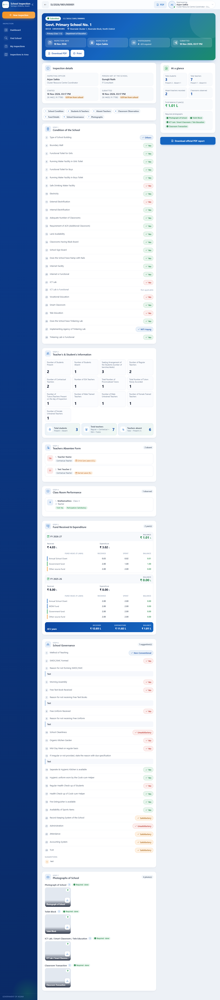

`GET /inspections/{id}` (`ReportController@show`) shows:
- a header with the status, the inspection number, the school and the area
- the date, the officer, the photo count and the submit time
- an **At a glance** panel: total students and teachers, absent teachers recorded, classrooms observed, fund balance and the required photos
- every step's answers. Yes, No and Satisfactory answers are coloured; fund years have totals.
- the photos by category. They are served only through `EvidenceController@show`, after a permission check.

**Download PDF** (`/inspections/{id}/pdf`) gives the official printable report (dompdf, `inspections/pdf.blade.php`).

**Ratings (Modification V9):**
- The automatic rating is still calculated at submit.
- It is **not shown** on the report, the lists, the school page, the map, the sidebar Rating Report or the Excel export unless `RATING_DISPLAY=true` (`config('inspection.rating.display')`, default false).
- The **Rating Report** (`/reports/ratings`) is for the **State Administrator only**. Every other officer gets 403 and no sidebar link. The State Admin sees it even with the switch off.
- These are removed for good:
  - the rating section of the inspection PDF
  - the Rating Report PDF (route `reports.ratings.pdf`)
- The State Admin keeps Rating Settings.

**Who can open a report** (`InspectionPolicy@view`):
- its officer, always
- users with *view reports* whose area covers the inspection, but **only once it is not a draft**

---

## 9. Code walkthrough

### 9.1 Files
| Layer | File | Role |
|---|---|---|
| Routes | `routes/web.php` (the `inspections/{inspection}` group) | All form endpoints, behind the `auth`, `active` and `password.fresh` middleware. Uploads use the `throttle:uploads` limiter |
| Definition | `app/Questionnaire/QuestionnaireDefinition.php` | **The form itself**: `steps()` (7 steps), `questions()` (codes, labels, types, options, `show_if`, `enable_if`, `required_if`), totals, labels. `VERSION = 2` |
| Rules | `app/Questionnaire/InspectionValidator.php` | Server-side rules: `visible`, `enabled`, `required`; `missing()` (blocking), `warnings()` (hints) and `progress()` (per-step and overall %, `can_submit`) |
| Controller | `app/Http/Controllers/InspectionController.php` | Start, step pages, auto-save, the repeating rows, fund, suggestions, review, submit, cancel, unlock |
| Controller | `app/Http/Controllers/EvidenceController.php` | Upload, delete and view photos and documents |
| Services | `app/Services/InspectionStartGuard.php` | The 4 start rules (section 5.2) |
| | `app/Services/InspectionNumberGenerator.php` | `SI/{year}/{district}/{000001}`, under a row lock |
| | `app/Services/EvidenceStorage.php` | Checks the real MIME, size, SHA-256 and ClamAV (when configured), then makes the private file and row. Idempotent on `evidence_uid` |
| | `app/Services/JurisdictionService.php` | Area checks (`coversSchool`, `coversInspection`) |
| | `app/Services/AuditLogger.php` | Append-only audit log |
| Policy | `app/Policies/InspectionPolicy.php` | `view`, `update` (own and draft/unlocked), `cancel` (own draft), `unlock` (State Admin, submitted only) |
| Models | `app/Models/Inspection*.php` | `Inspection` (`answerMap()`, `isEditable()`), `InspectionAnswer`, `InspectionAbsentTeacher` (`TYPES`, `REASONS`), `InspectionClassroomObservation` (`CLASSES`, `PARTICIPATION`), `InspectionFundPosition` (`AMOUNT_COLUMNS`, `financialYears()`), `InspectionEvidence` |
| Views | `resources/views/inspections/step.blade.php` + `partials/` (`stepper`, `question`, `camera`, `fund-summary`, `photo-viewer`, `step-answers`) | The wizard page. The question partial renders each question type |
| | `review.blade.php`, `submitted.blade.php`, `show.blade.php`, `pdf.blade.php` | Review, done page, report, PDF |
| JS | `resources/js/wizard.js` | Auto-save queue, browser-side rules (show, grey out, required), inline errors, repeating rows, fund form, suggestions, missing-items dialog, step 2 totals, subject autocomplete, session-expiry handling |
| | `resources/js/camera.js` | Camera and gallery, GPS watch, resize, stamping, JPEG compression, SHA-256, background upload with retry, photo tiles |
| Config | `config/inspection.php` | `mandatory_photos`, `evidence` limits, `max_suggestions` (3), `draft_expiry_days` (7) |
| Schedule | `routes/console.php` | `inspections:expire-drafts` runs daily at 00:30 |

### 9.2 How a question is defined, rendered and checked
1. **Define it once** in `QuestionnaireDefinition::questions()`:
   ```php
   $yn('CND_17', 'Internet Facility'),
   $yn('CND_18', 'Internet is Functional', ['enable_if' => ['CND_17', ['yes']], 'required' => false, 'required_if' => ['CND_17', ['yes']]]),
   ```
2. **Render:** `step()` passes `Q::questions()[$step]` to `step.blade.php`. `partials/question.blade.php` draws the right input for each `type` (radio buttons, number stepper, text, textarea, date, select, multi). The rule data goes to the browser in `window.SI`.
3. **Browser rules** (`wizard.js`): `isVisible()`, `isEnabled()` and `isRequired()` mirror the PHP rules, so a dependant appears or greys out at once.
4. **Server rules on save:** `saveAnswer()`:
   - checks the code exists
   - cleans the value by type in `cleanValue()`. Radio values must be one of the options; numbers must be whole numbers from 0 to 100,000; dates cannot be in the future; text is cut to 200 characters (2,000 for a textarea).
   - refuses an answer to a greyed-out question
   - clears children that the new value disables
5. **Server rules on submit:** `InspectionValidator::missing()` is evaluated again from the stored data. The browser is never trusted.

**To add a question in the future:**
- Add a **new** code to the definition. Never rename or reuse a code.
- No migration is needed, because answers are rows.
- Check the report, PDF and Excel export views if the new question needs special display.

### 9.3 Progress calculation (`InspectionValidator::progress`)
- **Required items per step:**
  - every visible, enabled and required question
  - plus 1 for step 4 (a classroom row)
  - plus 4 for step 7 (the mandatory photo categories)
- **Done** = required − missing. Step % = done ÷ required. Overall % = all done ÷ all required.
- `can_submit` = nothing is missing anywhere, including photos still pending upload.
- While editing, `completion_pct` is stored as at most 99. It becomes 100 only on submit.

### 9.4 Concurrency and safety in code
| Risk | Protection |
|---|---|
| Two officers start the same school at the same moment | `lockForUpdate()` on the school row inside the start transaction, then the start rules |
| A double tap on Start | `UNIQUE(officer_id, school_id, inspection_date)` plus a catch of `QueryException` that opens the existing row |
| Saves arriving out of order | One promise chain in `wizard.js` (`queue()`) |
| Two answers to the same question | `UNIQUE(inspection_id, question_code)` + `firstOrNew` |
| A photo uploaded twice (retry) | `UNIQUE(evidence_uid)` + an early return of the stored row |
| A double submit, or two numbers given | Row lock + `isEditable()` check in the transaction. The number is generated with the last number row locked |
| An edit after submit | `InspectionPolicy@update` allows only draft or unlocked inspections of the officer's own |

---

## 10. Security and data rules
- **Area:** an officer can start inspections only in schools of their own area. Location IDs from the browser are never used: the location snapshot is copied from the school row.
- **Ownership:** only the officer who started an inspection can edit it, and only while it is a draft or unlocked.
- **Lock:** a submitted inspection is read-only. Only the State Admin can unlock it, with a reason, and each unlock is audited. A resubmitted inspection keeps its number.
- **Server time:** the inspection date, start, submit and photo `received_at` times all come from the server. The device `taken_at` is stored as well, for reference.
- **Evidence:**
  - Photos are kept on the `private` disk under random names. There are no public links; every view checks `InspectionPolicy@view`.
  - The MIME type is detected from the file content, the size is limited, and the SHA-256 is verified.
  - An optional ClamAV scan runs when one is configured.
- **Audit:** every start, block, upload, delete, download, submit, cancel and unlock goes to `audit_logs`. The log is append-only.
- **Draft expiry:** drafts with no activity for 7 days (`draft_expiry_days`) are cancelled each night.

---

## 11. Tests that cover the form
`tests/Feature/InspectionFlowTest.php` (22 tests) and `tests/Feature/UserTypeAccessTest.php` cover:
- the start rules
- the one-per-day key
- auto-save, and greyed-out children being cleared
- the repeating rows and the fund year upsert
- mandatory photos and idempotent uploads
- submit and numbering
- lock and unlock
- draft expiry
- the indexes
- who may see a draft or a submitted report

Run them with:
```bash
php artisan config:clear   # never test with a cached config
php artisan test
```

---

## 12. Taking the screenshots again
The screenshots were taken from the running app with headless Chrome, using the demo data (`DemoUserSeeder`):
1. Back up the database first: viewing pages writes sessions and audit rows.
2. Run `php artisan serve --port=8010`.
3. Sign in as `9000000031` / `Demo@1234`.
4. Open the pages at 1366 px width (desktop) and 412 px width (phone).
5. Blur the evidence photos before publishing the images.
6. Restore the database afterwards.

Screens shown: `/login`, `/dashboard`, `/schools`, `/schools/2`, `/inspections/4/step/1` … `/step/7`, `/inspections/4/review` and `/inspections/5`.

**Note on serving from a sub-folder:** the build uses relative asset URLs (`base: './'` in `vite.config.js`, ACTION.md #64). So icons and fonts load both at a site root and under a sub-folder such as `http://localhost/SCHOOLINSPECTION/public`. Run `npm run build` after pulling.
