# School Inspection Management System: project document

Modification of the Application V5, Step 1, updated for the New Modules (Map View, Scheduling, Rating) for **Modification V6** (security, login monitoring, district KML, my location and road route, school rating, rating report) and for **Modification V7** (registration form changes and the rating card) and **Modification V8** (map popups and colour key, rating report design, PDF without device location, daily login report), and since then V9–V14 (latest 25-11-2026, section 14). This document covers the database schema and the functional flow, for developers and for users. Phase 1. Date: 19-11-2026, updated 25-11-2026.

| For | Read |
|---|---|
| Officers and administrators (users) | Sections 1, 3, 4 |
| Developers | All sections, then 5–9 |
| What changed in V6 | Section 9 |
| What changed in V7 | Section 10 |
| Teacher totals and working without network | Section 11 |
| What changed in V8 (map, rating report, PDF, daily login report) | Section 12 |

Related documents:
- `Documents/School_Inspection_PRD.docx`: the requirements
- `CLAUDE.md`: developer rules
- `DB_INDEXING.md`: database indexes
- `LOAD_TEST.md`: capacity
- `BROWSER_SUPPORT.md`: browsers
- `ACTION.md`: change log
- `NEW_MODULES_PLAN.md`: plan and status of the New Modules and the V6 modules
- `Documents/Modification of the ApplicationV6.docx`: the V6 request

The diagrams use Mermaid. GitHub and VS Code (with a Mermaid extension) show them as pictures.

---

## 1. What the application does
Inspecting officers of the Samagra Shiksha (Assam) at **State, District, Block and Cluster** level use the application.
1. They **register** themselves and are **approved** by a higher officer.
2. They **find a school** by UDISE code, within their own area.
3. At the school they fill a **fixed 7-step inspection form** and take **geo-stamped photographs** in the app.
4. They **submit** the report, which is then **locked**.
5. Higher officers **see the reports of their area**, print them as **PDF** and export them to **Excel**.
6. The **State Administrator** manages masters (locations, schools), users and unlocks, and reads the audit log and the **login monitoring report** (V6).
7. Officers see coverage and **ratings on the Map View**: their **district outline** comes from the district KML, and they can see **their own location and the road route to a school** (V6).
8. Higher officers **plan inspection visits** and read the **rating report** of their area (V6).
9. **Security (V6):** record IDs in URLs are encrypted, and passwords are encrypted in the browser before they are sent.

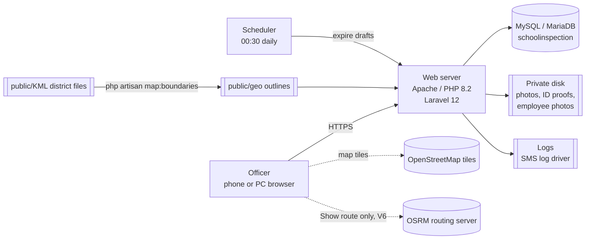

---

## 2. Main terms
| Term | Meaning |
|---|---|
| **Level** | State Admin, State, District, Block or Cluster. Set at registration; users cannot change it themselves |
| **Jurisdiction** | The area of a user: the whole state, one district, one block or one cluster. Stored as a *posting* (`user_jurisdictions`) with start and end dates |
| **UDISE code** | The 11-digit national school code, used to find a school |
| **Draft** | An inspection that has been started but not submitted. Only its officer can see it. Cancelled automatically after 7 days |
| **Submitted** | Final and locked. It gets an Inspection ID such as `SI/2026/1801/000123` |
| **Unlocked** | Opened again by the State Admin, with a reason, so the officer can correct it and submit again |
| **Question code** | A fixed ID for every question (e.g. `GOVR_02`), stored with each answer. Never renamed or reused |

---

## 3. User types and what they can do
### 3.1 Levels and area
| Level | Area (jurisdiction) | Typical designation |
|---|---|---|
| State Administrator | Whole state; also manages masters and users. Created at installation | System administrator |
| State | Whole state | Director, Joint Director, Deputy Director |
| District | One district and its blocks, clusters and schools | DEO, Inspector of Schools, DPC |
| Block | One block and its clusters and schools | BEEO, BMC, BRP |
| Cluster | One cluster and its schools | CRCC |

### 3.2 Rights (PRD 3.2)
Rights are **permissions**. Each level has a default role, and a higher administrator can grant extra rights to one person.

| Action | State Admin | State | District | Block | Cluster |
|---|---|---|---|---|---|
| Conduct and submit inspections | Yes | Yes | Yes | Yes | Yes |
| View inspection reports | All | All | Own district | Own block | Own cluster + own |
| Export to Excel | Yes | Yes | Yes | Yes | Own only |
| Approve registrations of the level below | Yes | If granted | If granted | If granted | No |
| Activate, deactivate, edit, transfer users | Yes | No | If granted | No | No |
| Masters (locations, schools, import) | Yes | No | No | No | No |
| Unlock a submitted inspection | Yes | No | No | No | No |
| Mobile number changes, audit log | Yes | No | No | No | No |
| Login monitoring report (V6) | Yes | No | No | No | No |
| Map View, schedules, rating report (V6) | All | All | Own district | Own block | Own cluster |
| Rating report Excel (V6) | Yes | Yes | Yes | Yes | Yes (own cluster) |

### 3.3 Who approves a registration (PRD 3.3)
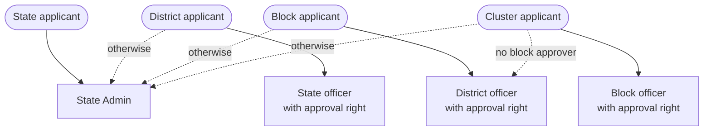
An approver must be **active**, hold the **approval right**, and have the applicant's area **inside their own**. Nobody approves themselves.

### 3.4 User type check (V5 Step 1)
The automated test `tests/Feature/UserTypeAccessTest.php` checks all five levels on every run of `php artisan test`. It verifies:

| Check | Result |
|---|---|
| State Admin opens all officer and admin screens: dashboard, profile, find school, my inspections, area inspections, approvals, users, mobile changes, audit, locations, schools, imports | Pass |
| State, District, Block and Cluster officers open the officer screens and get **403** on every admin screen | Pass |
| A District officer given "approve" and "manage users" opens only those two admin screens; audit and masters stay closed | Pass |
| A submitted inspection is seen by: State Admin, State, the District / Block / Cluster officers **of the same area**. It is **not** seen by another district, block or cluster (report page and area list) | Pass |
| A draft is seen only by its own officer | Pass |

Demo accounts for a manual check are in `CLAUDE.md`:
- active officers at every level, plus pending, rejected and inactive accounts
- password `Demo@1234`
- Admin: `9999999999`

---

## 4. Functional flows (for users and developers)

### 4.1 Registration and approval
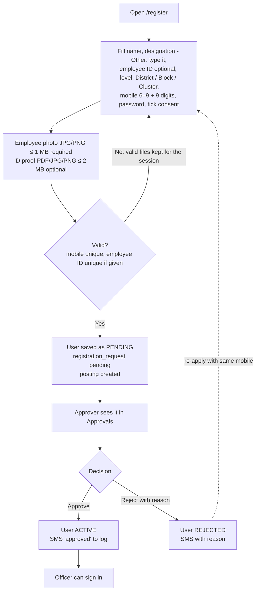

### 4.2 Sign in and session security
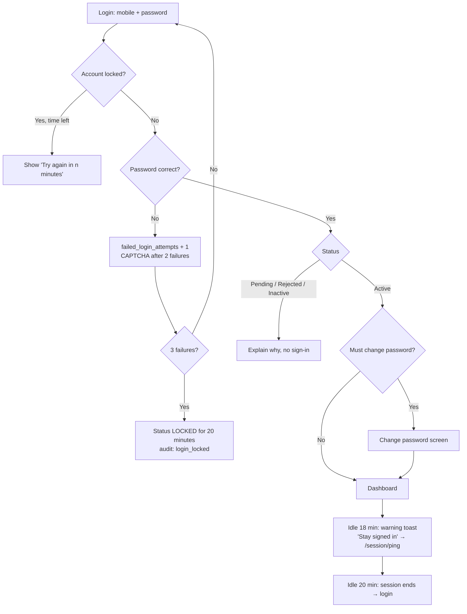
The login form allows 10 attempts per minute from one IP address. Forgot password sends a reset link by email.

**Password encrypted before submit (V6 Module 5).** The browser never sends a password in plain text, not even over plain HTTP.
- **Forms covered:** login, registration, change password and reset password. In fact, any form with a `password`, `password_confirmation` or `current_password` field.
- **How it works:**
  1. Every page carries the server's RSA-2048 public key and a per-session nonce (`<meta name="pw-key">`).
  2. `resources/js/password-encrypt.js` replaces each field with `enc:` + RSA-OAEP(password + nonce).
     - It uses WebCrypto.
     - On plain HTTP over a LAN address, where WebCrypto is unavailable, it loads `node-forge` on demand.
  3. The `DecryptPasswordFields` middleware decrypts the value before validation. Storage stays bcrypt.
- **What is refused:**
  - a value from another session (wrong nonce), or a damaged value
  - a plain-text value, when `PASSWORD_ENCRYPTION_REQUIRED=true` (default; load-test mode excepted)

  The user sees "Your password could not be sent securely. Please reload the page and try again." A refused value is not counted as a wrong password.
- **Keys:** `php artisan security:keys` creates the pair in `storage/app/private/keys` (also created on first use); `--force` replaces it. Back up `password.key` with the server.

**Encrypted record IDs in URLs (V6 Module 4).** Records never appear in a URL by their database number. `/schools/203` is now `/schools/FJyzzv-_Vd03dtnCGFS8opNNXg-x3KyMhWuQQ4ueHOI`.
- **What it covers:** every model bound in a route (inspections and their rows, schools, users, registrations, schedules and items, evidence, mobile requests, import batches) uses the trait `HasEncryptedRouteKey`. The admin location editor uses the same token.
- **The token:** `App\Support\UrlId` builds it with AES-256 under keys derived from `APP_KEY`, plus an HMAC check.
  - The same record always gets the same token, so links stay stable.
  - A typed number, an edited token, or a token of another record type returns **404**.
- **What it does not replace:** the permission checks still run as before. Filters in the query string (`?cluster=`, `?officer=`) stay numeric, because they are checked through `JurisdictionService`.
- **Rotating `APP_KEY`** changes every URL; old bookmarks then return 404.

### 4.3 Find a school and start an inspection (start rules, Modification V3)
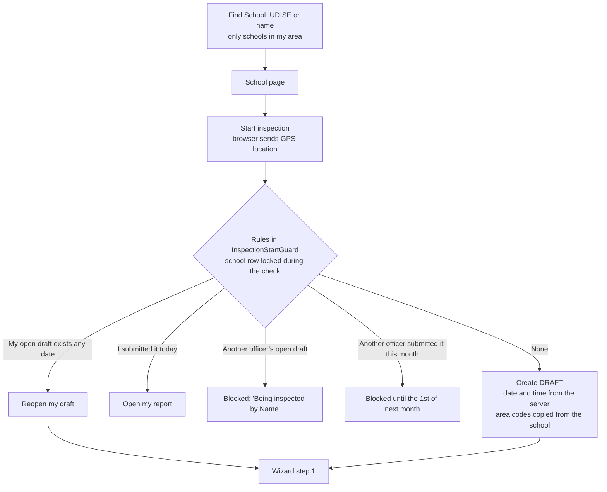
Cancelled inspections never block. Every blocked attempt is audited (`inspection_start_blocked`). The database allows **one inspection per officer, per school, per day** (unique key).

### 4.4 The inspection form (7 steps)
```mermaid
flowchart LR
    S1[1 Condition of the School<br/>CND_* + person met] --> S2[2 Teachers and Students<br/>TSI_* numbers]
    S2 --> S3[3 Teachers Absentee rows]
    S3 --> S4[4 Classroom Performance rows]
    S4 --> S5[5 Fund received and expenditure<br/>by financial year, in lakh]
    S5 --> S6[6 School Governance<br/>GOVR_* + 3 suggestions]
    S6 --> S7[7 Photographs<br/>4 mandatory categories]
    S7 --> R[Review: all answers,<br/>missing items, Expand all]
    R --> SUB[Submit]
```
- **Auto-save:** every answer is saved as soon as it changes (`POST /answers`), so nothing is lost if the network or the session drops. The progress bar comes from `/progress`.
- **Dependent questions:** a question that depends on another one (e.g. CND_18 only when CND_17 = Yes) is greyed out. Its answer is cleared if the parent answer changes.
- **Photos:**
  - taken with the in-app camera or picked from the gallery
  - resized to at most 1600 px and saved as JPEG
  - a strip is stamped with the date, time and GPS; SHA-256 is calculated
  - then uploaded
  - Gallery photos are marked "From gallery". Uploading the same photo again does nothing (`evidence_uid`).
  - Mandatory: school building, toilet block, ICT / smart class, classroom transaction.

### 4.5 Submit, lock, unlock and expiry (inspection life cycle)
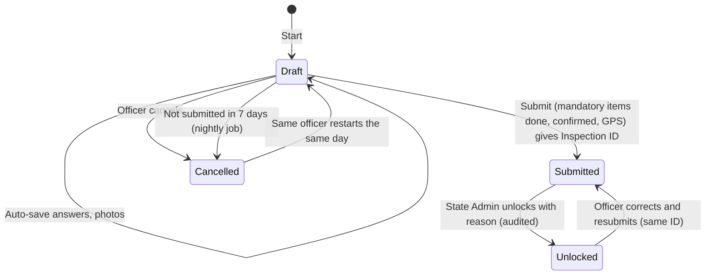
- **Inspection ID:** `SI/<year>/<district code>/<6-digit running number>`, given at the first submission.
- **Submitted inspections are read-only.** Only the State Admin can unlock one.

### 4.6 Reports, PDF and Excel
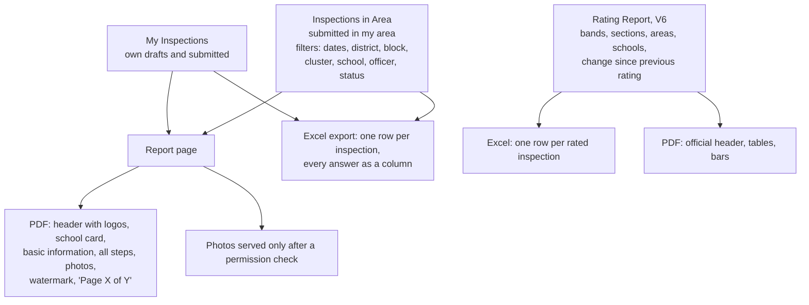
Counts at the top of the area list: schools in the area, schools inspected in the period, and inspections submitted. The **Rating Report** (V6 Module 10) is described in 4.10. Since 20-11-2026 it is for the State Administrator only.

#### Inspection Coverage Report (20-11-2026)
`/reports/coverage` (sidebar **Coverage Report**, `view_reports`). It shows how much of the school network was covered, **District-wise, Block-wise and Cluster-wise**, in descending order of unique schools visited (other orders can be chosen). It is scoped to the viewer's jurisdiction.

| Measure | How it is counted |
|---|---|
| Assigned schools | Active schools of the area in the School Master |
| **Visit Coverage** | Schools with at least one **verified visit** in the coverage period ÷ assigned schools. A visit is any inspection that was not cancelled (draft or submitted). It is verified when the start location, the submit location or a geo-tagged photo is within the radius (default 500 m) of the school. If the school has no GPS in the master, any captured location counts. |
| **Inspection Coverage** | Schools with a **submitted** formal inspection within the prescribed **inspection cycle** (monthly, quarterly, half-yearly Apr–Sep / Oct–Mar, or yearly Apr–Mar) that contains the end of the period ÷ assigned schools. A school without one is **due**. |
| Repeat / unverified | Repeat = verified visits − unique schools visited. Unverified visits (no location, or too far) are shown but not counted. |
| Bands | Good ≥ 75 %, Moderate 50–74.9 %, Low 25–49.9 %, Critical below 25 % |

- **Configurable coverage period** (`coverage_settings`, page `/reports/coverage/settings`):
  - The State Admin sets the state default: Daily, Weekly (Mon–Sun), Monthly, Quarterly or a Custom date range, plus the inspection cycle and the verification radius.
  - A **District officer with the Manage users right** can give their own district its own period and cycle, or go back to the state default.
  - Every change is audited.
  - Viewers can step back and forward (‹ ›) or pick another period for their own view.
- **Drill-down:** District → Blocks → Clusters → the schools of a cluster. The school list shows not-visited schools first, the visit status (Visited n× / Unverified only / Not visited) and the cycle status (Inspected / Due).
- **Excel** (audited): sheets Summary, District-wise, Block-wise, Cluster-wise, Schools not visited and Due in cycle.

### 4.7 Administration
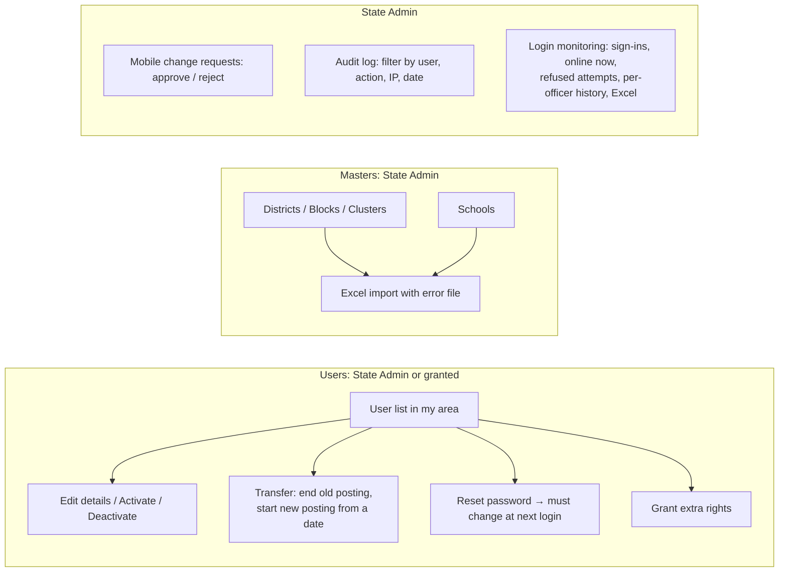
Officers request a **mobile number change** from their profile; the State Admin decides it. **Transfers** keep past inspections in the old area.

**Login monitoring (V6 Module 6), State Admin only: `/admin/login-report`.**
- **What is recorded:** every sign-in attempt goes into `user_login_logs`.
  - The result: **Signed in**, **Failed** (wrong password or unknown number), **Locked** (the attempt that locked the account, or an attempt while locked), or **Not allowed** (pending, rejected or inactive), with the reason.
  - The IP address, plus the browser, platform and device read from the user agent.
  - For a sign-in: its session, the last activity (updated at most once a minute) and the sign-out time.
- **Session state:** a session is **Online** while it is active within the session lifetime; after that it is **Timed out**.
- **The report:**
  - tiles: sign-ins, officers signed in, online now, refused attempts, accounts locked now, active officers who never signed in
  - officers who signed in, by level, against active officers
  - the numbers with the most refused attempts (a sign of guessing)
  - the sign-in log, 25 per page, with filters for dates (default today), level, district, result and officer
  - a per-officer history with the devices used
  - Excel export

  Monitoring never blocks a sign-in: write errors are only reported. The append-only `audit_logs` keep their `login` / `login_failed` entries as before.

### 4.8 Map View (New Module 1)
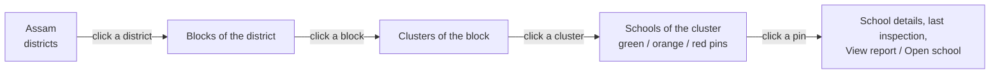
- Menu **Map View** (`/map`, right `view_reports`). The map opens at the user's own level: the State sees districts, a District officer sees the blocks of their district, a Block officer the clusters, a Cluster officer the schools.
- **Area circles** are sized by the number of schools and coloured by coverage (green ≥ 75 %, orange 40–74 %, red below 40 %). An area with no coordinates is placed at the average of its schools' GPS.
- **School pins:** green = submitted in the period, orange = draft or unlocked, red = not inspected. Schools without GPS are counted and listed but not drawn.
- **Stat cards:** registered officers, total schools, inspected, pending, coverage. **Table:** district-, block- or cluster-wise coverage with officers by level.
- **Filters:** District, Block, Cluster, school search (UDISE or name), inspection officer, period (default: this month).
- **Access:** all data comes from `JurisdictionService`. An area or officer outside the user's jurisdiction returns 403.
- **Slow networks:** one level per request (small JSON), Leaflet bundled with the app, pins grouped with marker clustering, server results cached for 60 s (`MAP_CACHE_SECONDS`).
- **Tiles:** OpenStreetMap by default. `MAP_TILE_URL` and `MAP_TILE_ATTRIBUTION` point to another tile server (self-hosted or commercial) for heavy production use. **Boundaries:** the Assam state outline and the district shapes come from the KML files in `public/KML/Assam` (`Assam.kml`, `Assam Dist/<District>.kml`). `php artisan map:boundaries` converts them into small simplified GeoJSON files in `public/geo` (about 240 KB). The state outline is always drawn; at district level each district shape is coloured by the coverage of the District Master row with the same name (or `code`), and districts not in the master are grey. Run the command again when the KML files change.
- **District outline (V6 Module 7).** The command also writes one outline per district: `public/geo/districts/<slug>.geojson` plus `index.json`.
  - **How the outline is built:** the constituency polygons of the district KML are *dissolved*. Edges shared by two constituencies are dropped, the rest are chained back into rings, and the result is simplified to about 40 m.
  - **On the maps:** whenever a district is in view, the map draws its outline in bold and greys the land outside it. A District, Block or Cluster officer's map opens that way, and so does a State user who opens a district. The district view zooms to the outline. The schedule planner and the route map draw the officer's district too.
  - **Matching to the District Master:** a district uses its **Map boundary** (`districts.boundary_name`, chosen in the Location Master), otherwise the outline with the same name.
  - **Checking the matches:** `php artisan map:boundaries --check` lists which outline every district uses, and suggests one for the unmatched rows from the outline that contains the district headquarters or the average position of its schools. `--assign` saves those suggestions, each one audited.
- **My location, distance and road route (V6 Module 8).** The Map View and the school page (a new "Location & route" card) have a **My location** button. It shows the officer's GPS position as a blue dot with an accuracy circle.
  - **School popup or card:** shows the straight-line distance from the officer.
  - **Show route:** draws the road route and gives the road distance and approximate driving time. It uses OSRM, `MAP_ROUTING_URL`, by default the public `router.project-osrm.org`; point it to your own server for heavy use. If routing fails, the panel shows a dashed straight line instead.
  - **Google Maps:** opens turn-by-turn directions from the officer's position.
  - **Privacy:** the position stays in the browser. It is sent to the routing server only when the officer presses *Show route*.
  - **HTTPS:** browsers share location only over HTTPS or on localhost. On plain HTTP the button explains this.

### 4.9 Inspection Scheduling (New Module 2)
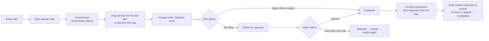
- Menu **Inspection Schedules** (`/schedules`): Day, Week and Month calendar of the user's own plans and the plans of officers below them; filter by officer and status. **Approvals** lists plans waiting for the user.
- **Planner** (`/schedules/plan?date=&officer=`): Leaflet map of the schools the officer may inspect (grey can be planned, green inspected this month, red not available, blue on this plan, numbered in visit order) with the route line from the start point. **Available schools** (nearest first) are dragged into the **Day plan** (SortableJS, works with touch) and reordered there; a map popup also has “Add to plan”. The plan shows km and arrival time per stop, totals, “Optimise route” and “Start from my location”.
- **Rules** (checked on save and again on approval): date today or later (up to 92 days ahead); at most 8 schools a day; each school active and inside the officer's jurisdiction; not on another officer's plan that day (also a database unique key on school + date); not being inspected by another officer, and not already inspected by another officer in the plan's month (the start rules of Modification V3).
- **Who:** an officer plans their own days. A higher officer whose jurisdiction covers the officer (State Admin, State, District, Block) can plan for them (published at once), change, **reassign** to another officer below them (the schools are checked against the new officer), approve or send back. Cluster officers cannot plan for others. With `SCHEDULE_APPROVAL_REQUIRED=false` an officer's own plan is published directly.
- **Distances and times:** straight-line distance × 1.3 road factor, 25 km/h average speed, 60 minutes per visit, day starts 09:30 (all in `config/inspection.php` → `schedule`). Route optimisation is nearest neighbour + 2-opt (`App\Support\RouteOptimizer`, same algorithm in the browser). No external routing service is used; **Directions** opens the route in the phone's maps app.
- **Conducting:** on the plan day the officer starts each inspection from the plan. Submitting the inspection marks that visit *inspected*; a visit can be *skipped* with a reason; when nothing is left the plan is *Completed*. The dashboard shows **Today's plan**.
- **History:** every step (created, changed, submitted, approved, sent back, published, reassigned, visit inspected or skipped, cancelled, completed) is written to the audit log and shown on the plan page.
### 4.10 Automatic Inspection Rating (New Module 3)
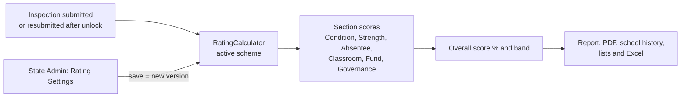
- **Formula:** Score % = Σ(weight × points) ÷ Σ(weight of the applicable items) × 100. The same formula gives each section's score. Points run from 0 to 1.
- **Not Applicable** items are left out of the denominator: a question hidden or disabled by its parent (`show_if` / `enable_if`), an answer not in the points list (e.g. “Not Applicable”), or a metric with nothing to divide by (no absentees, no classrooms observed, no fund received, no students). A section with nothing applicable shows “N/A”; an inspection with nothing applicable is “Not rated”.
- **Default scheme (version 1):**

| Section | Scored items |
|---|---|
| Condition | CND_02–CND_24 yes = 1, no = 0 (CND_12 “additional classroom required” is inverted); CND_01 Pucca 1, Semi-pucca 0.5, Others 0; CND_26 yes/no (“na” = N/A). Weight 1 each |
| Strength | Student attendance (present ÷ enrolled), teacher attendance (present ÷ total), trained teachers. Weight 3 each |
| Absentee | Share of absences on authorised leave (not UL). Weight 3 |
| Classroom | Share of classrooms using TLM; share with satisfactory participation. Weight 3 each |
| Fund | Utilisation = expenditure ÷ received, capped at 100 %. Weight 3 |
| Governance | GOVR yes/no items and satisfactory/unsatisfactory items; GOVR_01 non-conventional 1, conventional 0.5. Reason boxes are not scored. Weight 1 each |

- **Bands:** Excellent ≥ 90 (green), Very Good 75–89.99 (blue), Good 60–74.99 (yellow), Needs Improvement 40–59.99 (orange), Unsatisfactory below 40 (red).
- **Shown:** report page (score dial, band, section bars, summary, strengths, weaknesses, areas requiring improvement = sections below 60 %), PDF (“School Performance Summary”), school page history (score and change since the previous rated inspection), My Inspections / Inspections in Area (rating column) and the Excel export (score and band).
- **Updates:** rated on submit; an authorised correction (State Admin unlock, officer resubmits) re-rates it. The old and new scores are written to the audit log (`inspection_rated`, `inspection_rerated`).
- **Rating Settings** (`/admin/rating`, right `manage_masters`): change weights, points per answer and bands. Saving creates a **new version**; earlier ratings keep the version they were calculated with until “Recalculate all” (or `php artisan ratings:recalculate --all`). Legacy v1 inspections are not rated.
- **Deploy:** run `php artisan ratings:recalculate` once to rate inspections submitted before this module.
---

**The rating shown for the school (V6 Module 9).** A school's current rating is the rating of its latest **submitted** inspection (`School::latestRatedInspection`). An inspection unlocked for correction does not count until it is resubmitted.
- **School page:** the header shows the score, the band and the date, with the change since the rating before it.
- **Find School:** the result list shows the score and band on each school.
- **Map View:**
  - the school popup and table show the school's rating
  - the switch *Colour schools by Status / Rating* colours the pins by band, with the score in the pin and a band legend
  - district, block and cluster rows, popups and tooltips show the average rating of the inspections submitted in the period, banded with the active scheme

**Rating report (V6 Module 10): menu *Rating Report*, `/reports/ratings` (right `view_reports`).** It covers only rated, submitted inspections inside the user's jurisdiction (`RatingReportService`, built on `JurisdictionService`).
- **Filters:**
  - dates (default: the last three months)
  - district / block / cluster, limited to the user's area
  - rating band, school category, rating scheme version
- **Shown:**
  - tiles: rated inspections, schools rated, average score with its band, lowest to highest
  - band distribution: bars in the band colours with counts and share; a click filters by that band
  - average by questionnaire section
  - one row per area below the current scope (district, block or cluster), with rated, schools, average and a count per band; a click drills down
  - best and lowest five schools
  - a school table (25 per page) with each school's latest rating in the period, the rating before it (any earlier date) and the change in points; it can be sorted by score, change or name
- **Exports:**
  - **Excel** (right `export_excel`): one row per rated inspection, with each section's %
  - **PDF:** official header and footer, page numbers, up to 500 schools
  - Both exports are audited (`rating_report_exported`).

## 5. Database schema
MySQL / MariaDB database `schoolinspection`, InnoDB, utf8mb4. There are 38 tables (including Laravel's `migrations`), all created by `database/migrations`. The location masters run first (`0001_01_00_*`).

### 5.1 Entity relationship diagram (main tables)
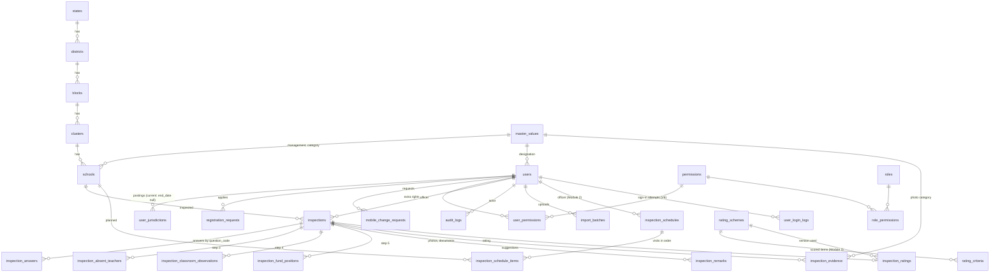

### 5.2 Tables
**Location and school masters**
| Table | Purpose | Key columns |
|---|---|---|
| `states` | State (single-state deployment, code 18) | `code` UQ, `name`, `is_active` |
| `districts` | Districts | `state_id` FK, `code` UQ (e.g. 1801), `name`, lat/lng, `boundary_name` (KML outline, V6), `is_active` |
| `blocks` | Blocks | `district_id` FK, `code` UQ (180101), `name`, lat/lng, `is_active` |
| `clusters` | Clusters | `block_id` FK, `code` UQ (18010101), `name`, lat/lng (New Module 1), `is_active` |
| `schools` | School master | `udise_code` CHAR(11) UQ, `name`, `state_id`/`district_id`/`block_id`/`cluster_id` FK, `management_id`/`category_id` → master_values, address, lat/lng, `status` (active/closed), soft delete |
| `master_values` | Drop-down lists | `type` (designation, management, category, photo_category, fund_category, subject), `code`, `label`, `sort`, `is_active` |
| `import_batches` | Excel imports of masters | `type` (location/school), file, `uploaded_by`, total/added/updated/rejected, `error_file_path` |

**Users and access**
| Table | Purpose | Key columns |
|---|---|---|
| `users` | Officers and administrators | `name`, `designation_id`, `designation_other` (text when the designation is "Other", V7), `employee_id` UQ nullable (V7), `mobile` CHAR(10) UQ (login; MySQL CHECK `^[6-9][0-9]{9}$`, V7), `email`, `password` (bcrypt), `level`, `status` (pending, active, rejected, inactive, locked), `id_proof_path`, `photo_path` (private disk), `failed_login_attempts`, `locked_until`, `must_change_password`, `last_login_at`, soft delete |
| `user_jurisdictions` | Postings. The **current** one has `end_date` null; a transfer ends it and adds a new one | `user_id`, `state_id`, `district_id`, `block_id`, `cluster_id` (filled down to the user's level), `start_date`, `end_date`, `assigned_by` |
| `roles` / `role_permissions` | One role per level, with its default rights | `slug` = level |
| `permissions` | Rights | `slug`: conduct_inspections, view_reports, export_excel, approve_registrations, manage_users, manage_masters, unlock_inspections |
| `user_permissions` | Extra rights given to one user | `user_id`, `permission_id`, `granted_by`, `granted_at` |
| `registration_requests` | Approval queue | `user_id`, `approver_id`, `status` (pending/approved/rejected), `reason`, `decided_at` |
| `mobile_change_requests` | Mobile number changes | `user_id`, `old_mobile`, `new_mobile`, `status`, `reason`, `decided_by`, `decided_at` |
| `otp_verifications` | Ready for Phase 2 OTP (not used in Phase 1) | `mobile`, `purpose`, `otp_hash`, `attempts`, `expires_at` |
| `password_reset_tokens`, `sessions` | Laravel password reset and sessions (database driver) | |

**Inspections**
| Table | Purpose | Key columns |
|---|---|---|
| `inspections` | One inspection | `inspection_no` UQ (given at submit), `officer_id`, `school_id`, `inspection_date` (server date), `started_at`, `submitted_at`, `district_id`/`block_id`/`cluster_id` and their codes (copied from the school at start, so a later master change or transfer does not move old reports), start/submit GPS and accuracy, `person_met_name`/`_designation`, `status` (draft, submitted, unlocked, cancelled), `completion_pct`, `questionnaire_version` (2), `unlocked_by`/`_at`/`unlock_reason`, `cancelled_reason`, soft delete. **UQ (officer_id, school_id, inspection_date)** |
| `inspection_answers` | Answers of steps 1, 2 and 6 | `inspection_id`, `step`, `question_code`, `value` (JSON), `remarks`. **UQ (inspection_id, question_code)** |
| `inspection_absent_teachers` | Step 3 rows | `teacher_name`, `teacher_type`, `reason` (e.g. UL = unauthorised leave), `status`, `remarks` |
| `inspection_classroom_observations` | Step 4 rows | `teacher_name`, `class`, `subject`, `tlm_used`, `participation`, `remarks` |
| `inspection_fund_positions` | Step 5, one row per financial year | `financial_year` (UQ per inspection), received/expenditure for ASG, MDM, Govt, Other (lakh) |
| `inspection_remarks` | Suggestions and notes | `type` (suggestion, general, classroom_note, inspection_remark), `sort`, `body` |
| `inspection_evidence` | Photos and documents | `evidence_uid` UQ (idempotent upload), `kind`, `source` (camera/gallery), `category_id`, `question_code`, `caption`, `taken_at`, `received_at`, GPS, `no_location_reason`, `mime`, `size_bytes`, `storage_path` (private disk, random name), `sha256`, `status` (pending, uploaded, failed), `uploaded_by` |

**Inspection schedules (New Module 2)**
| Table | Purpose | Key columns |
|---|---|---|
| `inspection_schedules` | One plan per officer per day | `officer_id` FK, `schedule_date`, UQ (officer, date), `status` (draft, submitted, rejected, published, completed, cancelled), `created_by`, `submitted_at`, `reviewed_by`/`reviewed_at`/`review_note`, `published_at`, start lat/lng, `total_distance_km`, `total_minutes`, `notes` |
| `inspection_schedule_items` | Schools of a plan in visit order | `schedule_id` FK (cascade), `school_id` FK, `schedule_date` (copy), `sequence`, `distance_km`, `travel_minutes`, `planned_arrival`, `status` (planned, inspected, skipped), `inspection_id`; UQ (schedule, school) and **UQ (school, date)**: a school is on one plan per day |

**Automatic rating (New Module 3)**
| Table | Purpose | Key columns |
|---|---|---|
| `rating_schemes` | Versioned scoring set-ups; one active | `version` UQ, `name`, `is_active`, `bands` JSON (min, label, color), `created_by`, `activated_at` |
| `rating_criteria` | Scored items of a scheme | `scheme_id` FK, `section`, `code` (question code or metric key), `label`, `kind` (answer/metric), `weight`, `points` JSON (answer → 0..1), `sort`; UQ (scheme, code) |
| `inspection_ratings` | One rating per inspection | `inspection_id` UQ FK, `scheme_id` FK, `obtained`, `applicable`, `score_percent` (null = not rated), `band`, `color`, `sections`, `details`, `strengths`, `weaknesses` JSON, `calculated_at` |

**Audit and system**
| Table | Purpose |
|---|---|
| `user_login_logs` | **V6 login monitoring**: one row per sign-in attempt. `user_id` (null for an unknown number), `mobile`, `status` (success, failed, locked, denied), `reason`, `session_id`, `ip_address`, `user_agent`, `browser`, `platform`, `device`, `login_at`, `last_seen_at`, `logout_at`, `logout_reason`. Operational (a sign-in row is updated on activity and sign-out); not the audit log |
| `audit_logs` | **Append-only** log: `user_id`, `action` (e.g. login, login_failed, registration_approved, inspection_started, inspection_submitted, inspection_unlocked, inspection_pdf, evidence_downloaded), `auditable_type`/`_id`, `meta` JSON, `ip_address`, `user_agent`, `created_at`. Kept for 5 years |
| `cache`, `cache_locks`, `jobs`, `job_batches`, `failed_jobs`, `migrations` | Laravel cache, queue and migration tables |

Indexes and the reason for each one are in `DB_INDEXING.md`.

### 5.3 Rules the database enforces
- **Unique keys:**
  - one inspection per officer, school and day
  - one answer per question per inspection
  - one fund row per year
  - unique mobile, employee ID, UDISE code, Inspection ID and `evidence_uid`
- **Foreign keys with RESTRICT:** a location or school that has inspections cannot be deleted.
- **Soft deletes** on users, schools, inspections and evidence. Nothing is removed for good from the screens.
- **The answer `value` column holds JSON.** The model casts it.
- **V6:** `user_login_logs` is operational (a sign-in row is updated on activity and sign-out) and is separate from the append-only `audit_logs`. `districts.boundary_name` is nullable; when it is null, the outline is matched by name.
- **Not stored in the database (V6):** the password RSA key pair (`storage/app/private/keys`), the district outlines (`public/geo/districts`) and the URL token keys (derived from `APP_KEY`).

---

## 6. Modules and the tables they use
| Module (controller / service) | Reads | Writes |
|---|---|---|
| Registration (`Auth\RegisterController`) | locations, master_values | users, user_jurisdictions, registration_requests, audit_logs |
| Login, password (`Auth\LoginController`, `PasswordController`, `LoginMonitorService`) | users | users (failures, lock, last_login), sessions, password_reset_tokens, user_login_logs, audit_logs |
| Login monitoring (`Admin\LoginReportController`) | user_login_logs, users, user_jurisdictions | — |
| Approvals (`Admin\ApprovalController`, `ApproverResolver`) | registration_requests, users, user_jurisdictions, user_permissions | registration_requests, users.status, audit_logs |
| Users (`Admin\UserController`) | users, user_jurisdictions, permissions | users, user_jurisdictions (transfer), user_permissions, audit_logs |
| Profile, mobile change (`ProfileController`, `Admin\MobileRequestController`) | users, user_jurisdictions, inspections (counts) | users.photo_path, mobile_change_requests, users.mobile, audit_logs |
| Masters (`Admin\LocationController`, `SchoolMasterController`, `ImportController`, `MasterImportService`) | locations, schools | states, districts, blocks, clusters, schools, import_batches, audit_logs |
| Find School (`SchoolController`, `JurisdictionService`) | schools, inspections (badges; since 23-11-2026 the list is ordered not inspected first, then the fewest visits, then the oldest last visit) | — |
| Start (`InspectionController::start`, `InspectionStartGuard`) | schools (locked row), inspections | inspections, audit_logs |
| Wizard (`InspectionController`, `InspectionValidator`, `QuestionnaireDefinition`) | inspections and all child tables | inspection_answers, absent_teachers, classroom_observations, fund_positions, remarks, inspections (person met, completion) |
| Photos (`EvidenceController`, `EvidenceStorage`) | inspection_evidence | inspection_evidence, private disk, audit_logs (download) |
| Submit / unlock / cancel | inspections | inspections (number, status, GPS), audit_logs |
| Reports, PDF, Excel (`ReportController`) | inspections + children, schools, users, locations | audit_logs (pdf, export) |
| Dashboard (`DashboardController`) | inspections, registration_requests | — |
| Rating (`RatingService`, `App\Rating\RatingCalculator`, `Admin\RatingController`) | inspections + answers, absentees, classrooms, funds, rating_schemes, rating_criteria | inspection_ratings, rating_schemes, rating_criteria, audit_logs |
| Schedules (`ScheduleController`, `ScheduleService`, `RouteOptimizer`) | users, user_jurisdictions, schools, inspections, schedules | inspection_schedules, inspection_schedule_items, audit_logs |
| Map View (`MapController`, `MapDataService`) | districts, blocks, clusters, schools, inspections, users, user_jurisdictions | — (read only, cached 60 s) |
| Audit (`Admin\AuditLogController`, `AuditLogger`) | audit_logs | audit_logs (append only) |
| URL encryption, V6 (`HasEncryptedRouteKey`, `UrlId`) | (APP_KEY) | — |
| Password encryption, V6 (`DecryptPasswordFields`, `PasswordCrypto`) | key pair on the private disk, session nonce | — (keys by `security:keys`) |
| District outlines, V6 (`ImportMapBoundaries`, `DistrictBoundaryService`) | public/KML, public/geo/districts, districts, schools | public/geo/districts, districts.boundary_name, audit_logs (`--assign`) |
| My location and route, V6 (`map-common.js`, `school-map.js`) | schools (coordinates) | — (OSRM called from the browser) |
| School rating display, V6 (`School::latestRatedInspection`, `MapDataService`) | inspections, inspection_ratings, rating_schemes | — |
| Rating report, V6 (`RatingReportController`, `RatingReportService`) | inspections, inspection_ratings, rating_schemes, schools, locations | audit_logs (exports) |
| Nightly job `inspections:expire-drafts` | inspections | inspections (cancelled), audit_logs |

**Example: one auto-save**
1. `POST /inspections/{id}/answers`
2. `InspectionPolicy::update`: only the officer, and only while the inspection is Draft or Unlocked
3. `QuestionnaireDefinition::find(code)` and clean the value
4. upsert `inspection_answers` (inspection_id, question_code)
5. clear the answers of children it now disables
6. update `inspections.person_met_*` if the question was the person met
7. return the progress as JSON

---

## 7. Developer guide
### 7.1 Code layout
| Path | Content |
|---|---|
| `app/Enums` | UserLevel (rank, area rules), UserStatus, InspectionStatus, EvidenceStatus |
| `app/Services` | JurisdictionService (**every** area filter), ApproverResolver, PermissionService, InspectionStartGuard, InspectionNumberGenerator, EvidenceStorage, AuditLogger, MasterImportService, MapDataService, ScheduleService, RatingService, Otp/*; V6: PasswordCrypto, LoginMonitorService, DistrictBoundaryService, RatingReportService |
| `app/Support` | RouteOptimizer; V6: `UrlId` (URL tokens), `UserAgent` (browser, platform, device) |
| `app/Models/Concerns` | V6: `HasEncryptedRouteKey` (encrypted route keys of every route-bound model) |
| `app/Rating` | `RatingCalculator`, `DefaultScheme` (Module 3) |
| `app/Questionnaire` | `QuestionnaireDefinition` (version 2, the fixed questions; it drives both the screens and the validation), `InspectionValidator` |
| `app/Policies/InspectionPolicy.php` | view / update / cancel / unlock rules |
| `app/Http/Middleware` | `active` (signed-out if not active), `password.fresh` (force password change); V6, in the web group: `DecryptPasswordFields`, `TouchLastSeen` |
| `app/Console/Commands` | `map:boundaries` (KML → GeoJSON, outlines, `--check` / `--assign`), `ratings:recalculate`, V6 `security:keys` |
| `config/inspection.php` | Configurable values: draft expiry, login lock, photo limits, mandatory photos, page size, retention |
| `resources/views`, `resources/js`, `resources/scss` | Blade screens, wizard / camera / review / map / planner JS, Samagra Shiksha theme. V6: `password-encrypt.js`, `school-map.js`, outline and directions helpers in `map-common.js`, `admin/login-report/*`, `reports/ratings/*` |
| `public/geo` | State and district GeoJSON; V6 `districts/<slug>.geojson` + `index.json` (committed; raw `public/KML` is not) |
| `database/seeders` | Roles, masters, demo locations and schools, State Admin, demo users, load-test data |
| `tests/Feature` | Registration and login, approvals and users, the inspection flow, masters and audit, user types, load-test switch, map, schedules, rating; V6: `UrlEncryptionTest`, `PasswordEncryptionTest`, `LoginReportTest`, `DistrictBoundaryTest`, `SchoolDirectionsTest`, `SchoolRatingDisplayTest`, `RatingReportTest` |
| `tools/loadtest` | Load driver (LOAD_TEST.md) |

### 7.2 Request path
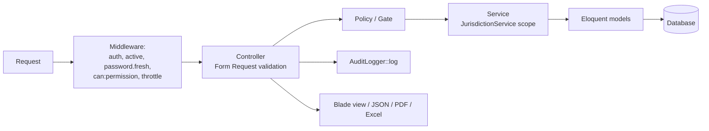

### 7.3 Rules that must not be broken
They are listed in `CLAUDE.md` under domain rules. In short:
1. Every school, user and inspection query goes through `JurisdictionService`. Location IDs from the browser are never trusted.
2. Users cannot change their own level or area.
3. Question codes are never renamed or reused.
4. Submitted means locked; only the State Admin unlocks, with a reason.
5. One inspection per officer, school and day; the start rules apply.
6. Evidence stays on the private disk and is served only after a permission check.
7. The audit log is append-only.
8. Server time is the source of truth.
9. Record IDs in URLs are encrypted tokens (`HasEncryptedRouteKey`). Pass the model, or `Model::routeKeyFor($id)`, to `route()`, never a raw `*_id`.
10. Password fields are sent encrypted (`password-encrypt.js` + `DecryptPasswordFields`). Never submit a password form with `form.submit()`, and never log or audit a password.
11. Ratings are derived data, and a rating scheme is versioned, never edited in place.

### 7.4 Commands
```bash
php artisan migrate --seed            # schema + roles, masters, State Admin, demo data
php artisan serve --port=8010         # development (Apache for load tests)
npm run dev | npm run build           # assets
php artisan config:clear && php artisan test   # tests (SQLite in memory only)
php artisan inspections:expire-drafts # nightly at 00:30 through the scheduler
php artisan optimize                  # production (required on Windows/Apache, LOAD_TEST.md)
php artisan ratings:recalculate [--all]       # rate submitted inspections (Module 3)
php artisan security:keys [--force]           # V6: RSA key pair for password encryption
php artisan map:boundaries                    # KML -> public/geo (state, districts, V6 district outlines)
php artisan map:boundaries --check | --assign # V6: which outline each District Master row uses / link unmatched
```

### 7.5 Testing
- 131 feature tests (V6, V7 and section 11 included; V7: `RegistrationV7Test`, `RatingCardTest`; section 11: `TeacherTotalsTest`, `OfflineReplayTest`), run on SQLite in memory. `tests/TestCase.php` refuses to run against any other database.
- **Never run the tests while the config is cached.**
- Demo data for manual tests: `DemoUserSeeder`.
- Volume data: `LoadTestSeeder`. Use it only on a database you have backed up.
- `phpunit.xml` sets `PASSWORD_ENCRYPTION_REQUIRED=false`, so the older tests can post plain passwords. `PasswordEncryptionTest` turns it on and posts `PasswordCrypto::encryptForSession()` values.

---

## 8. Statuses at a glance
| Object | Statuses |
|---|---|
| User | pending → active / rejected; active ↔ inactive; active → locked (20 min) → active |
| Registration request | pending → approved / rejected |
| Mobile change request | pending → approved / rejected |
| Inspection | draft → submitted → unlocked → submitted; draft → cancelled (by the officer or after 7 days) |
| Evidence | pending → uploaded / failed |
| School | active / closed (closed schools cannot be inspected) |
| Schedule | draft → submitted → published (approved) or rejected (sent back, can be resubmitted); published → completed; cancelled |
| Sign-in attempt (V6) | success / failed / locked / denied; a success session is online → signed out or timed out |
| School rating (V6) | the rating of the latest submitted inspection; an unlocked inspection does not count until resubmitted |

---

## 9. Modification V6 (19-11-2026)
Source: `Documents/Modification of the ApplicationV6.docx`. Each item was built as one module, committed and pushed on its own, and logged in `ACTION.md` (#69–#76). The details are in the sections shown.

| # | V6 item | What was built | Users see | Section |
|---|---|---|---|---|
| 4 | Security for URL encryption | Route-bound records appear in URLs as 43-character AES tokens with an HMAC check, tied to the record type | `/schools/FJyz…` instead of `/schools/203`; an edited or numeric URL gives 404 | 4.2, 7.3 |
| 5 | Password encrypted automatically on submit | RSA-OAEP encryption in the browser with a session nonce (WebCrypto, `node-forge` on plain HTTP); the server decrypts before validation; storage stays bcrypt | Nothing changes on screen; the network shows `password=enc:…` | 4.2, 7.3 |
| 6 | Login user monitoring report (State Admin) | `user_login_logs`, `LoginMonitorService`, `/admin/login-report` | Sign-ins, online now, refused attempts with the reason, locked and never-signed-in officers, devices, per-officer history, Excel | 4.7, 5.2 |
| 7 | Use the district KML for the district | Constituency polygons dissolved into one outline per district; `districts.boundary_name`; `--check` / `--assign` | Officers' maps open on their district, outlined with the outside greyed; also on the planner and route map | 4.8 |
| 8 | My current location, distance from the school, road view | My location button, straight-line distance, OSRM road route with drive time, Google Maps link | Map popups and a "Location & route" card on the school page | 4.8 |
| 9 | Rating display for the school | `School::latestRatedInspection`, ratings in the map data | School page header with change, Find School pill, map pins coloured by rating, area averages | 4.10 |
| 10 | Rating report | `RatingReportService`, `/reports/ratings`, Excel and PDF | Bands, section averages, area drill-down, best and lowest, school change | 4.6, 4.10 |

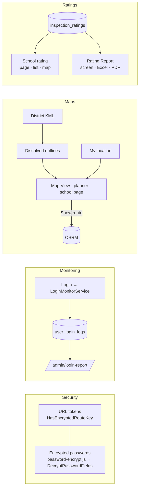

**New settings** (`config/inspection.php`, `.env`):
| Setting | Default | Meaning |
|---|---|---|
| `PASSWORD_ENCRYPTION` | true | Send password fields encrypted |
| `PASSWORD_ENCRYPTION_REQUIRED` | true | Refuse plain-text passwords (load-test mode still accepts them) |
| `MAP_ROUTING` / `MAP_ROUTING_URL` | true / `https://router.project-osrm.org` | Road route server; use your own for production |
| `inspection.map.geojson.district_dir` | `geo/districts` | Folder of the district outlines |

**Deploy checklist for V6:**
1. `php artisan migrate`. This adds `user_login_logs` and `districts.boundary_name`, and nothing existing changes.
2. `npm install && npm run build`. This adds `node-forge`, used only as a fallback chunk.
3. `php artisan security:keys`, then back up `storage/app/private/keys`.
4. `php artisan map:boundaries`, then `php artisan map:boundaries --check`. Link any unmatched districts with `--assign`, or in the Location Master.
5. `php artisan ratings:recalculate`, so inspections submitted before the rating module are rated.
6. Serve the app over **HTTPS**. Browsers share location only on secure pages, and the session cookie should be secure.

**Known limits:**
- **Plain HTTP:** location (My location) does not work.
- **Road routes:** these depend on the routing server being reachable. If it is not, a dashed straight line and its distance are shown.
- **Changing `APP_KEY`:** this changes every URL token, so old bookmarks stop working.
- **Replacing the RSA keys** (`--force`): pages already open must be reloaded before they can sign in.

## 10. Modification V7 (19-11-2026)
Source: `Documents/Modification of the ApplicationV7.docx`. The document asks for registration form changes and a cleaner rating view. They were built as five modules, each committed and pushed on its own and logged in `ACTION.md` (#78 plan, #79–#83).

| Module | V7 item | What was built | Users see |
|---|---|---|---|
| V7-1 | Employee ID and identity proof not mandatory | `users.employee_id` nullable (still unique when given); both fields optional at registration and in the admin edit | "(optional)" on the form; approvers see "Not provided" and a note instead of the ID-proof viewer |
| V7-2 | Mobile must start with 6, 7, 8 or 9; check validation in the DB and UI | `mobile-input.js` on every mobile field; regex on login, forgot and reset (registration and profile already had it); MySQL CHECK constraints on `users.mobile` and `mobile_change_requests.new_mobile`; audit of every registration field | A wrong first digit is refused while typing, with a message; short numbers are flagged before submit |
| V7-3 | Dropdown placeholder colour, standard file size, designation "Other", highlighted consent | Grey empty selects (CSS `:has`); `App\Support\FileSize`; `users.designation_other` and `User::designation_label`; `.reg-consent` panel | "Select district" etc. look like placeholders; "Max 1 MB" from config; Other → text box; the consent box turns red if missed and green when ticked |
| V7-4 | Uploaded files not removed after an error | `RegisterUploadStash`: valid files kept on the private disk for the visitor's session, preview route `register.kept`, daily `register:purge-tmp` | After an error the photo and ID proof stay chosen ("kept from your last attempt") and can be removed |
| V7-5 | Rating on the inspection view more attractive | New rating card; `Inspection::previousRating()` | Score dial, band, change since the last rated inspection, band scale with a marker, section tiles, strength / weakness / improvement cards |

**Validation audit (V7-2).** "If already done, skip" was applied field by field:

| Field | Already in place | Added in V7 |
|---|---|---|
| Mobile | server regex on register and profile; unique; CHAR(10) | UI pattern and live message; regex on login, forgot and reset; DB CHECK |
| Name | required, max 120 | min 3, letters / spaces / `. ' -` only (UI and server, also the admin edit) |
| Email | `email:rfc`, max 150 | UI `maxlength` |
| Password | strength rule, confirmation | max 64 (UI and server), within the RSA encryption limit |
| Employee ID | format, max 40, unique | optional (V7-1) |
| Designation, level, locations, photo, ID proof, CAPTCHA, consent | DB `exists` and hierarchy checks, type and size checks | Other text (V7-3); consent check before submit |

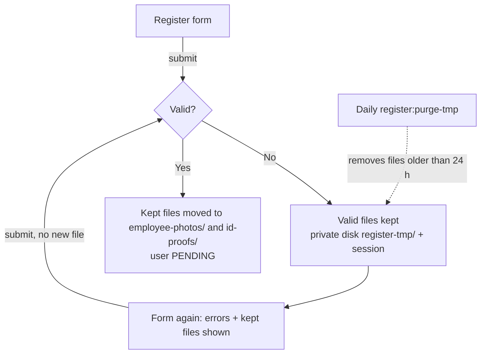

**Deploy checklist for V7:**
1. `php artisan migrate`. This makes `employee_id` nullable, adds `users.designation_other` and adds the mobile CHECK constraints on MySQL/MariaDB. The CHECK migration stops with a message if any stored mobile is invalid; fix those rows first.
2. `npm run build`.
3. Make sure the scheduler runs (`php artisan schedule:run` every minute), so `register:purge-tmp` cleans kept files daily.

**Known limits:**
- **Kept files:** they live only for the visitor's session. If the session expires, the files must be chosen again; the purge removes them after 24 h.
- **Grey placeholders:** these use CSS `:has()`. Very old browsers show the "Select …" text in the normal colour, but the form still works.
- **CHECK constraints:** these are MySQL/MariaDB only. Tests on SQLite rely on the application rules.

## 11. Teacher totals and working without network (19-11-2026)
Two follow-up requests from users of the inspection questionnaire. Each was built as one module, committed and pushed, and logged in `ACTION.md` (#85, #86).

### 11.1 Teacher totals (step 2)
| Rule | Checked when | Effect |
|---|---|---|
| Male trained + Male untrained + Female trained + Female untrained (TSI_10–13) **=** Total teachers (TSI_04–08), i.e. equal (back to "equal" on 21-11-2026; it was "less than or equal" from 19-11-2026). Only Total trained / Total untrained are shown, no male / female. | Total teachers and all four breakdown numbers are entered | **Blocking**: step 2 is not complete and Submit is refused |
| Teachers present (TSI_09) ≤ Total teachers | Both are entered | **Blocking** (it was a warning before) |

- **On screen:**
  - A live box under the breakdown shows Trained, Untrained, Male, Female and their sum, with "Within Total teachers (n)" in green or "More than Total teachers (n)" in red.
  - "Show me" and the review page show the exact message, e.g. "Trained (7) + Untrained (2) = 9 and Male (4) + Female (5) = 9, but Total teachers is 10."
  - The report and the PDF list the trained/untrained and male/female totals.
- **Code:**
  - `QuestionnaireDefinition::teacherBreakdown()`, `TEACHER_TOTAL_CODES`, `TEACHER_BREAKDOWN_CODES`
  - `InspectionValidator::teacherConsistency()`, used by `missing()`
- **Already-submitted inspections are not changed;** the rule applies to new submissions.

### 11.2 Working without network
The application stays a responsive **web** application, used in the browser on desktop and phone with nothing to install. When the network drops during an inspection, unsent work is kept in the browser's own storage (IndexedDB) and sent automatically when the network returns.

| Situation | What happens |
|---|---|
| Answer, remark or suggestions saved with no network | Kept on the device. The save indicator says "Saved on this device" and an orange banner says "No network. n changes saved on this device…" |
| New absent-teacher, classroom or fund-year row with no network | Kept on the device and shown in the list as "Saved on this device · waiting for network" |
| Editing or removing a row that is already saved | Needs the network; the officer is told to try again |
| Photo taken or chosen with no network | Kept on the device and shown as "On this device · waiting for network"; uploaded when the network returns |
| Tab closed or phone browser reloaded | Kept data is restored the next time the inspection is opened (opening a page itself needs the network) |
| Network returns | Sent in the order made (the `online` event, every 20 s, and when a page opens). The banner shows "Back online: sending…" and then "All changes saved to the server." |
| Review & Submit | Locked while anything is still on the device: "n changes and p photos saved on this device still to send". When they are sent, the page refreshes and Submit unlocks |
| Starting an inspection, submitting | Need the network (server time and location are recorded by the server) |

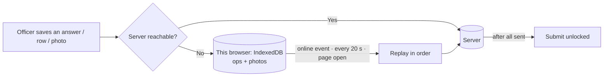

- **Safe replays:**
  - answers, fund years and suggestions are upserts
  - photos carry `evidence_uid`
  - new rows carry a `row_uid` (new nullable unique column on `inspection_absent_teachers` and `inspection_classroom_observations`, migration `2026_11_19_000009`), so a row sent twice is stored once
- **Code:**
  - `resources/js/offline-queue.js`: storage, `syncAll()` and the banner
  - `wizard.js`: `queue()` with ops, provisional rows, restoring kept answers
  - `camera.js`: photos kept until uploaded
  - `review.js`: Submit lock and sync
  - `InspectionController::addRow()`: `createOrFirst` by `row_uid`
- **Limits:**
  - Pages cannot be opened with no network. A full offline app (service worker) remains Phase 2.
  - Data kept in one browser is not visible in another browser or device.
  - A browser in private mode or with no free storage falls back to the old behaviour and says so.
  - A change kept offline that the server later refuses (e.g. the inspection was cancelled) is dropped with a message.
- **Deploy:** run `php artisan migrate` (adds `row_uid`), then `npm run build`.

---

## 12. Modification V8 (19-11-2026)
Source: `Documents/Modification of the ApplicationV8.docx`. All 8 items are screen and report changes. The database is unchanged; no migration is needed.

| # | Request | What was done | Where |
|---|---|---|---|
| 1 | Map View: school details popup more elegant and attractive | The school popup has a header coloured by status (green inspected, orange in progress, red not inspected), the school name, the UDISE code, status and rating chips, rows with icons (area, address), a "Last inspection" box (number, date, officer), the directions panel, and the buttons **Open school** and **View report** side by side. The area popup uses the same header, with three count tiles, a coverage bar, the average rating and the officers | `resources/js/map.js` (`schoolPopup()`, `areaPopup()`), `app.scss` (`.map-pop`) |
| 2 | Map View: inspected / not inspected colour key on top of the map | A strip above the map shows **Inspected · In progress · Not inspected** with live counts for the level on screen and the period. With "Colour by Rating" it shows the rating bands. The side legend is unchanged | `map/index.blade.php` (`.map-keybar`), `map.js` (`renderStats()`) |
| 3 | Map View: selected item colour of the filter dropdowns like the other fields | A chosen district, block, cluster or officer is written in the same colour and weight as the text in the date and School fields; "All …" stays placeholder grey | `app.scss` (`.map-filters`) |
| 4 | Map View: filter selects small, as standard | Every map filter uses `form-select-sm` / `form-control-sm` (34 px). Phones keep 16 px text, so iOS does not zoom in | `map/index.blade.php`, `app.scss` |
| 5 | Rating Report: more attractive, clean and elegant: bands and average by section | **Rating bands:** a donut of the band shares with the average score and band in the middle, plus a legend (count, share and bar; tap to filter). **Average by section:** one row per section, with the step icon, the percent, a band pill, and a bar coloured by the band. The stat tiles keep their text inside the box. Each section average now carries its band (`RatingReportService::sections()`) | `reports/ratings/index.blade.php`, `RatingReportService.php`, `app.scss` (`.report-donut`, `.band-legend`, `.section-scores`) |
| 6 | Remove the device location (start) and (end) from the PDF report | The two rows "Device location (start / submit)" are no longer printed in the PDF. The coordinates are still stored, and the web report page still shows them. Photo GPS stamps are unchanged | `inspections/pdf.blade.php` |
| 7 | Daily Login Report with the current login status | New **Daily report** tab on Login Monitoring (`/admin/login-report/daily`, State Admin). It has one row per active officer for the chosen date (default today), showing the first sign-in, last activity, sign-ins, time online, refused attempts and the **current status**. Tiles: online now, signed in that day, not signed in, refused. Filters: date, level, district, status, officer. Excel export | `LoginMonitorService::daily()`, `dailySummary()`, `dailyMinutes()`; `LoginReportController@daily`, `@dailyExport`; `admin/login-report/daily.blade.php`, `tabs.blade.php`; routes `admin.login-report.daily[.export]` |
| 8 | Login Monitoring: top card text inside the box; clean and elegant | The tiles use `<x-stat-card wrap>`: the label wraps onto at most two lines inside the box and is never cut off. They have a short hint line, a coloured edge and equal heights, in a 6 / 3 / 2-per-row grid. The missing `tone-orange` icon colour was added | `components/stat-card.blade.php` (`wrap`, `hint` props), `admin/login-report/index.blade.php`, `app.scss` (`.stat-card-wrap`) |

**Current status rules (daily report).** The status is worked out from the officer's latest successful sign-in:

| Status | Rule |
|---|---|
| **Online now** | The session is not signed out and was active within the session lifetime (20 min). This is the same rule as "Online now" in the sign-in log |
| **Not signed in (today)** | No successful sign-in on the chosen day |
| **Signed out** | The latest session was signed out |
| **Timed out** | The latest session ended by inactivity |
| **Never signed in** | The officer has no sign-in at all |

**Tests:**
- `LoginReportTest::test_daily_report_shows_every_officer_with_the_current_status`
- `MapViewTest` (colour key, small filters)
- `RatingReportTest` (donut, section bands)
- `InspectionFlowTest` (PDF HTML has no "Device location")
- Full suite: 133 passed.

**Deploy:** `npm run build`.

## 13. One active officer per cluster (20-11-2026)

A cluster can have only **one active officer**. `App\Services\AreaOfficerGuard` holds the rule. It applies to the **Cluster level only**. State, District and Block officers are not limited: several can be registered and active for the same state, district or block.

| When | What happens |
|---|---|
| Registration (`RegisterRequest::after()`) | If the cluster already has an Active or Locked officer, the form is refused. It shows "Officer already registered" with that officer's name, designation and masked mobile (`******1234`), and asks the applicant to contact their higher officials (Block or District officer, or the State Admin) to deactivate or transfer the existing account. Nothing is saved. The attempt is audited (`registration_blocked_area_taken`) |
| The existing officer is Inactive, Rejected or Pending | Registration goes ahead normally (status Pending) |
| Approval (`ApprovalController::approve`) | If another officer has become active for the cluster in the meantime, Approve is disabled and the review page explains why. A forced POST is refused. Rejecting still works |
| Re-activation (`UserController::toggleStatus`) | Refused while another officer is active in the cluster |
| Transfer (`UserController::transfer`) | Refused into a cluster that already has an active officer |

Existing duplicates are not changed automatically. Deactivate or transfer the extra accounts from User Management.

Tests: `tests/Feature/OneOfficerPerClusterTest.php`.

## 14. Modification V14, updated document (25-11-2026)

The updated `Documents/Modification of the ApplicationV14.docx` adds five items. They are built module by module.

### 14.1 Holiday calendar (item 3)
- **Who sees it:** every officer opens **Holiday Calendar** (`/holidays`). It shows a month grid and the year's list: the state holidays plus their own district's local holidays. State-wide users can pick a district to see its local holidays too.
- **Who manages it** (gate `manage_holidays`, the same rule as the Coverage settings):
  - The **State Admin** adds state holidays (whole state) and local holidays for any district.
  - A **District officer with Manage users** adds, edits and deletes the local holidays of their own district only.
- **Import:**
  - The Excel template has the columns `date`, `name` and `district_code`; a blank district code means a state holiday.
  - Every row is checked before anything is saved: the date, the name, a district code that exists, and the uploader's right to that district.
  - Holidays already in the calendar are skipped.
- **Holiday types** (25-11-2026): `gazetted` (office closed: the only type that blocks plans and Today's schools), `restricted` (Restricted Holiday, an employee may take 2: shown only) and `half` (half holiday from 1 PM: shown only). The import has a `type` column (blank = gazetted).
- **Assam list 2026:** `AssamHolidaySeeder` loads the GAD notification of 17-11-2025 (`Documents/HolidayList2026.pdf`): 35 holidays, 1 half holiday, 39 restricted holidays, and Ali-Aye-Ligang as a full holiday in its 11 districts. The page's Template menu gives the blank template and the filled Assam 2026 list (`Documents/HolidayList2026.xlsx`). 2nd / 4th Saturdays are not off days in the app.
- **Dashboard:** a Calendar & Notices rail on the right: the month with holidays marked by type (gazetted red, local orange, restricted green, half sky blue; today a filled circle), the next 4 holidays ("today", "tomorrow", "in N days"), and the latest notices with the unread count (the State Admin sees the ones sent, with read counts). The banner has quick-link pills: Today's schools, Plan inspections, Map, Notices, Holidays.
- **Weekly off days:** `config('inspection.holidays.weekly_off')`, default Sunday.
- **Effects:**
  - No inspection plan can be saved for a holiday of the officer's district (`ScheduleService::checkDate()`).
  - The schedule calendar shows the holiday name and hides "Plan this day".
  - Today's schools (item 5) shows no schools on a holiday.
- **Audit:** `holiday_created`, `holiday_updated`, `holiday_deleted`, `holidays_imported`.
- **Code:**
  - table `holidays` (date, name, district_id null = state)
  - `App\Models\Holiday`
  - `App\Services\HolidayCalendar` (`holiday()`, `isWorkingDay()`, `offReason()`, `previousWorkingDay()` / `nextWorkingDay()`, `canManage()`; cached per year with a version key)
  - `HolidayController`, view `holidays/index`
- **Tests:** `tests/Feature/HolidayCalendarTest.php`.

### 14.2 Notices & Orders (item 1)
- **Sending:** the State Admin, or a District officer with Manage users (gate `issue_notices`), sends an **Instruction**, **Notification** or **Order** letter from **Notices & Orders → New notice**. Fields:
  - type, letter / order number, date, subject, message
  - an optional attachment: PDF, Word or image up to 5 MB, stored on the private disk under `notices/`
  - "show until" (optional)
  - the audience: officer levels below the sender (Cluster = CRCC), plus a district, block or cluster
- **District senders** are kept to their own district. A cluster sets its block and district automatically.
- **Recipients** (`Notice::scopeFor()`) are the active officers of the ticked levels whose current posting is inside the area, while the notice is published and not expired. They see it in three places:
  - the **Inbox**, with new ones highlighted
  - the **dashboard card** "Notices & orders"
  - the **sidebar / topbar badge**: unread count, cached 60 s, reset when a notice is sent or read
- **Reading:** opening a notice marks it read, and **Acknowledge** records the confirmation. The attachment opens only through `notices.attachment`, which checks the audience and is audited.
- **Read report:** the sender (and the State Admin or the district's sender) sees "Who has read it": officers, read and acknowledged counts, and a per-officer status. They can **Withdraw** the notice, which removes it from the inboxes.
- **Audit:** `notice_published` (audience, recipient count), `notice_acknowledged`, `notice_attachment_viewed`, `notice_withdrawn`.
- **Not included:** SMS and email (Phase 1 has no SMS gateway). Notices are in-app.
- **Code:**
  - tables `notices`, `notice_reads`
  - `App\Models\Notice` / `NoticeRead`
  - `App\Services\NoticeService`
  - `NoticeController`, views `notices/index|create|show`
- **Demo data:** on non-production installs `DemoNoticeSeeder` adds 8 sample notices (state-wide orders, instructions and notifications from the State Administrator; a KOKRAJHAR district instruction, a DHUBRI district order and a DOTMA block notification), including one with an attached order letter (PDF), one expired and one withdrawn, with a few reads and acknowledgements.
- **Tests:** `tests/Feature/NoticeTest.php`, `tests/Feature/DemoNoticeSeederTest.php`.

### 14.3 Assigned visits with an order, and self-planned visits (items 4 and 2)
- **Order with the plan:** the Plan Inspections planner has an **Order / letter no.** box and an **Attach the order** file (PDF, Word or image, up to 5 MB).
  - When a higher officer assigns visits to a CRCC, the plan is published at once with the order. An officer may also attach one to their own plan.
  - A new file replaces the old one.
  - Files are stored on the private disk under `schedule-orders/` and open only through `schedules.attachment`, for the officer and their higher officers. The route is audited (`schedule_order_viewed`; attaching is `schedule_order_attached`).
  - The plan page and the dashboard "Today's plan" show "Assigned by {name} · Order {no.} · file". The calendar shows a paperclip.
- **Self-planned visits:** every officer level that inspects (State, District, Block, Cluster) plans its own days, with distance, route map and directions, as before.
  - A school still *planned* after its day shows **Pending**.
  - The calendar status filter has **Pending visits (day passed)**.
  - Inspected visits are marked **Inspected** at submit, as before.
- **Tests:** `tests/Feature/ScheduleOrderTest.php`.

### 14.4 Today's Schools: daily school display with admin settings (item 5)
- **What officers see:** each working day a CRCC finds **Today's Schools** (sidebar and dashboard card), the schools to visit that day. Each row has:
  - a reason chip
  - the distance from the office (route start point) and a Google Maps **Route**
  - **Start** (captures the location, like the planner)
  - **Skip** with a reason
- **Started but not completed** (25-11-2026): when the officer has an open draft for a listed school, the row shows **Draft in progress · N %** with the last-saved time and a **Continue** button in place of Start; Skip is hidden. The school stays on the list, and carries forward, until the inspection is submitted. The dashboard card shows a "Draft N %" chip.
- **When the list is made:** on the officer's first view of the day, once, and it stays the same all day (no cron). Submitting an inspection marks the school **Visited**.
- **No list** on a holiday (Holiday Calendar) or a weekly off day, which shows "Holiday: …" or "Weekly off".
- **Order of the list:**
  1. **Manual selection:** schools a higher officer assigned for the day (Today's Schools → Assign schools; only officers below them in their area; working days only).
  2. **Pending school list:** schools still pending from earlier days (up to 30) move to the next working day. They show "Pending from earlier · since …", and the old row reads "Moved to the next working day".
  3. **Automatic picks** up to the **daily display limit** (default 2):
     - **Eligible schools:** active, in the officer's area, not on another officer's list or plan that day, and not inspected within the **recently visited restriction** (30 days).
     - Optionally, schools *being inspected / already inspected this month by another officer* are skipped, and schools beyond a **maximum distance** are left out.
     - **Random selection:** a random choice among the eligible schools.
     - **Priority**, the score of each enabled option:
       - **Not yet inspected** +100
       - **Low-rated** (latest rating below the threshold, default 50 %) +40 + the gap
       - **Issue-based** +50 (+5 per issue): open issues on the latest submitted inspection, from `config('inspection.daily_list.issue_answers')`: no girls' or boys' toilet, no safe drinking water, no electricity, too few classrooms, a network problem
       - **Less frequently visited**: up to +60 by days since the last visit
       - Ties are random. The chip shows the strongest reason; "Low rating" reads "Needs support" while ratings are hidden.
- **Admin settings** (**Today's Schools → Settings**, gate `manage_holidays`): the State Admin sets the state default and any district's own setting; a District officer with Manage users sets their district's (or goes back to the state default). The options:
  - on / off
  - which officer levels get the list (default Cluster). Since 25-11-2026 a **district setting chooses only Block and Cluster officers** (ticked from the State default at first, then the district's own choice); **District and State officers** in every district always follow the State default, set by the State Administrator
  - daily limit
  - selection (priority / random)
  - the four priorities with the low-rating threshold
  - carry forward
  - skip schools taken by another officer
  - recently visited days
  - maximum distance (km)
  - weekly off days
- **Extra options proposed beyond the document:** levels, weekly off days, maximum distance, skip taken schools, and the on / off switch per district.
- **Audit:** `daily_list_generated`, `daily_list_assigned`, `daily_list_removed`, `daily_list_skipped`, `daily_settings_updated` / `daily_settings_reset`.
- **Code:**
  - tables `daily_display_settings`, `daily_school_list_days` (generated-day marker), `daily_school_lists`
  - `App\Models\DailyDisplaySetting` / `DailySchoolList`
  - `App\Services\DailySchoolListService` (`forOfficer()`, `generate()`, `pick()`, `markVisited()` called at submit, `assign()`, `skip()`, `remove()`)
  - `TodaySchoolsController` (`/today`, `/today/assign`, `/today/settings`)
- **Tests:** `tests/Feature/TodaySchoolsTest.php`.

### 14.5 Navigation: a smaller sidebar (25-11-2026)
- **Main menu (9 items):** Dashboard · Today's Schools · **Schools** · **Inspections** · **Reports** · Map View · Notices & Orders · Inspection Schedules · Holiday Calendar.
- **Merged items with tabs** at the top of the page (`<x-page-tabs>`; each tab keeps its own permission, and the tab row is hidden when only one is allowed):

| Menu item | Tabs |
|---|---|
| Schools | Find School · My Schools |
| Inspections | My Inspections · In My Area |
| Reports | Coverage · Rating (State Administrator only) · Network Issues |

- **Folding groups** under *Administration*: **Users** (Pending Approvals with its count, User List, Mobile Changes) and **Masters & Admin** (Location, AC / PC, School and TLM Masters, Excel Upload, Rating Settings, Login Monitoring, Audit Log). A group is closed unless one of its pages is open. In the icon rail every link stays visible.
- Page addresses, permissions and the phone bottom navigation are unchanged.
