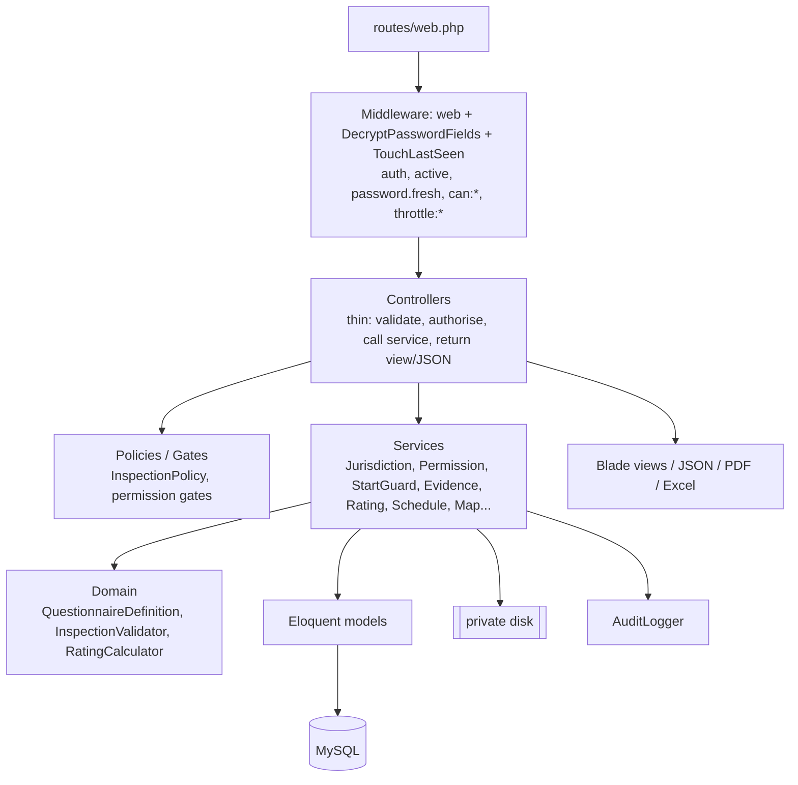
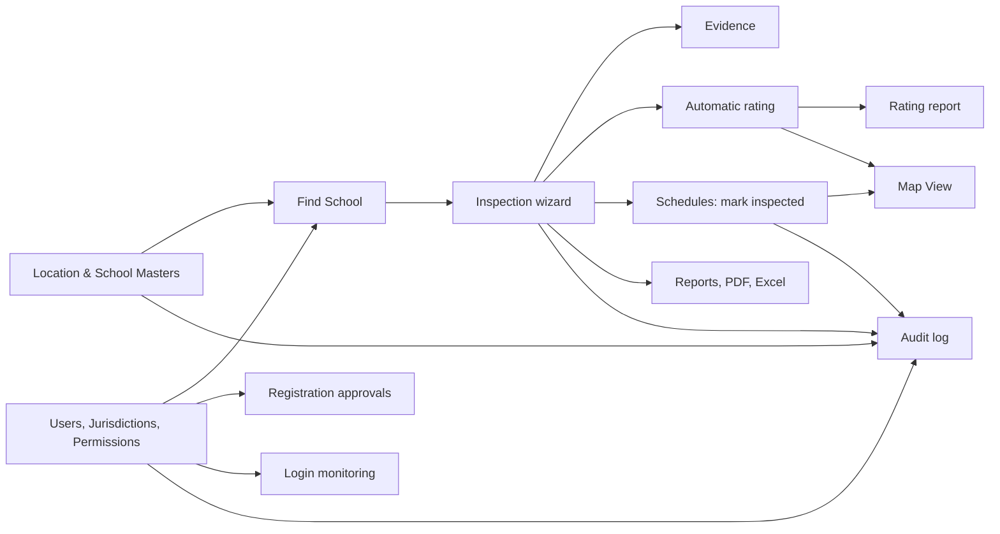

# Project File Structure and Technical Architecture

School Inspection Management System, 19-11-2026. This document is based on the files in the repository (357 tracked files) and on `php artisan route:list` (102 routes).

---

## 1. Technology stack (verified from `composer.json`, `package.json`, `vite.config.js`)

| Layer | Technology | Version / note |
|---|---|---|
| Language | PHP | ^8.2 (XAMPP `D:\xampp\php`) |
| Framework | Laravel | ^12.0 |
| Database | MySQL / MariaDB | MariaDB 10.4 locally; SQLite in-memory for tests |
| PDF | `barryvdh/laravel-dompdf` | ^3.1: inspection report and rating report PDFs |
| Excel | `maatwebsite/excel` | ^3.1: master imports, report and login exports (`App\Exports\ArrayExport`) |
| CAPTCHA | `mews/captcha` | ^3.5: login, from the 3rd attempt |
| Views | Blade + anonymous components | `resources/views/components` |
| CSS | Bootstrap 5.3 + custom SCSS design system | `resources/scss/app.scss` (≈1,700 lines), Bootstrap Icons |
| JavaScript | Vanilla ES modules (no jQuery, no SPA framework) | 15 modules in `resources/js`, `axios` for AJAX |
| Maps | Leaflet 1.9 + `leaflet.markercluster` | bundled locally; OpenStreetMap tiles; OSRM routing |
| Drag and drop | SortableJS | schedule planner |
| Crypto in browser | `node-forge` | RSA encryption of password fields |
| Offline | IndexedDB (native API) | `resources/js/offline-queue.js` |
| Build | Vite 6 + `laravel-vite-plugin`, Sass, Autoprefixer | targets Chrome/Edge/Firefox 100+, Safari 15+ |
| Tests | PHPUnit 11 | 20 feature test files; no unit or JS tests |
| Dev tools | Laravel Pint, Pail, Sail, Collision, Faker, Mockery | |

**What the brief expected but is not in the project:** jQuery, `config/permission.php` (no Spatie package; permissions are custom tables), `routes/api.php` (no API), `public/css`, `public/js` and `public/images` (assets are built by Vite into `public/build`, and logos are in `public/logo`).

---

## 2. Directory structure

```text
SCHOOLINSPECTION/
├── app/
│   ├── Console/Commands/      GeneratePasswordKeys (security:keys), ImportMapBoundaries (map:boundaries), RecalculateRatings (ratings:recalculate)
│   ├── Enums/                 UserLevel, UserStatus, InspectionStatus, EvidenceStatus, ScheduleStatus
│   ├── Exports/               ArrayExport (generic Excel export)
│   ├── Http/
│   │   ├── Controllers/       14 root/feature controllers + Admin/ (9) + Auth/ (3)
│   │   ├── Middleware/        DecryptPasswordFields, EnsureUserIsActive, ForcePasswordChange, TouchLastSeen
│   │   └── Requests/          RegisterRequest (Form Request)
│   ├── Models/                27 Eloquent models + Concerns/HasEncryptedRouteKey
│   ├── Policies/              InspectionPolicy
│   ├── Providers/             AppServiceProvider (gates, rate limiters, HTTPS, logout audit)
│   ├── Questionnaire/         QuestionnaireDefinition (fixed form v2), InspectionValidator
│   ├── Rating/                RatingCalculator (pure formula), DefaultScheme (version 1)
│   ├── Services/              17 services + Otp/ (OtpSender, LogOtpSender)
│   └── Support/               UrlId, RouteOptimizer, FileSize, UserAgent
├── bootstrap/app.php          routing, middleware aliases ('active', 'password.fresh'), web middleware append
├── config/                    Laravel config + inspection.php (all project-specific settings)
├── database/
│   ├── migrations/            24 migrations
│   ├── seeders/               RolePermission, MasterValue, DemoLocationSchool, StateAdmin, DemoUser, LoadTest
│   └── factories/             UserFactory
├── Documents/                 PRD, Modification V1–V7 requests, paper form images, this documentation brief
├── docs/screenshots/          16 UI screenshots used by the documents
├── Product Details/           THIS folder: all product and technical documents, Requirements/ copies, the combined Word file
├── public/
│   ├── build/                 Vite output (ignored by git)
│   ├── geo/                   state and district GeoJSON + districts/ outlines (built by map:boundaries)
│   ├── KML/Assam/             raw district KML (17 MB, not committed)
│   ├── logo/                  ASSAM GOVT LOGO.png, SSA LOGO.png
│   └── index.php, robots.txt, favicon.ico
├── resources/
│   ├── js/                    app, wizard, camera, review, register, offline-queue, password-encrypt, mobile-input,
│   │                          map, map-common, leaflet-global, school-map, schedule-planner, schedule-route
│   ├── scss/app.scss          design system on top of Bootstrap
│   └── views/                 54 Blade files (see UI document)
├── routes/
│   ├── web.php                all HTTP routes (170 lines)
│   └── console.php            inspections:expire-drafts, register:purge-tmp + their schedule
├── storage/app/private/       employee-photos, id-proofs, evidence, keys (RSA), register-tmp
├── tests/Feature/             20 feature test files
├── tools/loadtest/            loadtest.php (see LOAD_TEST.md)
└── *.md                       README, CLAUDE (developer rules), ACTION (change log)
```

---

## 3. File inventory (important files)

| Sl | Path | Type | Purpose | Module |
|---|---|---|---|---|
| 1 | `routes/web.php` | Routes | All web routes, grouped by middleware and gate | All |
| 2 | `routes/console.php` | Routes | Artisan closures and the schedule (00:30 draft expiry, 01:00 purge of temporary registration files, monthly audit / cache clean-up), `users:reset-demo`, `data:clean-test` | Inspection, Registration |
| 3 | `bootstrap/app.php` | Bootstrap | Middleware aliases, global web middleware | Security |
| 4 | `app/Providers/AppServiceProvider.php` | Provider | Defines a gate per permission slug and the `state_admin` gate; rate limiters `login`, `register`, `uploads`; forces HTTPS in production | Access |
| 5 | `config/inspection.php` | Config | Draft expiry, login lockout, upload limits, mandatory photos, map, schedule and security settings, page size, retention | All |
| 6 | `app/Questionnaire/QuestionnaireDefinition.php` | Domain | The fixed 7-step questionnaire (codes, types, options, conditions) | Inspection |
| 7 | `app/Questionnaire/InspectionValidator.php` | Domain | Missing items, teacher totals rule, warnings, progress % | Inspection |
| 8 | `app/Http/Controllers/InspectionController.php` | Controller | Start, steps, save answers and rows, review, submit, cancel, unlock | Inspection |
| 9 | `app/Http/Controllers/EvidenceController.php` | Controller | Upload, serve and delete photos and documents | Evidence |
| 10 | `app/Http/Controllers/ReportController.php` | Controller | My Inspections, Inspections in Area, report page, inspection PDF, list PDF (the list Excel was removed in V14) | Reports |
| 11 | `app/Http/Controllers/RatingReportController.php` | Controller | Rating report, Excel, PDF | Rating |
| 12 | `app/Http/Controllers/MapController.php` | Controller | Map page and its JSON (areas, schools) | Map |
| 13 | `app/Http/Controllers/ScheduleController.php` | Controller | Calendar, planner, approvals, plan actions | Scheduling |
| 14 | `app/Http/Controllers/SchoolController.php` | Controller | Find School (search by UDISE or name, within the jurisdiction) and the school page | Schools |
| 15 | `app/Http/Controllers/DashboardController.php` | Controller | Personal dashboard | Dashboard |
| 16 | `app/Http/Controllers/Auth/*` | Controllers | Login, Register, Password (change, forgot, reset) | Auth |
| 17 | `app/Http/Controllers/Admin/*` | Controllers | Approvals, Users, Locations, Constituencies, Schools, TLM items, Notice types, Imports, Rating settings, Mobile requests, Audit log, Login report, Test data | Admin |
| 18 | `app/Services/JurisdictionService.php` | Service | Scopes every query to the user's area | Access |
| 19 | `app/Services/PermissionService.php` | Service | Role plus individual permissions; per-request cache | Access |
| 20 | `app/Services/ApproverResolver.php` | Service | Who may approve which registration | Registration |
| 21 | `app/Services/InspectionStartGuard.php` | Service | Start rules (own draft, another officer's draft, same month) | Inspection |
| 22 | `app/Services/EvidenceStorage.php` | Service | File validation, hash, malware scan, private storage | Evidence |
| 23 | `app/Services/InspectionNumberGenerator.php` | Service | Unique inspection number | Inspection |
| 24 | `app/Services/RatingService.php`, `app/Rating/*` | Service/Domain | Rating calculation, versions, recalculation | Rating |
| 25 | `app/Services/RatingReportService.php` | Service | Rating report queries | Rating |
| 26 | `app/Services/MapDataService.php`, `DistrictBoundaryService.php` | Service | Map aggregates, district outlines | Map |
| 27 | `app/Services/ScheduleService.php`, `app/Support/RouteOptimizer.php` | Service | Plan rules, approval, reassignment, route ordering | Scheduling |
| 28 | `app/Services/AuditLogger.php` | Service | Append-only audit insert | Audit |
| 29 | `app/Services/LoginMonitorService.php`, `app/Support/UserAgent.php` | Service | Login logs and report | Monitoring |
| 30 | `app/Services/PasswordCrypto.php`, `Middleware/DecryptPasswordFields.php`, `resources/js/password-encrypt.js` | Security | RSA password transport encryption | Security |
| 31 | `app/Support/UrlId.php`, `Models/Concerns/HasEncryptedRouteKey.php` | Security | Encrypted record IDs in URLs | Security |
| 32 | `app/Services/MasterImportService.php` | Service | Excel import of locations and schools with an error file | Masters |
| 33 | `app/Services/RegisterUploadStash.php` | Service | Keeps valid uploads across a failed registration submit | Registration |
| 34 | `resources/views/components/layouts/app.blade.php` | Layout | Authenticated shell: sidebar, top bar, bottom nav, idle-session warning | UI |
| 35 | `resources/views/components/layouts/portal.blade.php` | Layout | Guest pages (login, register, password) | UI |
| 36 | `resources/views/inspections/step.blade.php` | View | Wizard step screen (all 7 steps) | Inspection |
| 37 | `resources/js/wizard.js` | JS | Autosave, conditional questions, rows, live teacher totals, offline queue use | Inspection |
| 38 | `resources/js/camera.js` | JS | In-app camera and gallery, resize ≤1600 px, stamp strip, SHA-256, upload | Evidence |
| 39 | `resources/js/offline-queue.js` | JS | IndexedDB queue of unsent operations, replayed in order | Offline |
| 40 | `resources/js/map.js`, `map-common.js` | JS | Map View, outlines, directions panel | Map |
| 41 | `resources/js/schedule-planner.js` | JS | Planner with drag and drop and an ordered route | Scheduling |
| 42 | `resources/scss/app.scss` | SCSS | Design tokens and components | UI |
| 43 | `database/seeders/*` | Seeders | Roles/permissions, master values, demo locations and schools, State Admin, demo officers (non-production) | Data |
| 44 | `tests/TestCase.php` | Test | Refuses to run on anything but SQLite in-memory | Testing |
| 45 | `app/Http/Controllers/HolidayController.php`, `app/Services/HolidayCalendar.php`, `app/Models/Holiday.php` | Controller/Service | Holiday Calendar: month grid, add / edit / delete, Excel template and import, working-day checks, day popup data (`dayData()`), districts a user may edit (`editableDistricts()`) | Holidays (V14) |
| 46 | `app/Http/Controllers/NoticeController.php`, `app/Services/NoticeService.php`, `app/Models/{Notice,NoticeRead}.php` | Controller/Service | Notices & Orders: inbox, compose, publish (audience check), read / acknowledge, read report, homepage tick, withdraw, attachment, unread count (cached) | Notices (V14) |
| 47 | `app/Http/Controllers/Admin/NoticeTypeController.php`, `app/Models/NoticeType.php` | Controller/Model | Notice Types master (cached map; add, edit, make inactive) | Notices (V14) |
| 48 | `app/Http/Controllers/TodaySchoolsController.php`, `app/Services/DailySchoolListService.php`, `app/Models/{DailyDisplaySetting,DailySchoolList}.php` | Controller/Service | Today's Schools: list made once per day, priority / random pick, carry-over, assign, open drafts, settings | Today's Schools (V14) |
| 49 | `app/Http/Controllers/NetworkIssueController.php` | Controller | Network Issues list and PDF (NET_01) | Reports |
| 50 | `app/Http/Controllers/Admin/TestDataController.php`, `app/Services/TestDataCleaner.php` | Controller/Service | Clean Test Data by group, local server only (404 otherwise) | Test data |
| 51 | `app/Services/DemoUserReset.php`, `HousekeepingService.php` | Service | `users:reset-demo`; audit archive / purge and cache clean-up | Housekeeping |
| 52 | `resources/js/notice-badge.js`, `holiday-day.js`, `filter-partial.js`, `school-suggest.js` | JS | Live unread counters; calendar day popup; section loading of filter pages; school suggestions | UI |
| 53 | `resources/views/components/page-tabs.blade.php`, `dashboard/partials/{calendar,notices,ticker}.blade.php`, `holidays/partials/day-modal.blade.php` | Views | Page tabs of merged menu items; dashboard rail and Latest Notice strip; day popup | UI |

### 3.1 Shared components and reusable code
- **Blade components:** `<x-layouts.app>`, `<x-layouts.portal>`, `<x-status-badge>`, `<x-rating-badge>`, `<x-stat-card>`, `<x-empty-state>`, `<x-user-avatar>`.
- **Partials:** `partials/flash`, `partials/captcha`, `partials/password-key`, `inspections/partials/*` (question, stepper, camera, photo viewer, step answers, fund summary, rating card).
- **Reusable PHP:** `JurisdictionService::scope()`, `PermissionService::has()`, `AuditLogger::log()`, `QuestionnaireDefinition::optionLabel()`, `FileSize::human()`, `UrlId`, `ArrayExport`.
- **Reusable JS:** `map-common.js` (`drawDistrictOutline()`, `createDirections()`, `directionsPanelHtml()`, `bindDirectionsPanel()`), `offline-queue.js`, `mobile-input.js` (`input[data-mobile]`).

### 3.2 Unused, legacy or duplicate items
| Item | Observation |
|---|---|
| `otp_verifications`, `app/Services/Otp/*` | Ready for Phase 2, not used by any screen |
| v1 question codes (`GOV_*`, `CON_*`, `ATT_*`, `CLS_*`, `FIN_*`), `InspectionAbsentTeacher::STATUSES`, fund `fund_category_id` / `amount_*` | Legacy, kept so that version 1 inspections stay readable. Must not be reused |
| `@fontsource-variable/inter` (npm) | Installed but imported nowhere. The SCSS uses a system font stack (Segoe UI, Noto Sans, Roboto…). It can be removed |
| `Documents/Document.docx` and `Documents/PRODUCT REQUIREMENTS DOCUMENT.docx` beside `School_Inspection_PRD.docx` | Several requirement documents; `School_Inspection_PRD.docx` v3.0 is the one cited in code |
| `Documents/~$ODUCT REQUIREMENTS DOCUMENT.docx` | Office lock file (ignored by git) |
| `public/KML/Assam` (17 MB) | Raw source for `map:boundaries`; it sits in the public web root although only the generated `public/geo` is needed at run time |
| `laravel/sail` | Docker dev tool, not used on XAMPP |

---

## 4. Backend architecture



**Request path, using "save an answer" as the example:** `POST /inspections/{key}/answers` → the `web` middleware group (session, CSRF, password decrypt, last seen) → `auth`, `active`, `password.fresh` → the route binding decrypts the `UrlId` token (404 if it is invalid) → `InspectionController::saveAnswer` → `authorize('update')` (the officer, while draft or unlocked) → validation against the `QuestionnaireDefinition` question → upsert `inspection_answers` → `completion_pct` update → JSON progress.

### 4.1 Middleware
| Middleware | Applied | Effect |
|---|---|---|
| `DecryptPasswordFields` | global web | Decrypts RSA-encrypted `password*` fields; refuses plain text unless config allows it |
| `TouchLastSeen` | global web | Updates the login log `last_seen_at` at most once a minute |
| `EnsureUserIsActive` (`active`) | authenticated group | Logs out users who are not active |
| `ForcePasswordChange` (`password.fresh`) | most authenticated routes | Redirects to Change Password while `must_change_password` is set |
| `can:<permission>` | route groups | Permission gates |
| `throttle:*` | login 10/min per IP, register 10/h, uploads 60/min per user, map and lookup 120/min | Rate limits |

### 4.2 Routes → controllers (summary)
| Area | Prefix / routes | Controller | Gate |
|---|---|---|---|
| Guest | `/login`, `/register`, `/register/kept/{field}`, `/forgot-password`, `/reset-password` | `Auth\*` | guest |
| Public lookup | `/locations/{districts\|blocks\|clusters}` | `LocationLookupController` | none (throttled) |
| Account | `/logout`, `/session/ping`, `/password/change`, `/dashboard`, `/profile*` | Login, Password, Dashboard, Profile | auth |
| Schools | `/schools`, `/schools/{school}`, `POST /schools/{school}/inspections`, `/my-inspections`, `/subjects/suggest` | School, Inspection, Report | `conduct_inspections` |
| Inspection | `/inspections/{inspection}/…` (step, answers, progress, teachers, classrooms, funds, suggestions, review, submit, submitted, cancel, unlock, evidence, show, pdf) | Inspection, Evidence, Report | policy |
| Evidence | `/evidence/{evidence}` GET/DELETE | Evidence | policy |
| Reports | `/inspections`, `/export-pdf/{mine\|area}`, `/reports/coverage[/export\|/export-pdf\|/settings]`, `/reports/ratings[/export\|/export-pdf]`, `/reports/network-issues[/export-pdf]` | Report, CoverageReport, RatingReport, NetworkIssue | `view_reports`, `export_excel`, `configure_coverage`, `state_admin` (ratings) |
| Today's Schools (V14) | `/today`, `/today/assign`, `/today/rows/{row}[/skip]`, `/today/settings` | TodaySchools | `conduct_inspections`, `view_reports` (assign), `manage_holidays` (settings) |
| Holidays (V14) | `/holidays`, `/holidays/{holiday}`, `/holidays/template`, `/holidays/import` | Holiday | any (view); `manage_holidays` (edit) |
| Notices (V14) | `/notices`, `/notices/create`, `/notices/unread-count`, `/notices/{notice}` + acknowledge, attachment, home, withdraw | Notice | any (inbox); `issue_notices` (compose, home, withdraw) |
| School suggestions | `/school-suggest` | School@suggest | auth (throttled) |
| Map | `/map`, `/map/areas/{level}`, `/map/schools` | Map | `view_reports` |
| Schedules | `/schedules`, `/plan`, `/plan/schools`, `/approvals`, `/{schedule}` + approve/reject/cancel/reassign, `/items/{item}/skip` | Schedule | `view_reports` + `ScheduleService` checks |
| Admin | `/admin/approvals*`, `/admin/users*`, `/admin/mobile-requests`, `/admin/audit`, `/admin/login-report*`, `/admin/locations*`, `/admin/schools*`, `/admin/rating*`, `/admin/imports*`, `/admin/constituencies*`, `/admin/tlm-items*`, `/admin/notice-types*`, `/admin/test-data*` (local only) | `Admin\*` | `approve_registrations`, `manage_users`, `state_admin`, `manage_masters` |
| Framework | `/up`, `/captcha/*` | Laravel, mews/captcha | none |

The full page list is in `UI_Pages_and_Application_Modules.md`.

### 4.3 Console commands and scheduler
| Command | Purpose | Schedule |
|---|---|---|
| `inspections:expire-drafts` | Cancel drafts older than `draft_expiry_days` (7) and audit each | daily 00:30 |
| `register:purge-tmp` | Delete kept registration uploads older than 24 h | daily 01:00 |
| `ratings:recalculate [--all]` | Re-rate inspections with the active scheme | manual |
| `map:boundaries [--check\|--assign]` | Build GeoJSON outlines from the KML; link districts | manual |
| `security:keys` | Generate the RSA key pair in `storage/app/private/keys` | manual (once per server) |
| `audit:purge [--days=]` | Archive audit entries older than the retention period to Excel, then delete them | monthly, 1st 02:00 |
| `cache:purge` | Clear the cache, compiled views and kept registration files | monthly, 1st 02:15 |
| `users:reset-demo --force` | Keep only the State Administrator and seed the demo officers and notices (refused in production) | manual |
| `data:clean-test {inspections\|schedules\|login_logs\|audit_logs\|all}` (alias `inspections:clean-test-data`) | Clean test data by group; local server only (`TEST_DATA_CLEANUP`, never production) | manual |
| `locations:renumber --force` | Renumber districts, blocks and clusters in code order | manual |

The scheduler requires a cron or Windows Task Scheduler entry for `php artisan schedule:run` every minute. That is a deployment step and is not in the code.

---

## 5. Frontend architecture

- **Server-rendered** Blade pages. JavaScript adds behaviour per page; Vite has 10 entry points (`vite.config.js`).
- `app.js` is loaded on every page. It imports Bootstrap, axios, `password-encrypt.js` and `mobile-input.js`, and handles the sidebar collapse (`localStorage` `si-sidebar`) and the idle-session warning and ping.
- The **wizard** (`wizard.js`) autosaves each answer through AJAX. It shows and hides conditional questions using the same rules as the server, adds and edits rows, and shows the live teacher totals box. Each save is queued through `offline-queue.js`, so it is replayed when the network returns.
- **Camera** (`camera.js`): `getUserMedia` or the gallery → canvas resize → stamp (date, time, GPS, school) → JPEG → SHA-256 → upload with `evidence_uid`.
- **Review** (`review.js`) locks Submit until the device queue is empty.
- **Maps** (`map.js`, `school-map.js`, `map-common.js`): Leaflet with clustered markers, area polygons and colour by status or rating. Directions use OSRM, called only when the officer presses "Show route".
- **Planner** (`schedule-planner.js`): pick schools, drag to reorder, suggested order (`RouteOptimizer` on the server), travel estimates.
- **Section loading** (`filter-partial.js`): filter forms and same-page links swap only the result sections, with a loader; the URL is pushed so Back works.
- **School suggestions** (`school-suggest.js`): name / UDISE suggestions on school search boxes.
- **Live unread counters** (`notice-badge.js`, V14): opening a notice clears its New tag and lowers every counter at once; counts are fetched again on Back, tab focus and every minute (`/notices/unread-count`).
- **Calendar day popup** (`holiday-day.js`, V14): clicking a calendar date opens the day's holidays; holiday managers add or remove holidays there.
- **Latest Notice strip** (dashboard, V14): a static strip (`.news-ticker`, no scrolling since 25-11-2026) of the pinned or newest notice ticked for the homepage.

---

## 6. Dependencies between modules



`JurisdictionService` and `PermissionService` are cross-cutting. Every module that lists schools, users or inspections depends on them.
