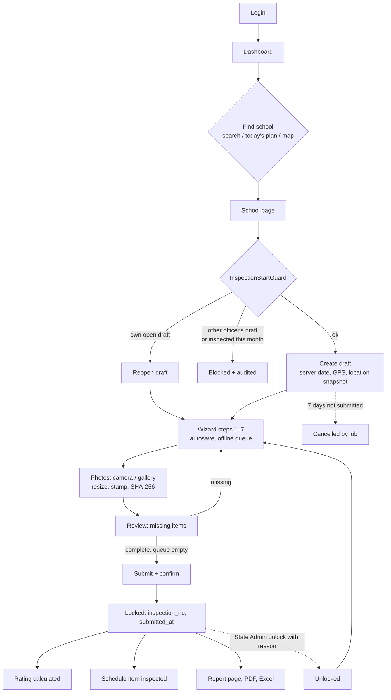

# School Inspection Mechanism

This document traces the whole mechanism, from officer registration to the final report. 19-11-2026. It is based on the source code, chiefly:
- `InspectionController`, `InspectionStartGuard`, `QuestionnaireDefinition` and `InspectionValidator`;
- `EvidenceStorage`, `ScheduleService`, `RatingService` and `RatingCalculator`;
- `ReportController` and `RatingReportController`.

Status labels: **Implemented**, **Partial**, **Not implemented**.

---

## 1. User management

| Function | How it works | Status |
|---|---|---|
| **User types** | `UserLevel`: `state_admin` (State Administrator), `state`, `district`, `block`, `cluster`. There are no separate "District Administrator" or "Inspection Officer" roles. Every officer level can inspect; administrative powers come from permissions (see `User_Roles_and_Permissions.md`). | Implemented |
| **Registration** | `/register` (`RegisterController`, `RegisterRequest`) collects: name, designation (master list or "Other" with text), optional employee ID, mobile, optional email, password, level, the area matching the level (cascading dropdowns from `/locations/{type}`), the employee photo (required, JPG/PNG ≤ 1 MB) and an optional ID proof (PDF/JPG/PNG ≤ 2 MB). Valid files are kept across a failed submit (`RegisterUploadStash`). The State Admin level cannot be self-registered. | Implemented |
| **Mobile validation** | `^[6-9]\d{9}$` in three places: the browser (`mobile-input.js`), the server rule, and the DB CHECK (`chk_users_mobile`). The mobile is unique and is the login ID. | Implemented |
| **OTP / verification** | Not in Phase 1. `app/Services/Otp/OtpSender` (bound to `LogOtpSender`) and the `otp_verifications` table exist; nothing uses them yet. | Not implemented |
| **Administrator verification** | The approver sees the applicant's details, photo and ID proof (served from the private disk via `admin.users.photo` / `admin.users.id-proof`). | Implemented |
| **Approval / rejection** | `ApproverResolver` chain: State → State Admin. District → State Admin, or a State officer with permission. Block → a District officer of the same district with permission, else State Admin. Cluster → a Block officer of the same block with permission, else a District officer, else State Admin. A rejection requires a reason. A rejected user can apply again. | Implemented |
| **Login / logout** | Mobile + password. CAPTCHA is required from the 3rd attempt (after 2 failures in the session). The account is locked for 20 minutes after 3 wrong attempts. The session is regenerated on login. Each login, refusal and logout is written to `user_login_logs` and `audit_logs`. | Implemented |
| **Password management** | Passwords are hashed with bcrypt (12 rounds). In transit they are RSA-encrypted in the browser and decrypted by middleware. A password change is forced on first login and after an admin reset. Forgot password sends an email link only when the user has an email address; otherwise the State Admin resets it. | Implemented (email reset: Partial, mail driver is `log` locally) |
| **Role-based access** | Role = level; 7 permissions; individual grants (approve registrations to State/District/Block; manage users to District). | Implemented |
| **Permission-based navigation** | The sidebar items are wrapped in `@can` (see the UI document). | Implemented |
| **Transfers** | `Admin\UserController::transfer` ends the current `user_jurisdictions` row and opens a new one. Users cannot change their own level or area. | Implemented |
| **Mobile number change** | The officer requests it from the Profile page; the State Admin approves it (`mobile_change_requests`). | Implemented |

---

## 2. School management

| Item | Implementation |
|---|---|
| Hierarchy | `states` → `districts` → `blocks` → `clusters` → `schools`. Each child holds its parent's FK. `schools` also stores `state_id`, `district_id`, `block_id` and `cluster_id`, so jurisdiction filters are a single-column match. |
| Codes | District `code`, block `code` (6 digits, e.g. 180101), cluster `code` (8 digits, e.g. 18010101), school `udise_code` (`char(11)`, unique) |
| Location | `schools.address`, `latitude`, `longitude` (decimal 10,7). Districts, blocks and clusters also have centre coordinates for the map. Districts have `boundary_name`, which links them to a KML outline. |
| Category / type | `management_id` and `category_id` refer to `master_values` (types `management`, `category`) |
| Status | `active` or `closed`. Closed schools are listed after active ones and cannot be inspected |
| Maintenance | School Master form (`Admin\SchoolMasterController`) and Excel import with a downloadable template and an error file (`Admin\ImportController`, `MasterImportService`, `import_batches`); State Admin / `manage_masters` only |
| Officer mapping | There is no school-to-officer assignment table. An officer can inspect **any active school inside their jurisdiction** (cluster, block, district or state), enforced by `JurisdictionService::coversSchool()`. A schedule can tie schools to an officer for a day. |
| Search and filtering | Find School (`/schools`) searches by UDISE prefix or by name within the jurisdiction. It shows badges ("being inspected by…", "inspected this month") and the latest rating. |

---

## 3. Inspection planning (New Module 2: Schedules)

| Function | Implementation | Status |
|---|---|---|
| Officer assignment | A higher officer (`ScheduleService::isSuperior`) can create a plan for an officer below them in their area. That plan is published straight away. | Implemented |
| Self-planning | An officer plans their own day. If `schedule.approval_required` (default true), the plan is **submitted** to a higher officer, who approves it (→ published) or rejects it with a note (→ the officer edits and resubmits). | Implemented |
| School allocation | `candidateSchools()` lists active schools in the officer's area for the date, with the last inspection date. A school can be on only one plan per day (DB unique key). At most 8 schools per day. Dates from today up to 92 days ahead. | Implemented |
| Date-wise planning | Calendar (`/schedules`) by week/month; the planner (`/schedules/plan`); the plan page (`/schedules/{key}`) | Implemented |
| District/block/cluster filtering | The planner filters by block and search; the calendar lists only officers in the user's area | Implemented |
| Route | `RouteOptimizer` orders the visits (nearest-neighbour from the start point). Distance = straight line × 1.3; time at 25 km/h + 60 min per visit; start at 09:30. A road route on a map is available per plan (`schedule-route.js`). | Implemented (estimate, not road-accurate) |
| Map-based identification | Map View (`/map`): drill-down District → Block → Cluster → schools, colour by status (inspected / in progress / pending) or by rating, district outline, directions | Implemented |
| Status | Plan: `draft` → `submitted` → `published` / `rejected` → `completed` / `cancelled`. Item: `planned` → `inspected` (set by `markInspected()` on submit) / `skipped` (with a reason). Reassignment to another officer is possible while the plan is open. Every step is audited. | Implemented |
| Notifications of plans | None. Officers see their plan on the dashboard ("Today's plan") | Not implemented (Phase 2) |

---

## 4. Inspection form and parameters (Questionnaire Version 2)

Source: `app/Questionnaire/QuestionnaireDefinition.php` (`VERSION = 2`, from `Documents/Modification of the ApplicationV1.docx`). The questionnaire is **fixed in code**; there is no question table. The same definition drives the rendering (`inspections/partials/question.blade.php`), the browser rules (`wizard.js`) and the server rules (`InspectionValidator`).

Answer types used: `radio` (Yes/No, Satisfactory/Unsatisfactory, other lists), `number`, `text`, `textarea`. The engine also supports `multi`, `select` and `date`, but v2 does not use them. Conditions: `show_if`, `enable_if`, `required_if`, `required_unless`. The engine also supports per-question remarks and photo rules (`remarks_if`, `photo`), but v2 uses step 7 for photos.

### 4.1 Steps
| Step | Title | Storage | Mandatory |
|---|---|---|---|
| 1 | Condition of the School | `inspection_answers` (`BAS_PERSON_*`, `CND_01`–`CND_26`) | Yes (conditional ones when their parent is answered) |
| 2 | Teacher's & Student's Information | `inspection_answers` (`TSI_01`–`TSI_13`) | Yes, all 13 numbers + the teacher totals rule |
| 3 | Teachers Absentee Form | `inspection_absent_teachers` rows | No (warning if fewer rows than absent teachers) |
| 4 | Class Room Performance | `inspection_classroom_observations` rows | At least 1 row |
| 5 | Fund Received & Expenditure | `inspection_fund_positions` (one row per financial year, lakh) | No |
| 6 | School Governance | `inspection_answers` (`GOVR_01`–`GOVR_24`) + up to 3 suggestions in `inspection_remarks` | Yes (conditional ones by rule) |
| 7 | Photographs of School | `inspection_evidence` | 4 mandatory categories (1 each): `school`, `toilet_block`, `ict_smart`, `classroom_transaction`; up to 20 photos and 5 documents |

### 4.2 Question inventory: step 1, Condition of the School
| Code | Question | Type / options | Rule |
|---|---|---|---|
| `BAS_PERSON_NAME` | Name of the person met at the school | text | required |
| `BAS_PERSON_DESIG` | Designation of the person met | text | required |
| `CND_01` | Type of School Building | Pucca / Semi Pucca / Others | required |
| `CND_02` | Boundary Wall | Yes/No | required |
| `CND_03` | Functional Toilet for Girls | Yes/No | required |
| `CND_04` | Running Water Facility in Girls Toilet | Yes/No | required |
| `CND_05` | Functional Toilet for Boys | Yes/No | required |
| `CND_06` | Running Water Facility in Boys Toilet | Yes/No | required |
| `CND_07` | Safe Drinking Water Facility | Yes/No | required |
| `CND_08` | Electricity | Yes/No | required |
| `CND_09` | External Electrification | Yes/No | required |
| `CND_10` | Internal Electrification | Yes/No | required |
| `CND_11` | Adequate Number of Classrooms | Yes/No | required |
| `CND_12` | Requirement of ACR (Additional Classroom) | Yes/No | required ("No" is the good answer for the rating) |
| `CND_13` | Land Availability | Yes/No | required |
| `CND_14` | Classrooms having Black Board | Yes/No | required |
| `CND_15` | School Sign Board | Yes/No | required |
| `CND_16` | Does the School have Ramp with Rails | Yes/No | required |
| `CND_17` | Internet Facility | Yes/No | required |
| `CND_18` | Internet is Functional | Yes/No | enabled and required if `CND_17` = Yes |
| `CND_19` | ICT Lab | Yes/No | required |
| `CND_20` | ICT Lab is Functional | Yes/No | enabled and required if `CND_19` = Yes |
| `CND_21` | Vocational Education | Yes/No | required |
| `CND_22` | Smart Classroom | Yes/No | required |
| `CND_23` | Tele Education | Yes/No | required |
| `CND_24` | Does the School have Tinkering Lab | Yes/No | required |
| `CND_25` | Implementing Agency of Tinkering Lab | NITI Aayog / Samagra Shiksha / Not Applicable | shown and required if `CND_24` = Yes |
| `CND_26` | Tinkering Lab is Functional | Yes / No / Not Applicable | shown and required if `CND_24` = Yes |

### 4.3 Step 2, Teacher's & Student's Information (all `number`, required)
`TSI_01` Students present · `TSI_02` Students absent · `TSI_03` Seating (benches/desks) · `TSI_04` Regular teachers · `TSI_05` Contractual teachers · `TSI_06` SSA teachers · `TSI_07` Provincialised tutors · `TSI_08` Tutors newly accorded · `TSI_09` Teachers present today · `TSI_10` Male trained · `TSI_11` Male untrained · `TSI_12` Female trained · `TSI_13` Female untrained.

**Blocking consistency rule** (`InspectionValidator::teacherConsistency()`, live box in `wizard.js`):
- Total teachers = `TSI_04` + `TSI_05` + `TSI_06` + `TSI_07` + `TSI_08`.
- `TSI_09` must be ≤ Total teachers.
- `TSI_10` + `TSI_11` + `TSI_12` + `TSI_13` (Trained + Untrained) must be **equal to** Total teachers (since 21-11-2026). Only Total trained / Total untrained are shown.
- Derived figures shown: total students = `TSI_01` + `TSI_02`; teachers absent = total − present.

### 4.4 Steps 3–5, repeating rows
| Step | Field | Validation |
|---|---|---|
| 3 Absentee | `teacher_name` | required, 2–120 chars |
| | `teacher_type` | Regular / Contractual / Tutor |
| | `reason` | CL, EL, MATL (Maternity), CCL, SL (Study), MEDL (Medical), UL (Un-authorised) |
| | `remarks` | optional ≤ 500 |
| 4 Classroom | `teacher_name` | required, 2–120 |
| | `class` | I–XII |
| | `subject` | required ≤ 100, with suggestions from the `subject` master (`/subjects/suggest`) |
| | `tlm_used` | yes/no |
| | `participation` | Satisfactory / Not Satisfactory |
| | `remarks` | optional ≤ 500 |
| 5 Fund | `financial_year` | `FY-YYYY-YY` from FY-2021-22 up to the current FY; one row per year |
| | `asg_received/expenditure` | Annual School Grant (SSA) |
| | `mdm_received/expenditure` | MDM Fund (SSA) |
| | `govt_received/expenditure` | Government |
| | `other_received/expenditure` | Other Source (decimal, in lakh) |

### 4.5 Step 6, School Governance
| Code | Question | Type | Rule |
|---|---|---|---|
| `GOVR_01` | Method of Teaching | Conventional / Non-Conventional | required |
| `GOVR_02` | SMDC/SMC Formed | Yes/No | required |
| `GOVR_03` | Reason for not forming SMDC/SMC | textarea | shown/required if `GOVR_02` = No |
| `GOVR_04` | Monthly Sitting of SMC/SMDC | Yes/No | shown/required if `GOVR_02` = Yes |
| `GOVR_05` | Morning Assembly | Yes/No | required |
| `GOVR_06` | Free Text Book Received | Yes/No | required |
| `GOVR_07` | Reason for not receiving Free Text Books | textarea | if `GOVR_06` = No |
| `GOVR_08` | Free Uniform Received | Yes/No | required |
| `GOVR_09` | Reason for not receiving Free Uniform | textarea | if `GOVR_08` = No |
| `GOVR_10` | School Cleanliness | Satisfactory/Unsatisfactory | required |
| `GOVR_11` | Organic Kitchen Garden | Yes/No | required |
| `GOVR_12` | Mid-Day Meal on regular basis | Yes/No | required |
| `GOVR_13` | Reason if MDM irregular or not provided | textarea | if `GOVR_12` = No |
| `GOVR_14` | Separate & Hygienic Kitchen | Yes/No | required |
| `GOVR_15` | Hygienic uniform worn by the Cook-cum-Helper | Yes/No | required |
| `GOVR_16` | Regular Health Check-up of Students | Yes/No | required |
| `GOVR_17` | Health Check-up of Cook-cum-Helper | Yes/No | required |
| `GOVR_18` | Fire Extinguisher available | Yes/No | required |
| `GOVR_19` | Availability of Sports Items | Yes/No | required |
| `GOVR_20` | Record Keeping System | Satisfactory/Unsatisfactory | required |
| `GOVR_21` | Administration | Satisfactory/Unsatisfactory | required |
| `GOVR_22` | Attendance | Satisfactory/Unsatisfactory | required |
| `GOVR_23` | Accounting System | Satisfactory/Unsatisfactory | required |
| `GOVR_24` | TLM | Satisfactory/Unsatisfactory | required |
| Suggestions | Up to 3 free-text suggestions (`max_suggestions`) | text ≤ 500 | optional |

### 4.6 Step 7, Photographs and documents
- **Source:** the in-app camera or the phone gallery (Modification V1). Both go through the same browser pipeline: resize to ≤ 1600 px → JPEG → stamp strip (date/time, GPS, school) → SHA-256. Gallery photos are saved with `source = gallery` and labelled "From gallery" in the report and PDF.
- **Server checks** (`EvidenceStorage`): real MIME type (JPEG for photos; PDF/JPEG/PNG for documents), photo ≤ 1 MB and document ≤ 5 MB, hash match, optional ClamAV scan. Random file name on the private disk. Idempotent by `evidence_uid`.
- **GPS:** latitude, longitude and accuracy are stored. If there is no fix, the officer enters a `no_location_reason`.

---

## 5. Inspection workflow

| # | Step | Implementation | Status |
|---|---|---|---|
| 1 | Login | `/login` (mobile, password, CAPTCHA, lockout) | Implemented |
| 2 | Dashboard | `/dashboard`: today / month / total submitted, drafts ("Continue where you left off"), recent reports, today's plan, pending approvals | Implemented |
| 3 | School selection | `/schools`: search within the jurisdiction; or from today's plan or the map | Implemented |
| 4 | School details | `/schools/{key}`: master data, location map and directions, inspection history, latest rating, start button with the start-rule message | Implemented |
| 5 | Start | `POST /schools/{key}/inspections`. `InspectionStartGuard`: reopens the officer's own open draft; blocks if another officer's draft is open or the school was inspected by another officer this calendar month (until the 1st of next month); one per officer/school/day; blocked attempts are audited (`inspection_start_blocked`). Server date/time; start GPS. | Implemented |
| 6 | Questions | `/inspections/{key}/step/{1..7}`. Steps can be visited in any order; each answer autosaves | Implemented |
| 7 | Evidence | Step 7 camera/gallery upload | Implemented |
| 8 | Remarks | Step 6 suggestions; row remarks in steps 3–4 | Implemented |
| 9 | Validation | Live progress (`/progress`); the review page lists missing items per step with links | Implemented |
| 10 | Offline | Unsent saves, rows and photos are kept in IndexedDB and replayed in order; Submit stays locked until the queue is empty | Implemented |
| 11 | Submission | `/review` → `POST /submit` with the "information is correct" confirmation. Inside a transaction with a row lock: `inspection_no` = `SI/{year}/{district code}/{000001}`, `submitted_at`, submit GPS, status `submitted` | Implemented |
| 12 | Status update | Locked; schedule item → `inspected`; rating calculated; audit `inspection_submitted` | Implemented |
| 13 | Administrator review | No review/approval of reports. The State Admin can only **unlock** (with a reason, audited) so the officer can correct and resubmit (`inspection_resubmitted`) | Not implemented (Phase 2) |
| 14 | Final reporting | `/inspections/{key}` report page, `/pdf` (DomPDF), Excel lists, rating report | Implemented |
| — | Draft expiry | Drafts not submitted within 7 days are cancelled daily at 00:30 | Implemented |
| — | Cancel | The officer can cancel their own draft with a reason | Implemented |

---

## 6. Inspection rating and scoring (New Module 3)

| Item | Implementation |
|---|---|
| Formula | Score % = Σ(weight × points) ÷ Σ(weight of the applicable criteria) × 100 (`RatingCalculator`) |
| Points | Each answer criterion maps answer values to 0–1. Yes = 1, No = 0 (reversed for `CND_12`); Satisfactory = 1; Pucca 1 / Semi Pucca 0.5 / Others 0; Non-Conventional 1 / Conventional 0.5 |
| Weights | Default 1 for answers, 3 for metrics; editable on Rating Settings |
| Metric criteria | `student_attendance` (present ÷ enrolled), `teacher_attendance` (present ÷ total teachers), `trained_teachers`, `absentee_authorised` (share of absences not un-authorised), `classroom_tlm`, `classroom_participation`, `fund_utilisation` (expenditure ÷ received) |
| Category scores | The same formula per section: condition, strength, absentee, classroom, fund, governance |
| Bands | ≥ 90 Excellent (green), ≥ 75 Very Good (blue), ≥ 60 Good (yellow), ≥ 40 Needs Improvement (orange), < 40 Unsatisfactory (red) |
| Satisfactory / unsatisfactory | A section below 60 % is listed as an improvement area. Strengths: criteria at full points (up to 3 per section). Weaknesses: criteria at 0 |
| Missing data | Not Applicable criteria are left out of both the numerator and the denominator. A criterion is N/A when its answer value is not listed (e.g. `na`), the question is hidden or disabled, or a metric's denominator is 0 or missing. With no applicable criteria the score is null (not rated) |
| Versioning | Saving the settings creates a new `rating_schemes` version; old ratings keep their scheme. `ratings:recalculate` re-rates with the active scheme |
| When | On submit and resubmit, inside try/catch, so a rating error never blocks a submission |
| Where shown | Report rating card (with the change against the school's previous rating), `<x-rating-badge>` in lists, the school page, Find School, the map (colour by rating), the rating report |

---

## 7. Inspection reports

| Report | Route | Status |
|---|---|---|
| Individual school inspection report | `/inspections/{key}` (HTML) and `/inspections/{key}/pdf`, with photos, GPS, the "From gallery" label and the rating card. Since Modification V8 the PDF does not print the device location at start and submit (the web page still shows it) | Implemented |
| My Inspections (officer-wise, own) | `/my-inspections` | Implemented |
| Inspections in Area | `/inspections` with filters: district, block, cluster, officer, status, school, date | Implemented |
| District / block / cluster-wise | Area filters on the list; the rating report groups by the next level down (`RatingReportService::areas()`); Map View area counts | Implemented |
| Officer-wise | `officer_id` filter on the area list and the map | Implemented (filter, no dedicated officer summary page) |
| Date-wise | Date-range filters; schedules calendar | Implemented |
| Completion statistics | Map View: inspected / in progress / pending per area for a period; dashboard personal counts | Implemented |
| Pending inspections | Map "pending" = schools with no submitted inspection in the period; drafts on the dashboard | Implemented |
| Rating report | `/reports/ratings`: summary, band distribution, section averages, areas, schools (latest against previous) | Implemented |
| Dashboard charts | No charts on the dashboard; the rating report uses bars and band chips | Partial |
| Export | Excel: inspections (`/export/mine`, `/export/area`, one column per question code), rating report, login report. PDF: inspection report, rating report. **CSV**: not provided separately | Implemented (Excel, PDF) |
| Login monitoring | `/admin/login-report` (State Admin) with Excel export | Implemented |
