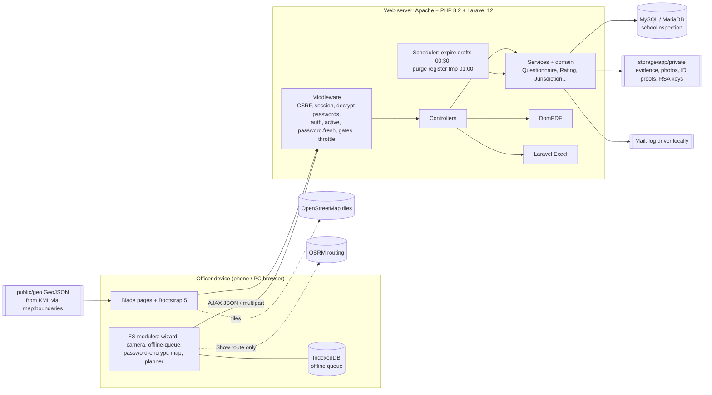
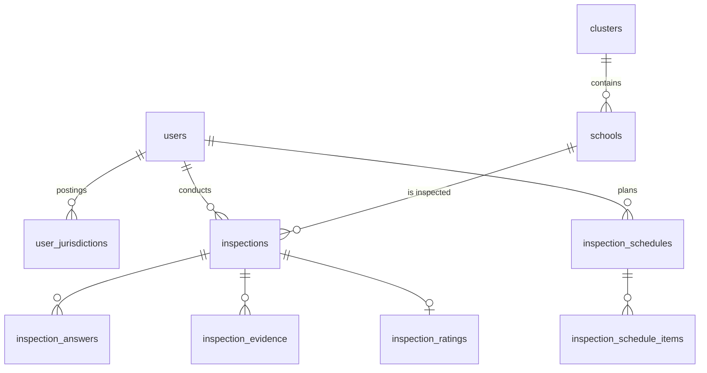
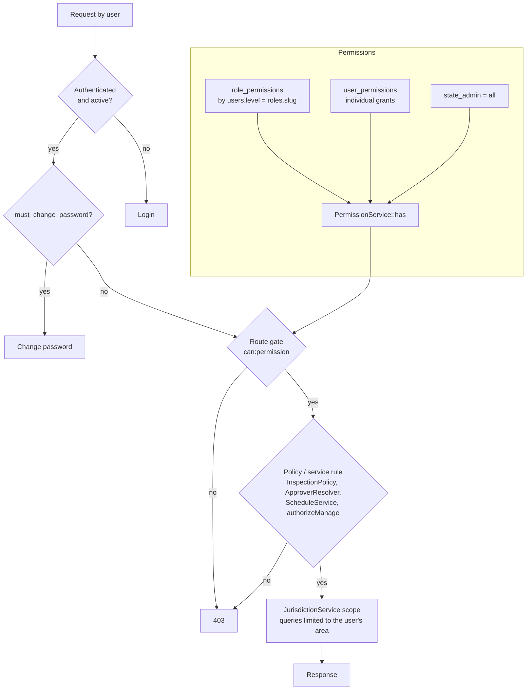
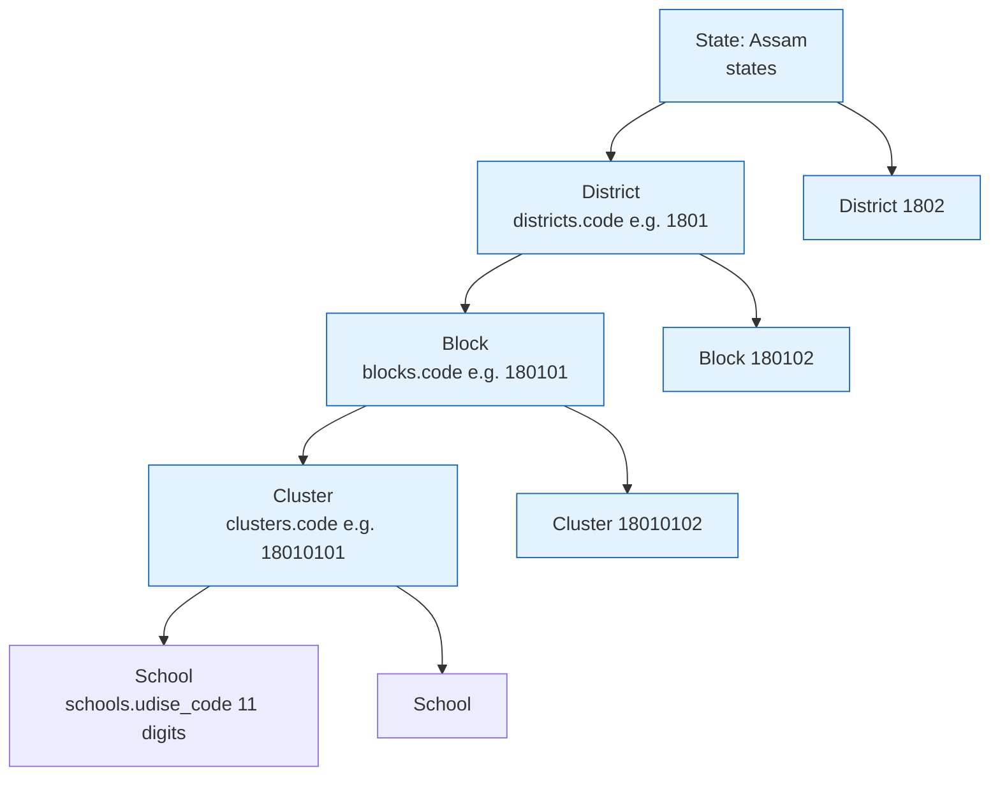
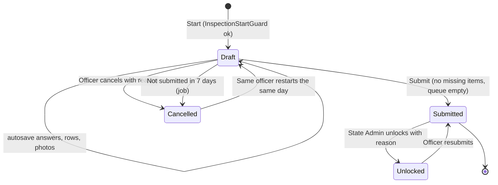
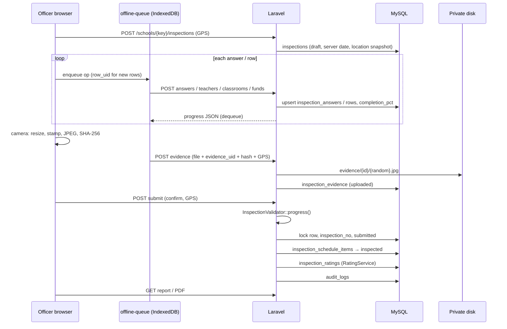
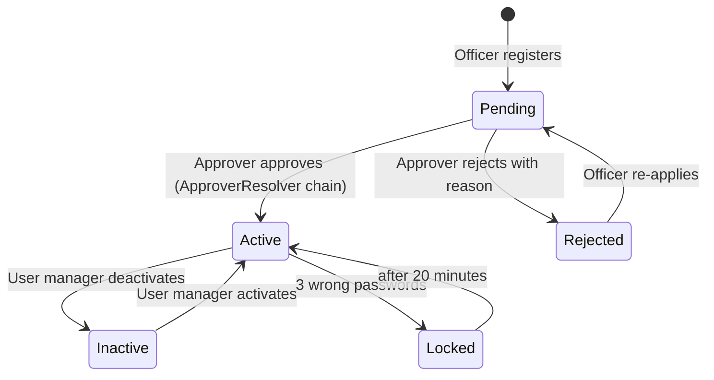
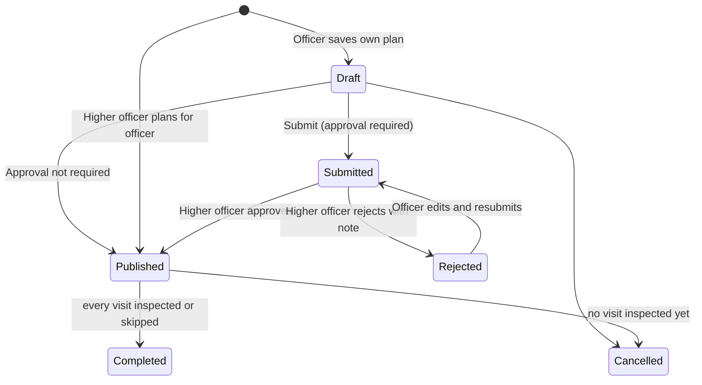
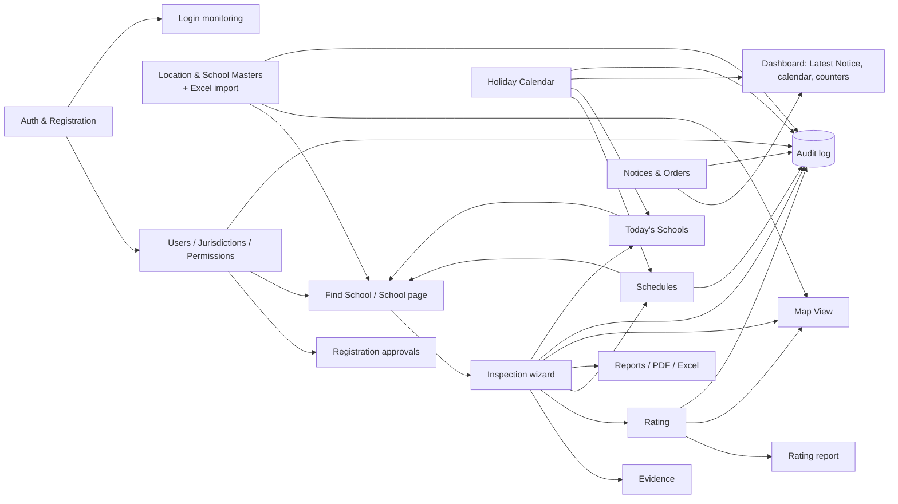
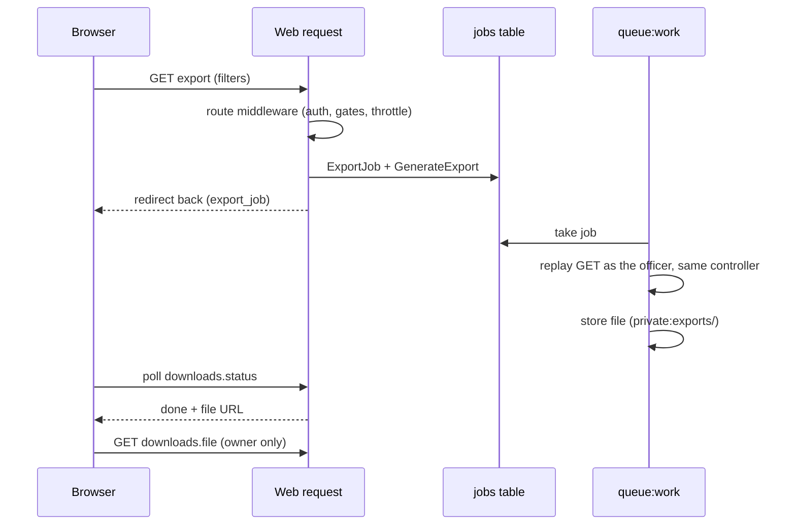

# System Architecture and Workflow

19-11-2026. Every diagram reflects the implemented code. Mermaid renders on GitHub and in VS Code (with a Mermaid extension). In the Word version each diagram is also written out as steps.

---

## 1. Overall system architecture

## 2. Database ER diagram

The ER diagram (main tables, all relations) is in `Database_Architecture_and_Schema.md` §3.5. A compact view:

## 3. User role and access architecture

## 4. School hierarchy

Officer jurisdictions use the same levels: a State officer covers S, a District officer one D, a Block officer one B, and a Cluster officer one C.

## 5. Inspection workflow

The step-level flowchart is in `School_Inspection_Mechanism.md` §5.

## 6. Inspection data flow

## 7. Approval workflows

There is **no approval workflow for inspection reports** (Phase 2). Three approval workflows are implemented.

### 7.1 Registration

### 7.2 Inspection schedule

### 7.3 Mobile number change
Officer request (Profile) → State Admin approves (the mobile is updated) or rejects. Both are audited.

## 8. Application module relationships

### 8.1 V14 workflows (25-11-2026)
- **Holiday → planning:** a gazetted holiday (state, or the officer's district) closes the day. `ScheduleService::checkDate()` refuses a plan on it, and Today's Schools makes no list. Restricted and half holidays are only shown. Holidays are added on the Holiday Calendar (also by clicking a date), by Excel import or by the Assam 2026 seeder.
- **Today's Schools:** on the first view of a working day, `DailySchoolListService` makes the officer's list once (manual → carried over → picked by priority or at random, within the daily limit and the settings). Submitting an inspection marks the row visited; a started draft stays on the list with Continue.
- **Notice → read → counters:** the sender publishes a notice to officer levels inside an area (`NoticeService::publish()`). Officers see it in the Inbox, the dashboard card and, when ticked for the homepage, the Latest Notice strip. Opening it records `read_at` and lowers every unread counter at once; Acknowledge records `acknowledged_at`; the sender sees the read report and can withdraw it.
- **Clean Test Data (local server only):** the State Administrator empties one part (inspections and Today's Schools, schedules, the login log, or the audit log after an Excel archive). The page and command do not exist in production.

### 8.2 Background work (26-11-2026)

Long work runs on the queue worker, not inside a web request:

- **Large downloads:** a click on a heavy Excel / PDF download first passes the route's own checks (sign-in, gates, throttle).
  1. `QueueLargeExports` saves it as an `export_jobs` row and answers at once.
  2. The worker (`GenerateExport`) replays the same request as the same officer through the same checks and controller, then stores the file.
  3. The page shows "Preparing…" and the file downloads by itself when ready. It stays on the **Downloads** page for 24 hours.
- **Excel Upload:** the check and the save run as `ImportMasterFile` jobs. The `import_batches` row follows them (checking → checked → queued → importing → done), and the Upload page shows a progress card that refreshes itself.
- **Clean-up:** `exports:purge` (hourly) removes old downloads and unconfirmed uploads, and marks work not finished in 3 hours as failed.

## 9. Deployment view (current and recommended)

| Item | Current (local) | Production (from the `.env.example` checklist) |
|---|---|---|
| Web | `php artisan serve --port=8010` / XAMPP Apache | Apache or Nginx + PHP-FPM, HTTPS (URLs forced to HTTPS) |
| Assets | `npm run dev` | `npm run build` → `public/build` |
| DB | MariaDB 10.4 | MySQL 8 / MariaDB 10.6+, with backups |
| Scheduler | manual | cron / Task Scheduler: `php artisan schedule:run` every minute |
| Queue | database driver; run `php artisan queue:work` for large downloads and Excel uploads (26-11-2026) | **required**: a `queue:work` service (NSSM / supervisor), `--timeout=3600`, restarted after deploys (`queue:restart`); `cache:status` shows waiting / failed jobs |
| Mail | log | SMTP for password reset links |
| Keys | `php artisan security:keys` | once per server, back up `storage/app/private/keys` |
