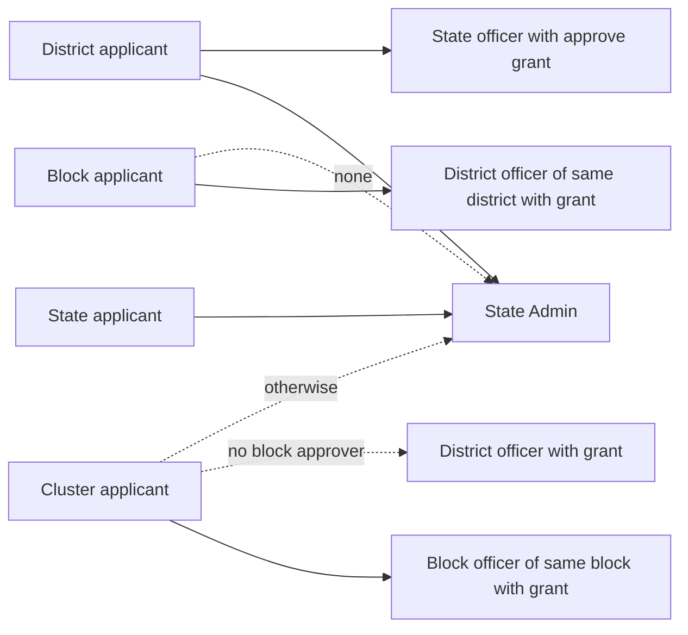

# User Roles and Permissions

19-11-2026. Sources:
- `app/Enums/UserLevel.php`, `app/Enums/UserStatus.php`
- `database/seeders/RolePermissionSeeder.php`
- `app/Services/PermissionService.php`, `app/Services/ApproverResolver.php`, `app/Services/JurisdictionService.php`
- `app/Providers/AppServiceProvider.php`, `app/Policies/InspectionPolicy.php`
- `app/Http/Controllers/Admin/UserController.php`, `resources/views/components/layouts/app.blade.php`

---

## 1. User types

| Level (`users.level`) | Label | Jurisdiction | Self-registration | Typical responsibilities |
|---|---|---|---|---|
| `state_admin` | State Administrator | Whole state | No (seeded by `StateAdminSeeder`) | Masters, users, unlocks, mobile changes, audit, login monitoring, rating settings, all approvals |
| `state` | State Level | Whole state | Yes | Inspect any school; area reports; approve District registrations if permitted |
| `district` | District Level | One district | Yes | Inspect; district reports; approve Block registrations and manage district users if permitted; plan for officers below |
| `block` | Block Level | One block | Yes | Inspect; block reports; approve Cluster registrations if permitted; plan for cluster officers |
| `cluster` | Cluster Level | One cluster | Yes | Inspect the schools of the cluster; cluster reports; own plans |

The brief's "District Administrator" and "Inspection Officer" are not separate roles in the code. A District officer with the `manage_users` grant acts as a district user administrator, and every officer level is an inspection officer.

**User status** (`UserStatus`): `pending` (awaiting approval) → `active` / `rejected`. `active` ⇄ `inactive` (by a user manager). `active` → `locked` (3 wrong passwords, automatically unlocked after 20 min). Only `active` users can sign in, and `EnsureUserIsActive` signs out a user whose status changes during a session.

---

## 2. Roles and permissions

The tables are `roles` (one per level, `slug` = level), `permissions` (7), `role_permissions` (role defaults) and `user_permissions` (individual grants, with `granted_by`). No third-party permission package is used.

| Permission slug | Meaning | state_admin | state | district | block | cluster |
|---|---|---|---|---|---|---|
| `conduct_inspections` | Conduct and submit inspections | ✔ | ✔ | ✔ | ✔ | ✔ |
| `view_reports` | View inspection reports (area lists, rating report, map, schedules) | ✔ | ✔ | ✔ | ✔ | ✔ |
| `export_excel` | Export lists to Excel | ✔ | ✔ | ✔ | ✔ | ✔ |
| `approve_registrations` | Approve registrations of the level below | ✔ | grant | grant | grant | — |
| `manage_users` | Activate, deactivate and edit users | ✔ | — | grant | — | — |
| `manage_masters` | Location Master, School Master, Excel upload, Rating Settings | ✔ | — | — | — | — |
| `unlock_inspections` | Unlock a submitted inspection | ✔ | — | — | — | — |

✔ = role default; **grant** = can be granted individually (`PermissionService::grantableFor()`), only by the State Admin.

**Resolution** (`PermissionService::has()`): an inactive user has nothing; the State Admin has everything; anyone else has the union of the role permissions and the individual grants (cached per request). Every slug is registered as a Laravel gate (`AppServiceProvider`), plus a `state_admin` gate.

### 2.1 Actions restricted beyond the gates
| Action | Rule |
|---|---|
| Edit a user, activate/deactivate | `manage_users` and the target is inside the actor's jurisdiction, not the State Admin, not oneself |
| Transfer, reset password, grant permissions | State Admin only |
| Approve or reject a registration | `ApproverResolver::canApprove()` chain (below) |
| View an applicant's photo / ID proof | The user themself, a valid approver, or a user manager in the jurisdiction |
| View an inspection | Its officer; or `view_reports` + not a draft + inside the jurisdiction (`InspectionPolicy::view`) |
| Edit an inspection | Its officer only, while `draft` or `unlocked` |
| Cancel | Its officer, while `draft` |
| Unlock | `unlock_inspections` (State Admin) and status `submitted`; a reason is required |
| Plan for another officer, approve/reject/reassign plans | A higher officer whose area covers the officer (`ScheduleService::isSuperior/canManage`) |
| Mobile change decisions, audit log, login report | `state_admin` |

### 2.2 Registration approval chain (`ApproverResolver`)

An approver can never approve themself and must be active. The State Admin can always approve.

---

## 3. Jurisdiction scoping (`JurisdictionService`)

- The current posting is the `user_jurisdictions` row with `end_date` null.
- `scope($query, $user, $table)` filters on `district_id` / `block_id` / `cluster_id`. State-wide users see the whole state. A user without a posting sees nothing (`1 = 0`).
- It is used for: school search, the area inspection list, exports, map data, rating report, schedules, user lists and approvals.
- Location IDs from the client (filters) are always combined with the scope, never trusted alone.
- Record IDs in URLs are encrypted tokens (`UrlId`, `HasEncryptedRouteKey`); a numeric or edited ID returns 404.

---

## 4. Authentication process

```mermaid
sequenceDiagram
    participant U as Officer (browser)
    participant J as password-encrypt.js
    participant M as DecryptPasswordFields
    participant L as LoginController
    U->>J: mobile + password (+ CAPTCHA after 2 failures)
    J->>M: password RSA-encrypted with the session key (nonce)
    M->>L: plain password (in memory only)
    L->>L: throttle 10/min/IP; check status, locked_until
    L->>L: Hash::check (bcrypt)
    alt wrong
        L->>L: failed_login_attempts++, lock 20 min at 3; log refusal
    else right
        L->>L: reset counters, last_login_at, session regenerate
        L->>L: audit 'login', user_login_logs row
        L-->>U: dashboard (or Change Password if must_change_password)
    end
```

| Item | Implementation |
|---|---|
| Guard | Laravel session guard (`config/auth.php`), Eloquent provider `User` |
| Login ID | Mobile number (10 digits, 6–9 start) |
| Password storage | bcrypt, `BCRYPT_ROUNDS=12` |
| Password transport | RSA (node-forge in the browser; keys from `php artisan security:keys`, stored on the private disk). Plain text is refused unless `PASSWORD_ENCRYPTION_REQUIRED=false` |
| CAPTCHA | `mews/captcha`, after `captcha_after_failures` (2) failures in the session |
| Lockout | 3 failures → `locked` for 20 min (`config('inspection.login')`) |
| First login | `must_change_password` → `ForcePasswordChange` middleware |
| Session | Database driver, **20-minute** lifetime, idle warning with "Stay signed in" (`/session/ping`). Regenerated on login, invalidated on logout |
| Remember me | Not offered |
| Forgot password | Email link only if the user has an email; otherwise ask the State Admin |
| Logout | `POST /logout` (CSRF), audited, logged in `user_login_logs` |

---

## 5. Navigation visibility per role (sidebar `components/layouts/app.blade.php`)

Since 25-11-2026 related pages share one menu item and switch with tabs on the page; each tab keeps the permission shown.

| Menu item (tab) | Route | Condition | SA | State | District | Block | Cluster |
|---|---|---|---|---|---|---|---|
| New inspection (button) | `schools.index` | `conduct_inspections` | ✔ | ✔ | ✔ | ✔ | ✔ |
| Dashboard | `dashboard` | always | ✔ | ✔ | ✔ | ✔ | ✔ |
| Today's Schools | `today.index` | `conduct_inspections` (list only for the chosen levels: Block / Cluster per district, District / State by the State) | ✔ | ✔ | ✔ | ✔ | ✔ |
| Schools (Find School, My Schools) | `schools.index`, `schools.mine` | `conduct_inspections` | ✔ | ✔ | ✔ | ✔ | ✔ |
| Inspections (My Inspections) | `inspections.mine` | `conduct_inspections` | ✔ | ✔ | ✔ | ✔ | ✔ |
| Inspections (In My Area) | `inspections.area` | `view_reports` | ✔ | ✔ | ✔ | ✔ | ✔ |
| Reports (Coverage, Network Issues) | `reports.coverage`, `reports.network` | `view_reports` | ✔ | ✔ | ✔ | ✔ | ✔ |
| Reports (Rating) | `reports.ratings` | `state_admin` | ✔ | — | — | — | — |
| Map View | `map.index` | `view_reports` | ✔ | ✔ | ✔ | ✔ | ✔ |
| Notices & Orders (unread count) | `notices.index` | always (sending: `issue_notices`) | ✔ | ✔ | ✔ | ✔ | ✔ |
| Inspection Schedules | `schedules.index` | `view_reports` | ✔ | ✔ | ✔ | ✔ | ✔ |
| Holiday Calendar | `holidays.index` | always (editing: `manage_holidays`) | ✔ | ✔ | ✔ | ✔ | ✔ |
| Users group: Pending Approvals (with count) | `admin.approvals.index` | `approve_registrations` | ✔ | grant | grant | grant | — |
| Users group: User List | `admin.users.index` | `manage_users` | ✔ | — | grant | — | — |
| Users group: Mobile Changes | `admin.mobile-requests.index` | `state_admin` | ✔ | — | — | — | — |
| Masters group: Location, AC / PC, School, TLM Masters, Notice Types, Excel Upload | `admin.locations/constituencies/schools/tlm/notice-types/imports.index` | `manage_masters` | ✔ | — | — | — | — |
| Admin Settings group: Rating Settings | `admin.rating.index` | `manage_masters` | ✔ | — | — | — | — |
| Admin Settings group: Coverage Settings, Today's Schools Settings | `reports.coverage.settings`, `today.settings` | `configure_coverage` / `manage_holidays` | ✔ | — | own district (with Manage users) | — | — |
| Admin Settings group: Login Monitoring, Audit Log | `admin.login-report.index`, `admin.audit.index` | `state_admin` | ✔ | — | — | — | — |
| Admin Settings group: Clean Test Data (local server only: never production, and `TEST_DATA_CLEANUP` on) | `admin.test-data.index` | `state_admin` | ✔ | — | — | — | — |
| Account menu: My Profile, Change Password, Sign out | | always | ✔ | ✔ | ✔ | ✔ | ✔ |

**Bottom navigation (phones):** Home, My Visits, a central "+" (new inspection), Area (`view_reports`), Profile.

**Observation:** "Inspection Schedules" uses the `view_reports` gate, so cluster officers see it too. That is correct, because they plan their own days.
